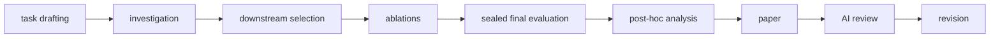

# langgraph-agentic-scientist

A LangGraph port of [The Agentic Scientist](https://github.com/SakanaAI/AI-Scientist-v3)
(AI-Scientist-v3, Sakana AI; [arXiv:2610.18933](https://arxiv.org/abs/2610.18933)), at upstream
commit `df8313889a004f8a44a472e19a833cd547bb828a`. The original turns a task description into
experiments, ablations and a paper, driven by coding agents. This package recreates its agent flow
and its prompts as reusable LangGraph graphs: every stage of the method is a factory that returns a
compiled graph, usable alone or mounted in a larger graph, and the whole method is one more graph
that chains them.

The phases, in upstream's order:



*Task drafting* turns a `task.md` into an evaluator and a task contract; *investigation* is the
idea, experiment and evaluate loop of the agents; *downstream selection* freezes a fallback program
when the search found no winner; *ablations* compare the winner with baselines and ablated variants;
the *final evaluation* scores the frozen winner once in a sealed evaluation; *post-hoc analysis*
mines the artefacts for more evidence; the *paper* phase writes, compiles and audits the manuscript
with its references and figures; *review* sends it to an automated reviewer and *revision* edits it
in response. Review and revision run only when selected, as upstream's do.

Nothing here is the original's code: the flow, the prompts and the validation rules are ported
from the upstream source, and every difference is declared (see
[Differences from upstream](#differences-from-upstream)).

### How it maps to upstream

| Upstream (AI-Scientist-v3) | This package |
|---|---|
| `agsci run`, `src/pipeline/` (phase order, degradation, resume) | `build_pipeline_graph`; resume is the caller's checkpointer |
| Task drafting: `task.sh`, `lib/task_design.sh`, `src/task_drafting/` | `build_task_drafting_graph`, with the design loop `build_task_design_graph`; gates behind `TaskGate` |
| Investigation: `idea.sh`, `run.sh`, `src/investigation/`, parallel workers | `build_investigation_graph`, mounting `build_campaign_worker_graph`, `build_ideation_graph`, `build_attempt_graph` |
| The harness incumbent: the task runtime's baseline record, `harness_incumbent.py` | `establish_incumbent`, once per campaign: the `incumbent` input, the task's qualification receipt, or one baseline evaluation |
| No-winner fallback: `pipeline/downstream_selection.py` | `build_downstream_selection_graph` |
| Ablations: `src/variants_pipeline/` | `build_variants_graph` |
| Sealed final evaluation: `src/final_evaluation/` | `build_final_evaluation_graph` with a `FinalEvaluator` |
| Post-hoc analysis: `src/posthoc_pipeline/` | `build_posthoc_graph`, mounting `build_analysis_graph` |
| Paper: `paper.sh`, `paper_edit.sh`, `src/orchestrator/` | `build_paper_graph` (fresh, edit and revision modes), mounting `build_references_graph`, `build_postdraft_graph`, `build_audit_graph`, `build_review_gate_graph` |
| Concept figures: `lib/concept_figure.sh` (Autoillustrate) | `AutoillustrateRenderer` behind `ConceptFigureRenderer`; the strategy's figure purpose is the `--prompt`, unchanged |
| AI review: `src/aireview.py` | `build_review_graph`; the second attempt of a reviewer is a new node execution |
| Revision: `src/pipeline/revision.py` | `build_revision_graph` |
| Coding-agent CLIs with staged skills | Deep Agents agents over a `Workspace`; the same skills staged under `.agents/skills/` (the harness-evaluated author gets a stage-specific `edit-program`) |
| Prompts and skills: `src/prompts/`, `src/agents/skills/` | package data under `prompts/` and `skills/`, derived byte for byte by declared changes, through `PromptRegistry` |
| Docker, the RPC broker, the evaluator wrapper | the `Workspace` (`WorkspaceBase` derives all but six core operations), `Evaluator` and `FinalEvaluator` protocols (local defaults included) |
| Hydra configuration and presets | `ScientistConfig`, `ScientistConfig.preset("paper")` |

## Install

```bash
uv add "langgraph-agentic-scientist @ git+https://github.com/GoatInAHat/langgraph-agentic-scientist"
```

Extras: `openai` (`langchain-openai`, for OpenAI-compatible servers), `review` (PDF text extraction
for the AI review), `retrieval` (Google Scholar fallback of the reference search) and `postgres`
(`langgraph-checkpoint-postgres`). For example
`"langgraph-agentic-scientist[postgres,review] @ git+https://github.com/GoatInAHat/langgraph-agentic-scientist"`.
For a checkout, `uv sync --all-extras --group dev` and `uv run pytest`.

Python 3.12 or later. The graphs run on LangGraph 1.2, LangChain 1.5 and Deep Agents 0.7. Any
LangChain chat model that supports tool calling works; no provider package is a dependency of the
core.

## Quickstart

The example below is [`examples/quickstart.py`](examples/quickstart.py). It copies the vendored
circle-packing task into a workspace, builds a context (a chat model, a local workspace and local
evaluators) and runs the whole pipeline with upstream's campaign preset. The tests run the same
code with a scripted model.

```python
async def run(
    model: BaseChatModel,
    workdir: Path,
    *,
    config: ScientistConfig | None = None,
    overrides: GraphOverrides | None = None,
) -> dict[str, Any]:
    """Run the pipeline on the circle-packing task and return its output."""
    # The workspace is the run's directory; the task to study is copied into it.
    workspace = LocalWorkspace(workdir / "run")
    shutil.copytree(EXAMPLE, workspace.root / "inputs" / "circpack")

    context = ScientistContext(
        models=ModelRegistry(default=model),  # any LangChain chat model
        workspace=workspace,
        evaluator=LocalCommandEvaluator(workspace),
        final_evaluator=LocalFinalEvaluator(workspace),
        config=config or ScientistConfig.preset("paper"),  # upstream's campaign preset
    )
    graph = build_pipeline_graph(checkpointer=InMemorySaver(), overrides=overrides)
    run_config: RunnableConfig = {"configurable": {"thread_id": "circpack-1"}}

    # durability="sync" writes each step's checkpoint before the next step starts, so a crash
    # loses no completed step (LangGraph's default writes it in the background).
    out: dict[str, Any] = await graph.ainvoke(
        {"task_dir": "inputs/circpack"}, run_config, context=context, durability="sync"
    )
    # The graph stops with an interrupt wherever upstream would ask a person (its only question
    # is the prune warning). Resume with the same thread id; Command(resume=...) is the answer.
    while out.get("__interrupt__"):
        out = await graph.ainvoke(
            Command(resume="proceed"), run_config, context=context, durability="sync"
        )
    return out
```

`python examples/quickstart.py` runs it with the model named by `LAS_MODEL` (any name accepted by
LangChain's `init_chat_model`). [`tests/pipeline/whole_flow.py`](tests/pipeline/whole_flow.py) is a
complete run of every phase's own graph with scripted roles and fake evaluators, which shows what
each role is asked to produce. What the code shows:

- **The context** (`ScientistContext`) is what a run is given: models, workspace, evaluators,
  configuration, prompts, hooks and policy. It is not checkpointed. A resumed run is given a
  context again, and the first node of a run records the method configuration and the prompt texts
  in state, so a resume with a different configuration or different prompts raises
  `ConfigurationMismatch` and changes nothing. Settings of the runtime only (`config.agents`,
  `config.review.sampling`) may change.
- **The checkpointer is yours.** The package keeps no persistence of its own. A run resumes from its
  checkpoint with the same thread id: `await graph.ainvoke(None, run_config, context=context,
  durability="sync")` after a crash, `Command(resume=answer)` after an interrupt. No completed step
  is repeated once its checkpoint is written. Pass `durability="sync"` on every call whose crash
  you mean to survive: LangGraph's default (`"async"`) writes a step's checkpoint while the next
  step runs, so a hard crash can lose the last one and that step runs again. An evaluation is
  requested under a deterministic id so that an evaluator can answer a repeated request from its
  record.
- **Questions to a person** are interrupts. Upstream asks one question, whether to prune the
  campaign's history, once per campaign. `InterruptPolicy` (the default) stops the run with the
  question; `AutoApprovePolicy` answers it as upstream does without a terminal; any object with a
  `decide(question)` method can answer in the person's place.
- **Tracing** is LangChain's: pass callbacks in the run config
  (`{"configurable": {...}, "callbacks": [handler]}`) and every model and tool call, and every
  nested graph, appears in the trace. The package has no tracing of its own, but it marks the
  root run of every agent session: each Deep Agents session and each plain model call of a
  reviewer runs with `run_name="agsci:<role>"`, the tags `["agsci", <role>]` and the metadata
  `agsci_role`, `agsci_phase` and `agsci_step`. Phase and step are the graph and the node that
  run the session, as in the hook keys of [`docs/STEPS.md`](docs/STEPS.md) (`paper` and
  `write` for the writer, `review` and `reviewer` for a reviewer); every node of the package's
  graphs carries them as LangGraph node metadata, so they are also in the metadata of every run
  inside a node.

The pipeline's output holds the status of every phase (`completed`, `degraded`, `failed` or
`skipped`, with a reason), each phase's result, and the run's overall `status`. Upstream's
degradation rules apply: ablations, an optional final evaluation, post-hoc analysis, review and
revision degrade the run when they fail and the paper is still written; drafting, investigation,
the paper and a final evaluation that the task's contract requires fail it. See
[`docs/ARCHITECTURE.md`](docs/ARCHITECTURE.md).

## Running one phase alone

Every phase factory has the same shape and returns a compiled graph:

```python
build_<phase>_graph(*, checkpointer=None, store=None, overrides=None, name="<phase>")
```

Pass a checkpointer (and a store) only to the graph you run at the top level; a graph mounted in
another graph inherits them. A phase reads the run-local snapshot of a task. `prepare_task_snapshot`
and `load_task_ref` make it, as the pipeline does:

```python
from langgraph_agentic_scientist import (
    ScientistConfig, build_investigation_graph, load_task_ref, prepare_task_snapshot,
)

await prepare_task_snapshot(workspace, "inputs/circpack")   # copies the task into task/, once
task = await load_task_ref(workspace, ScientistConfig())    # goal, rubrics, contract, seed program

graph = build_investigation_graph(checkpointer=saver, store=store)
out = await graph.ainvoke({"task": task, "run_id": "r1"}, run_config, context=context)
```

**Investigation on an existing scaffold** is that code: the task already has its evaluator and a
baseline program, so drafting has nothing to do. **A paper written into an existing LaTeX paper**
runs the paper graph alone in `edit` mode with the previous paper, your own results as
`PaperData` and the files they ground, and `EditOptions`; the upstream edit prompts and the scope
audit then do the writing:

```python
from langgraph_agentic_scientist import EditOptions, PaperData, build_paper_graph

graph = build_paper_graph(checkpointer=saver)
out = await graph.ainvoke(
    {
        "task": task,
        "run_id": "r1",
        "mode": "edit",
        "previous_paper_dir": "paper_v1",
        "paper_data": PaperData(generated_at="...", grounding_sources={...}),
        "artifact_paths": {...},
        "edit_options": EditOptions(edit_programs=["program_3"], reference_mode="preserve"),
    },
    run_config,
    context=context,
)
```

A paper that is not the package's own output names its main file and, if it has no venue, opts
out of the venue brief: `EditOptions(main_file="main.tex", venue_file="")`. The main file is
seeded as the workspace's `paper.tex` with the local files it inputs (`\input`, `\include`,
local packages and classes), and kept under its own name in `previous_paper/`; the finished
manuscript is `paper.tex` of the output directory, which every prompt, skill and validator of
upstream names. `venue_file` is upstream's `--venue-file`: a workspace path stages that brief as
`VENUE.md`, `""` stages none. The validation applies a page budget and venue checks only to a
manuscript that carries the LaTeX markers of a declared venue (`WorkspacePaperToolchain(venues=
VenueCatalog.from_directory(...))` declares your own, with `page_budget: null` for none), and
`config.paper.watermark=False` leaves the watermark out. The scope audit of edit mode is kept.

**A paper grounded in several tasks** uses upstream's cross-task route, which the writer prompts
already read: `task` is the primary task (staged as `./task`), `paper_data.task_names` lists
every task, each task's grounding is in `paper_data.grounding_sources` under its own ids
(upstream's are `result.<task>.<variant>.<statistic>`) and its results in
`paper_data.cross_task_results[<task>]`, and `artifact_paths["extra_tasks"]` and
`artifact_paths["aggregated"]` stage one directory per task (`./extra_tasks/<task>`,
`./aggregated/<task>`) with its `task.md` and tables. In edit mode `paper_edit_context.*` links
each task to its directories, and the one scope audit separates shared from task-specific claims
by their `scope`. A results bundle with upstream's `paper_bundle_manifest.json` (`"tasks":
{<task>: {"role": ..., "task_dir": ...}}`), given as the output directory of `variants`, builds
such paper data itself (`build_multitask_ablation_paper_data`).

The same works through the pipeline: `{"task_dir": ..., "phases": ["paper"], "investigation": result,
"previous_paper_dir": "paper_v1", "edit_options": EditOptions(...)}`. A pipeline run that starts
later takes the results of the earlier phases in its input, as upstream's
`execution.phases=paper paths.run_dir=...` takes them from the run directory.

## Extension points

Everything a caller will want to change is a public extension point, so that the package never has
to be forked.

| Extension point | What it is for |
|---|---|
| `Workspace` (`LocalWorkspace`, `WorkspaceBase`) | Where files live and commands run. Substitute a git worktree, a container or a remote sandbox; agents get a Deep Agents backend from `agent_backend`. Subclass `WorkspaceBase` to implement only the core (`read_bytes`, `write_bytes`, `stat`, `list_tree`, `remove`, `run`, `agent_backend`); it derives `exists`, `digest`, `copy_tree`, `snapshot` and `restore`. |
| The incumbent of a harness-evaluated campaign | Give `incumbent` (a `BestManifest` with a validated score) in the investigation's input when you hold a validated baseline; otherwise the task's qualification receipt or one evaluation supplies it. |
| `Evaluator`, `FinalEvaluator` | Everything the candidate must not touch. Implementations answer a repeated `evaluation_id` from their record or re-attach to the evaluation still running, so an evaluation of hours survives a crash. `DeferredEvaluator` interrupts with the request and takes the result from `Command(resume=...)`, so your own executor can run evaluations. |
| `GraphOverrides.phases` | Replace a whole phase with your own compiled graph. |
| `GraphOverrides.slots` | Replace a step: `investigation.ideation`, `investigation.attempt`, `investigation.worker`, `variants.run_variant`, `variants.cross_task`, `final_evaluation.draw_inputs`, `posthoc.analysis`, `paper.data`, `paper.references`, `paper.postdraft_enrichment`, `paper.validation`, `paper.audit`, `paper.review_gate`, `paper.figures`, `review`, `revision.paper`, `revision.audit_input_hashes`, `revision.scope_audit` ([`docs/STEPS.md`](docs/STEPS.md) says what each replaces). A compiled graph or, where the slot is a single step, an async function. |
| `Hooks` | Code before and after any step, in its own checkpointed node. |
| `RubricVerifier`, `TaskGate`, `PaperToolchain`, `ReferenceRetriever`, `ConceptFigureRenderer` | Replaceable verification, gates, LaTeX and PDF tools, retrieval and figures. |
| `PromptRegistry` | Override any prompt, entry by entry. |
| `AgentFactory` | Run each agent session your own way. |
| `HumanPolicy` | Answer the graph's questions in a person's place. |

**Hooks.** Every step of the method has a `<graph>.<step>.before` and `.after` node.
[`docs/STEPS.md`](docs/STEPS.md) lists every key and the state keys a hook may update. A completed
hook is checkpointed and does not run again after a crash or a resume; a hook that has an effect
must be idempotent, or key its effect by the step name and the thread.

```python
from langgraph_agentic_scientist import Hooks

async def archive(state, runtime):
    ...  # copy the finished paper somewhere; keyed by runtime.execution_info
    return {"hook_outputs": {"archived": True}}

context = ScientistContext(..., hooks=Hooks(after={"pipeline.paper": [archive]}))
```

**Slots and phases.**

```python
from langgraph_agentic_scientist import GraphOverrides, build_pipeline_graph

graph = build_pipeline_graph(
    checkpointer=saver,
    overrides=GraphOverrides(
        phases={"review": my_review_graph},        # a whole phase
        slots={"paper.audit": my_audit_graph},     # one step of a phase
    ),
)
```

A replacement accepts the slot's input schema and returns its output schema. Verification can be
replaced without a graph: `ScientistContext(rubric_verifier=..., task_gate=..., paper_toolchain=...)`.

**Prompts.** `PromptRegistry.default().with_overrides({"investigation/harness_edit": "text or a path"})`
replaces one prompt and leaves the rest; the override is part of the prompt fingerprint that a
resume checks.

**A sealed final evaluation apart from the search.** The final evaluation freezes the winner, records
the freeze in state, and only then calls the slot `final_evaluation.draw_inputs`, so a caller can
draw the sealed inputs after the candidate is frozen; the drawn `SealedInputs` reach the
`FinalEvaluator` in its request, and the search phases never receive a final evaluator.

**Postgres.** LangGraph's serializer refuses unknown types under `LANGGRAPH_STRICT_MSGPACK=true`.
`serde_allowlist()` lists every type the package stores, so the strict serializer accepts them:

```python
from langgraph.checkpoint.postgres.aio import AsyncPostgresSaver
from langgraph.checkpoint.serde.jsonplus import JsonPlusSerializer
from langgraph_agentic_scientist import build_pipeline_graph, serde_allowlist

serde = JsonPlusSerializer(allowed_msgpack_modules=serde_allowlist())
async with AsyncPostgresSaver.from_conn_string(url, serde=serde) as saver:
    await saver.setup()
    graph = build_pipeline_graph(checkpointer=saver)
    out = await graph.ainvoke(
        {"task_dir": "inputs/circpack"}, run_config, context=context, durability="sync"
    )
    # after a crash: await graph.ainvoke(None, run_config, context=context, durability="sync")
```

`serde_allowlist()` covers every record type the package stores, including the schemas of the
structured roles (the ideator's answer, for one). Pass your own pydantic models stored in state as
extra arguments of `serde_allowlist(...)`. A newer
release refuses a checkpoint written by an incompatible older one (`IncompatibleCheckpoint`) rather
than misreading it.

## Served models

`ModelRegistry(default=model, by_role={...}, pool=[...])` takes any chat model, a default and an
override by role; `pool` is upstream's multi-agent sampling (one model chosen per idea cycle).

- **Context window.** Deep Agents summarises a session's history at 85 % of the model's
  `max_input_tokens`, or at a fixed 170,000 tokens when the model's profile has none. A model served
  through an OpenAI-compatible endpoint usually has no profile, so set the window yourself:
  `ModelRegistry(default=ChatOpenAI(base_url=..., model=...), context_window=200_000)`
  (`context_window_by_role` for one role). The package warns once per role when neither is known.
  `config.review.fewshot=True` adds upstream's 60,000-character few-shot review (about 20,000
  tokens) to each review call; turn it off for a small window, or set
  `config.review.max_paper_tokens` to the reviewer's input budget (its window less
  `max_completion_tokens`): a request above it is sent without the few-shot review, and a paper
  that does not fit even then is not sent and the review fails with the category
  `paper_exceeds_review_window`. The estimate is the reviewer model's own token count when its
  class has one (`get_num_tokens_from_messages`), else LangChain's `count_tokens_approximately`
  (four characters per token).
- **Structured output.** Roles that answer with one structured artefact use LangChain's structured
  output. The default, `structured_output_method="function_calling"`, works with any tool-calling
  model; choose `"json_schema"` (per role with `structured_output_by_role`) only when the server
  supports strict JSON schema.
- **Retries.** Transient provider errors inside an agent session are retried with upstream's
  15, 45 and 90 second schedule (`config.agents.model_retry`), repeating only the failed model
  call; a node's `RetryPolicy` is the outer line and starts the session again, as upstream retries
  a failed agent run. `model_retry.max_retries=0` leaves only the outer line. A method retry that
  changes the prompt (a repair, a second attempt) is a graph loop, so each paid call is
  checkpointed on its own.
- **Request settings.** The request timeout, the maximum output tokens, sampling and any other
  model argument are the chat model's own: give a role its own model object in `by_role` to give
  it its own settings (`ChatOpenAI(base_url=..., model=..., timeout=900, max_tokens=8192)`). A
  `rate_limiter` set on a model (LangChain's `InMemoryRateLimiter`, or your own) paces every role
  that uses it, since the package copies a model only to set its context window and the copy
  shares the limiter.
- **Bounds of a session.** Each session has its phase's wall clock (the `*_timeout_seconds` of
  the configuration); a shell command has a default time limit of 600 s
  (`config.agents.execute_timeout_seconds`), may ask for at most 7200 s
  (`execute_max_timeout_seconds`), keeps `max_tool_output_bytes` of its output, and is killed with
  its process group when it times out or its session ends. `config.agents.model_call_limit` bounds
  the model calls of one session; the `general-purpose` subagent that an agent may start through
  Deep Agents' `task` tool has the same retries and limit. A subclass of `DeepAgentFactory` that
  extends `middleware()` adds middleware of your own (LangChain's `ToolCallLimitMiddleware`, for
  one) to every agent and its subagent.

## Concurrency

Parallel work is LangGraph's: `Send` fans out the five reviewers, the ablation variants after the
control, the post-hoc analyses and the campaign workers. The run config's `max_concurrency` bounds
all of them:

```python
run_config = {"configurable": {"thread_id": "r1"}, "max_concurrency": 1}
```

Use `1` when variants or analyses evaluate on a single GPU: upstream ran them one after another
partly to avoid contention for the device, and the package does not partition devices (that is the
evaluator's executor's business). Parallel campaign workers that share memory (`workers > 1`
without `isolate_worker_memory`) need a `store`, which is passed to `build_pipeline_graph`.

Each variant and each analysis works on a copy of the task's files, and the steps that compare or
fingerprint trees hash every file they list (`list_tree(..., with_digest=True)`), so keep
environments, datasets and other large files outside the task directory (the evaluator can reach
them where they are).

A whole run takes many LangGraph supersteps (a drafting run with repairs takes hundreds). The
default `recursion_limit` of LangGraph 1.2 (10,007) is enough; a run config that sets a lower one
must leave room for that.

## Concept figures

Concept figures are optional. `AutoillustrateRenderer` runs the outside
[Autoillustrate](https://github.com/SakanaAI/Autoillustrate) tool through the workspace; it is not a
dependency of this package, and it drives an agent CLI and an image model of its own, so it needs
their credentials. Without a renderer (`figure_renderer=None`, the default) the paper prompts'
documented fallback applies: a plain export of the figure, as upstream ships when it has no keys.
`config.paper.concept_figure_*_min_seconds` choose the full, medium or light mode by the time that
remains, as upstream does.

## Safety

`LocalWorkspace` runs agent commands on the host with the permissions of the calling process; it is
not a sandbox, and the agents are given full tool permissions in their directories, as upstream's are
(upstream keeps them in containers). Run untrusted tasks only in a workspace you isolate: implement
`Workspace` over a container or a remote sandbox, or give your own `AgentFactory`.

A task with a contract has an evaluator that the candidate must not reach, and the package refuses
to search or finally evaluate such a task with an `Evaluator` whose `isolated` property is false,
as upstream refuses a contracted task without container isolation. `allow_unisolated_contracted=True`
lifts this for local experiments and tests. Review is consent: selecting the `review` phase sends
the manuscript to the reviewer models, so use a model you may send it to.

## Prompts and provenance

The prompts, skills, workflow texts, venue briefs and helper scripts are package data under
`src/langgraph_agentic_scientist/` (`prompts/`, `skills/`, `venues/`), one file per role, loaded
through `PromptRegistry`. The original files are kept byte for byte under
[`third_party/ai-scientist-v3/`](third_party/ai-scientist-v3), and
`tools/derive_prompts.py` builds each package file from its original by the changes declared in
[`src/langgraph_agentic_scientist/prompts/changes/`](src/langgraph_agentic_scientist/prompts/changes)
(an exact old string, the new one, and the reason). `tools/derive_prompts.py --check` and a test
fail when a prompt differs from its derivation, so a paraphrase cannot enter and no change goes
unrecorded. Text that upstream keeps in code (retry suffixes, gate text, generated `task.md`
bodies, shell strings, heredocs, dictionary values, packed constants) is extracted from the
upstream source by the same tool, and each extraction is declared; a package constant that
mirrors such a text is pinned to its extraction, so `--check` fails when either side drifts.

## Differences from upstream

[`docs/ADAPTATIONS.md`](docs/ADAPTATIONS.md) lists every adaptation and every omission with its
reason, and links the per-area notes in [`docs/adaptations/`](docs/adaptations) and the declared
prompt changes. The main ones: coding-agent CLIs become Deep Agents agents over a workspace;
agent-written JSON becomes structured output; state kept in files becomes typed graph state; Docker,
the RPC broker, GPU leases and cost ledgers are the caller's executor's. Documentation of the graphs
is in [`docs/ARCHITECTURE.md`](docs/ARCHITECTURE.md), the hook keys and slots in
[`docs/STEPS.md`](docs/STEPS.md).

## Licence, notice and citation

Apache License 2.0, as upstream: see [`LICENSE`](LICENSE). [`NOTICE`](NOTICE) credits the original
and states that the prompts and other texts are taken or adapted from it. Please cite the paper of
the original:

```bibtex
@article{agentic_scientist,
  title   = {The Agentic Scientist: Orchestrating Coding Agents for Automated Scientific (Co-)Discovery},
  author  = {Lange, Robert Tjarko and Grillotti, Luca and Yamada, Yutaro and Charakorn, Rujikorn and Ha, David},
  journal = {arXiv preprint arXiv:2610.18933},
  year    = {2026}
}
```
