# Architecture

The package is a set of LangGraph graphs that port the phases of The Agentic Scientist, a small
set of protocols that stand for everything outside the method (files and commands, evaluation,
tools), and the records that the graphs pass between them. This page describes how the pieces fit;
the diagrams at the end are generated from the compiled graphs.

## Layers

```
build_pipeline_graph          the method: phases chained in upstream's order
  build_<phase>_graph         one graph per phase, usable alone or mounted
    steps (StepGraph)         a step of the method, with hook nodes around it
      agents / host code      a Deep Agents session, or plain Python
        protocols             Workspace, Evaluator, FinalEvaluator, TaskGate, ...
```

Every graph is built with `StepGraph`, a thin builder over LangGraph's `StateGraph`. It adds each
step of the method together with two hook nodes, `<graph>.<step>.before` and `.after`, so a caller
can run code at any step and a completed hook is checkpointed. Pure routing nodes carry no hooks.
All nodes are asynchronous (long evaluations and agent sessions are I/O bound), so the entry points
are `ainvoke` and `astream`.

## The pipeline

`build_pipeline_graph` is upstream's `agsci run`. Its nodes, in order:

| Node | What it does |
|---|---|
| `record_run_config` | Records the method configuration, the prompt fingerprint and the schema version in state, or verifies the recorded ones. |
| `snapshot_task` | Copies the task into `task/` once, verifies it by digest, builds the `TaskRef`, validates the phase selection and the context, and mints the run id. |
| `route_task_drafting`, `task_drafting` | Drafting runs only when the task has no scaffold; otherwise it counts as done. |
| `check_dependencies` | After drafting: refreshes the task from the published scaffold, reseals the snapshot, and stops the run if the drafted contract needs a final evaluation that is not selected. |
| `route_investigation`, `investigation` | The search. |
| `route_downstream_selection`, `downstream_selection` | Freezes a fallback program when the search found no winner and the policy is `best_available`. |
| `route_ablations`, `ablations` | Baselines and ablations. |
| `route_final_evaluation`, `final_evaluation` | The sealed final evaluation. |
| `route_posthoc`, `posthoc` | Post-hoc analysis. |
| `route_paper`, `paper` | The manuscript, written into `paper/` with its `latest_manifest.json` beside it, as upstream's pipeline writes it (the revision reads both there). |
| `route_review`, `review`, `route_revision`, `revision` | The automated review and the revision. |
| `finish` | Computes the run's status and outcome. |

A router precedes every phase. It reads the state and decides `run`, `skip` or `stop`, writes the
phase's status when it does not run it, and the conditional edge after it follows the decision.
The rules are upstream's, in upstream's order:

1. A stopped run stops: after a failure when `fail_fast` is set, after a terminal host failure
   (`evaluator_output_contract_invalid`, `agent_log_persistence_failed`), or after a drafted task
   that needs a final evaluation that is not selected.
2. A phase that is not selected is skipped.
3. If the investigation ended without a winner, the downstream phases run only on the frozen
   fallback program, and are skipped when the policy is `skip` or no program could be selected.
4. Post-hoc analysis is degraded, not run, when the selected ablations did not succeed.
5. A task whose contract requires a final evaluation blocks the paper when that evaluation failed
   (a failure) or did not qualify without a fallback program and without `allow_not_qualified`
   (not a failure); review and revision are skipped in the same cases.
6. A phase whose selected dependency did not succeed is skipped (`investigation` needs
   `task_drafting`; `ablations`, `final_evaluation`, `posthoc` and `paper` need `investigation`;
   `review` needs `paper`; `revision` needs `review`).

A phase's own outcome maps to a status as upstream's exit codes do. Ablations, an optional final
evaluation, post-hoc analysis (when it produced no valid analysis), review and revision are
`degraded` when they fail; drafting, investigation, the paper and a required final evaluation are
`failed`. The run's `status` is `failed` when any failure was recorded, `completed_degraded` when
any phase degraded, `completed` otherwise.

### Mounting a phase

A phase is mounted through a wrapper node that builds the phase's input from the pipeline state and
passes the phase the keys that its input schema declares. The wrapper returns the phase's result
as a delta, never the child's state, so reducer keys are not applied twice. The wrapper checks the
recorded configuration against the context before it calls the phase. Exceptions are not caught:
an interrupt propagates, and a phase reports its own failures in its result.

| Phase | Mounted from | Keys offered | Result read from |
|---|---|---|---|
| `task_drafting` | `overrides.phases` or `build_task_drafting_graph` | `task`, `capacity`, `run_id`, `run_config` | `drafting` or `result` |
| `investigation` | `build_investigation_graph` | `task`, `run_id`, `run_config` | `investigation` or `result` |
| `downstream_selection` | `build_downstream_selection_graph` | the above and `investigation` | `downstream` or `result` |
| `ablations` | `build_variants_graph` | the above and `downstream` | `variants` or `result` |
| `final_evaluation` | `build_final_evaluation_graph` | the above and `downstream` | `final` or `result` |
| `posthoc` | `build_posthoc_graph` | the above, `variants`, `artifact_only` | `posthoc` or `result` |
| `paper` | `build_paper_graph` | the above, `mode`, `final`, `posthoc`, `previous_paper_dir`, `edit_options` | `paper` or `result` |
| `review` | `build_review_graph` | `task`, `run_id`, `run_config`, `paper`, `pdf_path`, `paper_dir`, `artifact_stem`, `manifest_key` | `review` or `result` |
| `revision` | `build_revision_graph` | the above and `review` | `revision` or `result` |

`capacity` is `{"max_idea_cycles": ..., "max_program_evals_per_attempt": ...}`. The paper is given
the final evaluation only when upstream would give it (required by the contract, qualified, or
not qualified with a fallback program or `allow_not_qualified`) and the post-hoc result only when it
produced a valid analysis. When the revision is selected the review writes `ai_review.before_revision`
as upstream does. A phase that is replaced through `GraphOverrides.phases` sees the same input.

## State

State is typed. Each graph has a `TypedDict` with reducers where branches write the same key
(`operator.add` for append-only histories, `merge_dicts` for keyed status maps), and a context
schema for what a run is given. Every pydantic model stored in state derives from `StateModel`:
unknown fields are refused, the class carries a `schema_version`, and `serde_allowlist()` can find
every stored type by walking the subclasses. The records that cross a phase boundary are in
`core/results.py` (`DraftingResult`, `InvestigationResult`, `DownstreamSelection`,
`VariantsResult`, `PosthocResult`, `PaperResult`, `ReviewResult`, `RevisionResult`; the final
evaluation's result is `FinalEvaluationResult`); the records that several phases share
(`TaskRef`, `ProgramRef`, `RubricStatus`, `EvaluationRecord`, `PhaseStatus`, `Failure`, `Event`)
are in `core/state.py`.

The host's records (outer state, histories, counters, budgets, transactions) live in state and are
checkpointed by the caller's checkpointer. What agents write themselves, above all the memory files,
stays in the workspace, and the host reads it after a session.

## How a role runs

A role is one model-driven unit with one prompt. A role that edits or creates files is a Deep Agents
agent over a workspace backend; a role whose product is one structured artefact answers through
LangChain's structured output (a tool strategy by default, a provider strategy when the registry
says so). The agent is invoked inside the node that needs it, so its steps are checkpointed under the
node and a resume continues the session; one node runs at most one session. The session's wall
clock is a timeout caught in the node: a timed-out workspace role is still checked, as upstream's
timed-out CLI is. Skills are staged under `.agents/skills/` in the role's workspace. Roles that
must not write get a read-only backend that refuses every write and has no `execute` tool.

## Protocols

| Protocol | What stands behind it |
|---|---|
| `Workspace` | Files and commands for host steps, and the Deep Agents backend of agents. `LocalWorkspace` is a directory on the host (not a sandbox). |
| `Evaluator`, `FinalEvaluator` | Evaluation of candidates and the sealed final evaluation, keyed by a deterministic `evaluation_id`. A call with a known id returns the recorded result or re-attaches to the evaluation still running, and never evaluates again. The candidate never sees the evaluator's files. |
| `TaskGate`, `RubricVerifier` | The drafting checks and the rubric verdicts. |
| `PaperToolchain`, `ReferenceRetriever`, `ConceptFigureRenderer` | LaTeX and PDF tools, retrieval and figures. |
| `AgentFactory` | How a role becomes an agent. |
| `HumanPolicy` | Answers questions in a person's place. |

## Effects happen once

A LangGraph node that is interrupted or crashes starts again from its beginning on resume, and
nothing inside a node is checkpointed until it completes. Therefore a node does at most one thing
that cannot be repeated and does it last, or keys it by a deterministic id that the receiver
honours (evaluations, store writes); nothing with an effect runs before an `interrupt` call in the
same node; hooks run in their own nodes; and the sealed-input draw is its own node between freezing
the candidate and evaluating it.

## Run configuration and persistence

The context is not checkpointed. The first node of every graph that can run alone records the
method part of the configuration (as JSON, with its SHA-256), the SHA-256 of every prompt and skill
text after overrides, the package version and the state schema version. Later nodes read their
limits from the recorded configuration, never from the context, and every mounted phase and the
pipeline's wrapper verify the context against the record: a changed method field or prompt raises
`ConfigurationMismatch` naming it, a changed runtime-only field (everything under `agents`,
`review.sampling`) is accepted, and a checkpoint of an unsupported schema raises
`IncompatibleCheckpoint`. Under strict msgpack deserialization the checkpointer needs
`serde_allowlist()`.

## Graphs

The diagrams are drawn with `get_graph(xray=1)`, which expands each phase one level inside the
pipeline. The hook keys of every graph are listed in [STEPS.md](STEPS.md).

<!-- BEGIN GENERATED GRAPHS (tools/list_steps.py) -->

### pipeline

```mermaid
---
config:
  flowchart:
    curve: linear
---
graph TD;
	__start__([<p>__start__</p>]):::first
	record_run_config(record_run_config)
	snapshot_task(snapshot_task)
	pipeline\2esnapshot_task\2ebefore(pipeline.snapshot_task.before)
	pipeline\2esnapshot_task\2eafter(pipeline.snapshot_task.after)
	check_dependencies(check_dependencies)
	pipeline\2echeck_dependencies\2ebefore(pipeline.check_dependencies.before)
	pipeline\2echeck_dependencies\2eafter(pipeline.check_dependencies.after)
	finish(finish)
	pipeline\2efinish\2ebefore(pipeline.finish.before)
	pipeline\2efinish\2eafter(pipeline.finish.after)
	route_task_drafting(route_task_drafting)
	pipeline\2etask_drafting\2ebefore(pipeline.task_drafting.before)
	pipeline\2etask_drafting\2eafter(pipeline.task_drafting.after)
	route_investigation(route_investigation)
	investigation(investigation)
	pipeline\2einvestigation\2ebefore(pipeline.investigation.before)
	pipeline\2einvestigation\2eafter(pipeline.investigation.after)
	route_downstream_selection(route_downstream_selection)
	pipeline\2edownstream_selection\2ebefore(pipeline.downstream_selection.before)
	pipeline\2edownstream_selection\2eafter(pipeline.downstream_selection.after)
	route_ablations(route_ablations)
	pipeline\2eablations\2ebefore(pipeline.ablations.before)
	pipeline\2eablations\2eafter(pipeline.ablations.after)
	route_final_evaluation(route_final_evaluation)
	pipeline\2efinal_evaluation\2ebefore(pipeline.final_evaluation.before)
	pipeline\2efinal_evaluation\2eafter(pipeline.final_evaluation.after)
	route_posthoc(route_posthoc)
	pipeline\2eposthoc\2ebefore(pipeline.posthoc.before)
	pipeline\2eposthoc\2eafter(pipeline.posthoc.after)
	route_paper(route_paper)
	pipeline\2epaper\2ebefore(pipeline.paper.before)
	pipeline\2epaper\2eafter(pipeline.paper.after)
	route_review(route_review)
	review(review)
	pipeline\2ereview\2ebefore(pipeline.review.before)
	pipeline\2ereview\2eafter(pipeline.review.after)
	route_revision(route_revision)
	pipeline\2erevision\2ebefore(pipeline.revision.before)
	pipeline\2erevision\2eafter(pipeline.revision.after)
	__end__([<p>__end__</p>]):::last
	__start__ --> record_run_config;
	ablations\3avariants\2efinish\2eafter --> pipeline\2eablations\2eafter;
	check_dependencies --> pipeline\2echeck_dependencies\2eafter;
	downstream_selection\3adownstream\2efreeze_program\2eafter --> pipeline\2edownstream_selection\2eafter;
	final_evaluation\3a__end__ --> pipeline\2efinal_evaluation\2eafter;
	finish --> pipeline\2efinish\2eafter;
	investigation --> pipeline\2einvestigation\2eafter;
	paper\3a__end__ --> pipeline\2epaper\2eafter;
	pipeline\2eablations\2eafter --> route_final_evaluation;
	pipeline\2eablations\2ebefore --> ablations\3arecord_run_config;
	pipeline\2echeck_dependencies\2eafter --> route_investigation;
	pipeline\2echeck_dependencies\2ebefore --> check_dependencies;
	pipeline\2edownstream_selection\2eafter --> route_ablations;
	pipeline\2edownstream_selection\2ebefore --> downstream_selection\3arecord_run_config;
	pipeline\2efinal_evaluation\2eafter --> route_posthoc;
	pipeline\2efinal_evaluation\2ebefore --> final_evaluation\3arecord_run_config;
	pipeline\2efinish\2ebefore --> finish;
	pipeline\2einvestigation\2eafter --> route_downstream_selection;
	pipeline\2einvestigation\2ebefore --> investigation;
	pipeline\2epaper\2eafter --> route_review;
	pipeline\2epaper\2ebefore --> paper\3arecord_run_config;
	pipeline\2eposthoc\2eafter --> route_paper;
	pipeline\2eposthoc\2ebefore --> posthoc\3arecord_run_config;
	pipeline\2ereview\2eafter --> route_revision;
	pipeline\2ereview\2ebefore --> review;
	pipeline\2erevision\2eafter --> pipeline\2efinish\2ebefore;
	pipeline\2erevision\2ebefore --> revision\3arecord_run_config;
	pipeline\2esnapshot_task\2eafter --> route_task_drafting;
	pipeline\2esnapshot_task\2ebefore --> snapshot_task;
	pipeline\2etask_drafting\2eafter --> pipeline\2echeck_dependencies\2ebefore;
	pipeline\2etask_drafting\2ebefore --> task_drafting\3arecord_run_config;
	posthoc\3aposthoc\2epublish\2eafter --> pipeline\2eposthoc\2eafter;
	record_run_config --> pipeline\2esnapshot_task\2ebefore;
	review --> pipeline\2ereview\2eafter;
	revision\3arevision\2efinalize\2eafter --> pipeline\2erevision\2eafter;
	route_ablations -. &nbsp;run&nbsp; .-> pipeline\2eablations\2ebefore;
	route_ablations -. &nbsp;stop&nbsp; .-> pipeline\2efinish\2ebefore;
	route_ablations -. &nbsp;skip&nbsp; .-> route_final_evaluation;
	route_downstream_selection -. &nbsp;run&nbsp; .-> pipeline\2edownstream_selection\2ebefore;
	route_downstream_selection -. &nbsp;stop&nbsp; .-> pipeline\2efinish\2ebefore;
	route_downstream_selection -. &nbsp;skip&nbsp; .-> route_ablations;
	route_final_evaluation -. &nbsp;run&nbsp; .-> pipeline\2efinal_evaluation\2ebefore;
	route_final_evaluation -. &nbsp;stop&nbsp; .-> pipeline\2efinish\2ebefore;
	route_final_evaluation -. &nbsp;skip&nbsp; .-> route_posthoc;
	route_investigation -. &nbsp;stop&nbsp; .-> pipeline\2efinish\2ebefore;
	route_investigation -. &nbsp;run&nbsp; .-> pipeline\2einvestigation\2ebefore;
	route_investigation -. &nbsp;skip&nbsp; .-> route_downstream_selection;
	route_paper -. &nbsp;stop&nbsp; .-> pipeline\2efinish\2ebefore;
	route_paper -. &nbsp;run&nbsp; .-> pipeline\2epaper\2ebefore;
	route_paper -. &nbsp;skip&nbsp; .-> route_review;
	route_posthoc -. &nbsp;stop&nbsp; .-> pipeline\2efinish\2ebefore;
	route_posthoc -. &nbsp;run&nbsp; .-> pipeline\2eposthoc\2ebefore;
	route_posthoc -. &nbsp;skip&nbsp; .-> route_paper;
	route_review -. &nbsp;stop&nbsp; .-> pipeline\2efinish\2ebefore;
	route_review -. &nbsp;run&nbsp; .-> pipeline\2ereview\2ebefore;
	route_review -. &nbsp;skip&nbsp; .-> route_revision;
	route_revision -. &nbsp;skip&nbsp; .-> pipeline\2efinish\2ebefore;
	route_revision -. &nbsp;run&nbsp; .-> pipeline\2erevision\2ebefore;
	route_task_drafting -. &nbsp;skip&nbsp; .-> pipeline\2echeck_dependencies\2ebefore;
	route_task_drafting -. &nbsp;stop&nbsp; .-> pipeline\2efinish\2ebefore;
	route_task_drafting -. &nbsp;run&nbsp; .-> pipeline\2etask_drafting\2ebefore;
	snapshot_task --> pipeline\2esnapshot_task\2eafter;
	task_drafting\3a__end__ --> pipeline\2etask_drafting\2eafter;
	pipeline\2efinish\2eafter --> __end__;
	subgraph task_drafting
	task_drafting\3arecord_run_config(record_run_config)
	task_drafting\3adesign(design)
	task_drafting\3adrafting\2edesign\2ebefore(drafting.design.before)
	task_drafting\3adrafting\2edesign\2eafter(drafting.design.after)
	task_drafting\3ascaffold(scaffold)
	task_drafting\3adrafting\2escaffold\2ebefore(drafting.scaffold.before)
	task_drafting\3adrafting\2escaffold\2eafter(drafting.scaffold.after)
	task_drafting\3adesign_failed(design_failed)
	task_drafting\3a__end__(<p>__end__</p>)
	task_drafting\3adesign --> task_drafting\3adrafting\2edesign\2eafter;
	task_drafting\3adrafting\2edesign\2eafter -.-> task_drafting\3adesign_failed;
	task_drafting\3adrafting\2edesign\2eafter -. &nbsp;scaffold&nbsp; .-> task_drafting\3adrafting\2escaffold\2ebefore;
	task_drafting\3adrafting\2edesign\2ebefore --> task_drafting\3adesign;
	task_drafting\3adrafting\2escaffold\2ebefore --> task_drafting\3ascaffold;
	task_drafting\3arecord_run_config -. &nbsp;design&nbsp; .-> task_drafting\3adrafting\2edesign\2ebefore;
	task_drafting\3arecord_run_config -. &nbsp;scaffold&nbsp; .-> task_drafting\3adrafting\2escaffold\2ebefore;
	task_drafting\3ascaffold --> task_drafting\3adrafting\2escaffold\2eafter;
	task_drafting\3adesign_failed --> task_drafting\3a__end__;
	task_drafting\3adrafting\2escaffold\2eafter --> task_drafting\3a__end__;
	end
	subgraph downstream_selection
	downstream_selection\3arecord_run_config(record_run_config)
	downstream_selection\3aselect_fallback(select_fallback)
	downstream_selection\3adownstream\2eselect_fallback\2ebefore(downstream.select_fallback.before)
	downstream_selection\3adownstream\2eselect_fallback\2eafter(downstream.select_fallback.after)
	downstream_selection\3afreeze_program(freeze_program)
	downstream_selection\3adownstream\2efreeze_program\2ebefore(downstream.freeze_program.before)
	downstream_selection\3adownstream\2efreeze_program\2eafter(downstream.freeze_program.after)
	downstream_selection\3adownstream\2efreeze_program\2ebefore --> downstream_selection\3afreeze_program;
	downstream_selection\3adownstream\2eselect_fallback\2eafter --> downstream_selection\3adownstream\2efreeze_program\2ebefore;
	downstream_selection\3adownstream\2eselect_fallback\2ebefore --> downstream_selection\3aselect_fallback;
	downstream_selection\3afreeze_program --> downstream_selection\3adownstream\2efreeze_program\2eafter;
	downstream_selection\3arecord_run_config --> downstream_selection\3adownstream\2eselect_fallback\2ebefore;
	downstream_selection\3aselect_fallback --> downstream_selection\3adownstream\2eselect_fallback\2eafter;
	end
	subgraph ablations
	ablations\3arecord_run_config(record_run_config)
	ablations\3aprepare(prepare)
	ablations\3avariants\2eprepare\2ebefore(variants.prepare.before)
	ablations\3avariants\2eprepare\2eafter(variants.prepare.after)
	ablations\3aextract(extract)
	ablations\3avariants\2eextract\2ebefore(variants.extract.before)
	ablations\3avariants\2eextract\2eafter(variants.extract.after)
	ablations\3aretrofit_prepare(retrofit_prepare)
	ablations\3avariants\2eretrofit_prepare\2ebefore(variants.retrofit_prepare.before)
	ablations\3avariants\2eretrofit_prepare\2eafter(variants.retrofit_prepare.after)
	ablations\3aretrofit_agent(retrofit_agent)
	ablations\3avariants\2eretrofit_agent\2ebefore(variants.retrofit_agent.before)
	ablations\3avariants\2eretrofit_agent\2eafter(variants.retrofit_agent.after)
	ablations\3aretrofit_finish(retrofit_finish)
	ablations\3avariants\2eretrofit_finish\2ebefore(variants.retrofit_finish.before)
	ablations\3avariants\2eretrofit_finish\2eafter(variants.retrofit_finish.after)
	ablations\3agenerate(generate)
	ablations\3avariants\2egenerate\2ebefore(variants.generate.before)
	ablations\3avariants\2egenerate\2eafter(variants.generate.after)
	ablations\3aselect(select)
	ablations\3avariants\2eselect\2ebefore(variants.select.before)
	ablations\3avariants\2eselect\2eafter(variants.select.after)
	ablations\3acustom_baselines(custom_baselines)
	ablations\3avariants\2ecustom_baselines\2ebefore(variants.custom_baselines.before)
	ablations\3avariants\2ecustom_baselines\2eafter(variants.custom_baselines.after)
	ablations\3amaterialize(materialize)
	ablations\3avariants\2ematerialize\2ebefore(variants.materialize.before)
	ablations\3avariants\2ematerialize\2eafter(variants.materialize.after)
	ablations\3arun_control(run_control)
	ablations\3aafter_control(after_control)
	ablations\3avariants\2eafter_control\2ebefore(variants.after_control.before)
	ablations\3avariants\2eafter_control\2eafter(variants.after_control.after)
	ablations\3arun_variant(run_variant)
	ablations\3ajoin_variants(join_variants)
	ablations\3avariants\2ejoin_variants\2ebefore(variants.join_variants.before)
	ablations\3avariants\2ejoin_variants\2eafter(variants.join_variants.after)
	ablations\3across_task(cross_task)
	ablations\3avariants\2ecross_task\2ebefore(variants.cross_task.before)
	ablations\3avariants\2ecross_task\2eafter(variants.cross_task.after)
	ablations\3across_result(cross_result)
	ablations\3aaggregate(aggregate)
	ablations\3avariants\2eaggregate\2ebefore(variants.aggregate.before)
	ablations\3avariants\2eaggregate\2eafter(variants.aggregate.after)
	ablations\3areadme(readme)
	ablations\3avariants\2ereadme\2ebefore(variants.readme.before)
	ablations\3avariants\2ereadme\2eafter(variants.readme.after)
	ablations\3afinish(finish)
	ablations\3avariants\2efinish\2ebefore(variants.finish.before)
	ablations\3avariants\2efinish\2eafter(variants.finish.after)
	ablations\3aafter_control --> ablations\3avariants\2eafter_control\2eafter;
	ablations\3aaggregate --> ablations\3avariants\2eaggregate\2eafter;
	ablations\3across_result -. &nbsp;ok&nbsp; .-> ablations\3avariants\2eaggregate\2ebefore;
	ablations\3across_result -. &nbsp;finish&nbsp; .-> ablations\3avariants\2efinish\2ebefore;
	ablations\3across_task --> ablations\3avariants\2ecross_task\2eafter;
	ablations\3acustom_baselines --> ablations\3avariants\2ecustom_baselines\2eafter;
	ablations\3aextract --> ablations\3avariants\2eextract\2eafter;
	ablations\3afinish --> ablations\3avariants\2efinish\2eafter;
	ablations\3agenerate --> ablations\3avariants\2egenerate\2eafter;
	ablations\3ajoin_variants --> ablations\3avariants\2ejoin_variants\2eafter;
	ablations\3amaterialize --> ablations\3avariants\2ematerialize\2eafter;
	ablations\3aprepare --> ablations\3avariants\2eprepare\2eafter;
	ablations\3areadme --> ablations\3avariants\2ereadme\2eafter;
	ablations\3arecord_run_config --> ablations\3avariants\2eprepare\2ebefore;
	ablations\3aretrofit_agent --> ablations\3avariants\2eretrofit_agent\2eafter;
	ablations\3aretrofit_finish --> ablations\3avariants\2eretrofit_finish\2eafter;
	ablations\3aretrofit_prepare --> ablations\3avariants\2eretrofit_prepare\2eafter;
	ablations\3arun_control --> ablations\3avariants\2eafter_control\2ebefore;
	ablations\3arun_variant --> ablations\3avariants\2ejoin_variants\2ebefore;
	ablations\3aselect --> ablations\3avariants\2eselect\2eafter;
	ablations\3avariants\2eafter_control\2eafter -.-> ablations\3arun_variant;
	ablations\3avariants\2eafter_control\2eafter -.-> ablations\3avariants\2ejoin_variants\2ebefore;
	ablations\3avariants\2eafter_control\2ebefore --> ablations\3aafter_control;
	ablations\3avariants\2eaggregate\2eafter --> ablations\3avariants\2ereadme\2ebefore;
	ablations\3avariants\2eaggregate\2ebefore --> ablations\3aaggregate;
	ablations\3avariants\2ecross_task\2eafter --> ablations\3across_result;
	ablations\3avariants\2ecross_task\2ebefore --> ablations\3across_task;
	ablations\3avariants\2ecustom_baselines\2eafter -. &nbsp;finish&nbsp; .-> ablations\3avariants\2efinish\2ebefore;
	ablations\3avariants\2ecustom_baselines\2eafter -. &nbsp;ok&nbsp; .-> ablations\3avariants\2ematerialize\2ebefore;
	ablations\3avariants\2ecustom_baselines\2ebefore --> ablations\3acustom_baselines;
	ablations\3avariants\2eextract\2eafter -. &nbsp;finish&nbsp; .-> ablations\3avariants\2efinish\2ebefore;
	ablations\3avariants\2eextract\2eafter -. &nbsp;ok&nbsp; .-> ablations\3avariants\2eretrofit_prepare\2ebefore;
	ablations\3avariants\2eextract\2ebefore --> ablations\3aextract;
	ablations\3avariants\2efinish\2ebefore --> ablations\3afinish;
	ablations\3avariants\2egenerate\2eafter --> ablations\3avariants\2eselect\2ebefore;
	ablations\3avariants\2egenerate\2ebefore --> ablations\3agenerate;
	ablations\3avariants\2ejoin_variants\2eafter -. &nbsp;aggregate&nbsp; .-> ablations\3avariants\2eaggregate\2ebefore;
	ablations\3avariants\2ejoin_variants\2eafter -. &nbsp;cross_task&nbsp; .-> ablations\3avariants\2ecross_task\2ebefore;
	ablations\3avariants\2ejoin_variants\2eafter -. &nbsp;finish&nbsp; .-> ablations\3avariants\2efinish\2ebefore;
	ablations\3avariants\2ejoin_variants\2ebefore --> ablations\3ajoin_variants;
	ablations\3avariants\2ematerialize\2eafter -.-> ablations\3arun_control;
	ablations\3avariants\2ematerialize\2eafter -.-> ablations\3arun_variant;
	ablations\3avariants\2ematerialize\2eafter -.-> ablations\3avariants\2efinish\2ebefore;
	ablations\3avariants\2ematerialize\2eafter -.-> ablations\3avariants\2ejoin_variants\2ebefore;
	ablations\3avariants\2ematerialize\2ebefore --> ablations\3amaterialize;
	ablations\3avariants\2eprepare\2eafter -. &nbsp;ok&nbsp; .-> ablations\3avariants\2eextract\2ebefore;
	ablations\3avariants\2eprepare\2eafter -. &nbsp;finish&nbsp; .-> ablations\3avariants\2efinish\2ebefore;
	ablations\3avariants\2eprepare\2ebefore --> ablations\3aprepare;
	ablations\3avariants\2ereadme\2eafter --> ablations\3avariants\2efinish\2ebefore;
	ablations\3avariants\2ereadme\2ebefore --> ablations\3areadme;
	ablations\3avariants\2eretrofit_agent\2eafter --> ablations\3avariants\2eretrofit_finish\2ebefore;
	ablations\3avariants\2eretrofit_agent\2ebefore --> ablations\3aretrofit_agent;
	ablations\3avariants\2eretrofit_finish\2eafter -. &nbsp;custom&nbsp; .-> ablations\3avariants\2ecustom_baselines\2ebefore;
	ablations\3avariants\2eretrofit_finish\2eafter -. &nbsp;finish&nbsp; .-> ablations\3avariants\2efinish\2ebefore;
	ablations\3avariants\2eretrofit_finish\2eafter -. &nbsp;generate&nbsp; .-> ablations\3avariants\2egenerate\2ebefore;
	ablations\3avariants\2eretrofit_finish\2ebefore --> ablations\3aretrofit_finish;
	ablations\3avariants\2eretrofit_prepare\2eafter -. &nbsp;finish&nbsp; .-> ablations\3avariants\2efinish\2ebefore;
	ablations\3avariants\2eretrofit_prepare\2eafter -. &nbsp;agent&nbsp; .-> ablations\3avariants\2eretrofit_agent\2ebefore;
	ablations\3avariants\2eretrofit_prepare\2eafter -. &nbsp;done&nbsp; .-> ablations\3avariants\2eretrofit_finish\2ebefore;
	ablations\3avariants\2eretrofit_prepare\2ebefore --> ablations\3aretrofit_prepare;
	ablations\3avariants\2eselect\2eafter --> ablations\3avariants\2ecustom_baselines\2ebefore;
	ablations\3avariants\2eselect\2ebefore --> ablations\3aselect;
	end
	subgraph final_evaluation
	final_evaluation\3arecord_run_config(record_run_config)
	final_evaluation\3aresolve_incumbent(resolve_incumbent)
	final_evaluation\3afinal_evaluation\2eresolve_incumbent\2ebefore(final_evaluation.resolve_incumbent.before)
	final_evaluation\3afinal_evaluation\2eresolve_incumbent\2eafter(final_evaluation.resolve_incumbent.after)
	final_evaluation\3afreeze(freeze)
	final_evaluation\3afinal_evaluation\2efreeze\2ebefore(final_evaluation.freeze.before)
	final_evaluation\3afinal_evaluation\2efreeze\2eafter(final_evaluation.freeze.after)
	final_evaluation\3adraw_inputs(draw_inputs)
	final_evaluation\3afinal_evaluation\2edraw_inputs\2ebefore(final_evaluation.draw_inputs.before)
	final_evaluation\3afinal_evaluation\2edraw_inputs\2eafter(final_evaluation.draw_inputs.after)
	final_evaluation\3aattach_inputs(attach_inputs)
	final_evaluation\3aevaluate_sealed(evaluate_sealed)
	final_evaluation\3afinal_evaluation\2eevaluate_sealed\2ebefore(final_evaluation.evaluate_sealed.before)
	final_evaluation\3afinal_evaluation\2eevaluate_sealed\2eafter(final_evaluation.evaluate_sealed.after)
	final_evaluation\3averify_manifest(verify_manifest)
	final_evaluation\3afinal_evaluation\2everify_manifest\2ebefore(final_evaluation.verify_manifest.before)
	final_evaluation\3afinal_evaluation\2everify_manifest\2eafter(final_evaluation.verify_manifest.after)
	final_evaluation\3a__end__(<p>__end__</p>)
	final_evaluation\3aattach_inputs --> final_evaluation\3afinal_evaluation\2eevaluate_sealed\2ebefore;
	final_evaluation\3adraw_inputs --> final_evaluation\3afinal_evaluation\2edraw_inputs\2eafter;
	final_evaluation\3aevaluate_sealed --> final_evaluation\3afinal_evaluation\2eevaluate_sealed\2eafter;
	final_evaluation\3afinal_evaluation\2edraw_inputs\2eafter --> final_evaluation\3aattach_inputs;
	final_evaluation\3afinal_evaluation\2edraw_inputs\2ebefore --> final_evaluation\3adraw_inputs;
	final_evaluation\3afinal_evaluation\2eevaluate_sealed\2eafter -. &nbsp;stop&nbsp; .-> final_evaluation\3a__end__;
	final_evaluation\3afinal_evaluation\2eevaluate_sealed\2eafter -. &nbsp;continue&nbsp; .-> final_evaluation\3afinal_evaluation\2everify_manifest\2ebefore;
	final_evaluation\3afinal_evaluation\2eevaluate_sealed\2ebefore --> final_evaluation\3aevaluate_sealed;
	final_evaluation\3afinal_evaluation\2efreeze\2eafter -. &nbsp;stop&nbsp; .-> final_evaluation\3a__end__;
	final_evaluation\3afinal_evaluation\2efreeze\2eafter -. &nbsp;continue&nbsp; .-> final_evaluation\3afinal_evaluation\2edraw_inputs\2ebefore;
	final_evaluation\3afinal_evaluation\2efreeze\2ebefore --> final_evaluation\3afreeze;
	final_evaluation\3afinal_evaluation\2eresolve_incumbent\2eafter -. &nbsp;stop&nbsp; .-> final_evaluation\3a__end__;
	final_evaluation\3afinal_evaluation\2eresolve_incumbent\2eafter -. &nbsp;continue&nbsp; .-> final_evaluation\3afinal_evaluation\2efreeze\2ebefore;
	final_evaluation\3afinal_evaluation\2eresolve_incumbent\2ebefore --> final_evaluation\3aresolve_incumbent;
	final_evaluation\3afinal_evaluation\2everify_manifest\2ebefore --> final_evaluation\3averify_manifest;
	final_evaluation\3afreeze --> final_evaluation\3afinal_evaluation\2efreeze\2eafter;
	final_evaluation\3arecord_run_config --> final_evaluation\3afinal_evaluation\2eresolve_incumbent\2ebefore;
	final_evaluation\3aresolve_incumbent --> final_evaluation\3afinal_evaluation\2eresolve_incumbent\2eafter;
	final_evaluation\3averify_manifest --> final_evaluation\3afinal_evaluation\2everify_manifest\2eafter;
	final_evaluation\3afinal_evaluation\2everify_manifest\2eafter --> final_evaluation\3a__end__;
	end
	subgraph posthoc
	posthoc\3arecord_run_config(record_run_config)
	posthoc\3aextract(extract)
	posthoc\3aposthoc\2eextract\2ebefore(posthoc.extract.before)
	posthoc\3aposthoc\2eextract\2eafter(posthoc.extract.after)
	posthoc\3abootstrap_prepare(bootstrap_prepare)
	posthoc\3aposthoc\2ebootstrap_prepare\2ebefore(posthoc.bootstrap_prepare.before)
	posthoc\3aposthoc\2ebootstrap_prepare\2eafter(posthoc.bootstrap_prepare.after)
	posthoc\3abootstrap_reset(bootstrap_reset)
	posthoc\3aposthoc\2ebootstrap_reset\2ebefore(posthoc.bootstrap_reset.before)
	posthoc\3aposthoc\2ebootstrap_reset\2eafter(posthoc.bootstrap_reset.after)
	posthoc\3abootstrap_agent(bootstrap_agent)
	posthoc\3aposthoc\2ebootstrap_agent\2ebefore(posthoc.bootstrap_agent.before)
	posthoc\3aposthoc\2ebootstrap_agent\2eafter(posthoc.bootstrap_agent.after)
	posthoc\3abootstrap_evaluate(bootstrap_evaluate)
	posthoc\3aposthoc\2ebootstrap_evaluate\2ebefore(posthoc.bootstrap_evaluate.before)
	posthoc\3aposthoc\2ebootstrap_evaluate\2eafter(posthoc.bootstrap_evaluate.after)
	posthoc\3abootstrap_record(bootstrap_record)
	posthoc\3aposthoc\2ebootstrap_record\2ebefore(posthoc.bootstrap_record.before)
	posthoc\3aposthoc\2ebootstrap_record\2eafter(posthoc.bootstrap_record.after)
	posthoc\3abootstrap_finish(bootstrap_finish)
	posthoc\3aposthoc\2ebootstrap_finish\2ebefore(posthoc.bootstrap_finish.before)
	posthoc\3aposthoc\2ebootstrap_finish\2eafter(posthoc.bootstrap_finish.after)
	posthoc\3arestore_evidence(restore_evidence)
	posthoc\3aposthoc\2erestore_evidence\2ebefore(posthoc.restore_evidence.before)
	posthoc\3aposthoc\2erestore_evidence\2eafter(posthoc.restore_evidence.after)
	posthoc\3agenerate(generate)
	posthoc\3aposthoc\2egenerate\2ebefore(posthoc.generate.before)
	posthoc\3aposthoc\2egenerate\2eafter(posthoc.generate.after)
	posthoc\3aselect(select)
	posthoc\3aposthoc\2eselect\2ebefore(posthoc.select.before)
	posthoc\3aposthoc\2eselect\2eafter(posthoc.select.after)
	posthoc\3aapply_constraints(apply_constraints)
	posthoc\3aposthoc\2eapply_constraints\2ebefore(posthoc.apply_constraints.before)
	posthoc\3aposthoc\2eapply_constraints\2eafter(posthoc.apply_constraints.after)
	posthoc\3amaterialize(materialize)
	posthoc\3aposthoc\2ematerialize\2ebefore(posthoc.materialize.before)
	posthoc\3aposthoc\2ematerialize\2eafter(posthoc.materialize.after)
	posthoc\3arun_analysis(run_analysis)
	posthoc\3apublish(publish)
	posthoc\3aposthoc\2epublish\2ebefore(posthoc.publish.before)
	posthoc\3aposthoc\2epublish\2eafter(posthoc.publish.after)
	posthoc\3aapply_constraints --> posthoc\3aposthoc\2eapply_constraints\2eafter;
	posthoc\3abootstrap_agent --> posthoc\3aposthoc\2ebootstrap_agent\2eafter;
	posthoc\3abootstrap_evaluate --> posthoc\3aposthoc\2ebootstrap_evaluate\2eafter;
	posthoc\3abootstrap_finish --> posthoc\3aposthoc\2ebootstrap_finish\2eafter;
	posthoc\3abootstrap_prepare --> posthoc\3aposthoc\2ebootstrap_prepare\2eafter;
	posthoc\3abootstrap_record --> posthoc\3aposthoc\2ebootstrap_record\2eafter;
	posthoc\3abootstrap_reset --> posthoc\3aposthoc\2ebootstrap_reset\2eafter;
	posthoc\3aextract --> posthoc\3aposthoc\2eextract\2eafter;
	posthoc\3agenerate --> posthoc\3aposthoc\2egenerate\2eafter;
	posthoc\3amaterialize --> posthoc\3aposthoc\2ematerialize\2eafter;
	posthoc\3aposthoc\2eapply_constraints\2eafter --> posthoc\3aposthoc\2ematerialize\2ebefore;
	posthoc\3aposthoc\2eapply_constraints\2ebefore --> posthoc\3aapply_constraints;
	posthoc\3aposthoc\2ebootstrap_agent\2eafter -. &nbsp;evaluate&nbsp; .-> posthoc\3aposthoc\2ebootstrap_evaluate\2ebefore;
	posthoc\3aposthoc\2ebootstrap_agent\2eafter -. &nbsp;record&nbsp; .-> posthoc\3aposthoc\2ebootstrap_record\2ebefore;
	posthoc\3aposthoc\2ebootstrap_agent\2ebefore --> posthoc\3abootstrap_agent;
	posthoc\3aposthoc\2ebootstrap_evaluate\2eafter --> posthoc\3aposthoc\2ebootstrap_record\2ebefore;
	posthoc\3aposthoc\2ebootstrap_evaluate\2ebefore --> posthoc\3abootstrap_evaluate;
	posthoc\3aposthoc\2ebootstrap_finish\2eafter --> posthoc\3aposthoc\2erestore_evidence\2ebefore;
	posthoc\3aposthoc\2ebootstrap_finish\2ebefore --> posthoc\3abootstrap_finish;
	posthoc\3aposthoc\2ebootstrap_prepare\2eafter -. &nbsp;finish&nbsp; .-> posthoc\3aposthoc\2ebootstrap_finish\2ebefore;
	posthoc\3aposthoc\2ebootstrap_prepare\2eafter -. &nbsp;attempt&nbsp; .-> posthoc\3aposthoc\2ebootstrap_reset\2ebefore;
	posthoc\3aposthoc\2ebootstrap_prepare\2eafter -. &nbsp;stop&nbsp; .-> posthoc\3aposthoc\2epublish\2ebefore;
	posthoc\3aposthoc\2ebootstrap_prepare\2ebefore --> posthoc\3abootstrap_prepare;
	posthoc\3aposthoc\2ebootstrap_record\2eafter -. &nbsp;finish&nbsp; .-> posthoc\3aposthoc\2ebootstrap_finish\2ebefore;
	posthoc\3aposthoc\2ebootstrap_record\2eafter -. &nbsp;attempt&nbsp; .-> posthoc\3aposthoc\2ebootstrap_reset\2ebefore;
	posthoc\3aposthoc\2ebootstrap_record\2ebefore --> posthoc\3abootstrap_record;
	posthoc\3aposthoc\2ebootstrap_reset\2eafter --> posthoc\3aposthoc\2ebootstrap_agent\2ebefore;
	posthoc\3aposthoc\2ebootstrap_reset\2ebefore --> posthoc\3abootstrap_reset;
	posthoc\3aposthoc\2eextract\2eafter -. &nbsp;go&nbsp; .-> posthoc\3aposthoc\2ebootstrap_prepare\2ebefore;
	posthoc\3aposthoc\2eextract\2eafter -. &nbsp;stop&nbsp; .-> posthoc\3aposthoc\2epublish\2ebefore;
	posthoc\3aposthoc\2eextract\2ebefore --> posthoc\3aextract;
	posthoc\3aposthoc\2egenerate\2eafter -. &nbsp;stop&nbsp; .-> posthoc\3aposthoc\2epublish\2ebefore;
	posthoc\3aposthoc\2egenerate\2eafter -. &nbsp;go&nbsp; .-> posthoc\3aposthoc\2eselect\2ebefore;
	posthoc\3aposthoc\2egenerate\2ebefore --> posthoc\3agenerate;
	posthoc\3aposthoc\2ematerialize\2eafter -.-> posthoc\3aposthoc\2epublish\2ebefore;
	posthoc\3aposthoc\2ematerialize\2eafter -.-> posthoc\3arun_analysis;
	posthoc\3aposthoc\2ematerialize\2ebefore --> posthoc\3amaterialize;
	posthoc\3aposthoc\2epublish\2ebefore --> posthoc\3apublish;
	posthoc\3aposthoc\2erestore_evidence\2eafter -. &nbsp;go&nbsp; .-> posthoc\3aposthoc\2egenerate\2ebefore;
	posthoc\3aposthoc\2erestore_evidence\2eafter -. &nbsp;stop&nbsp; .-> posthoc\3aposthoc\2epublish\2ebefore;
	posthoc\3aposthoc\2erestore_evidence\2ebefore --> posthoc\3arestore_evidence;
	posthoc\3aposthoc\2eselect\2eafter --> posthoc\3aposthoc\2eapply_constraints\2ebefore;
	posthoc\3aposthoc\2eselect\2ebefore --> posthoc\3aselect;
	posthoc\3apublish --> posthoc\3aposthoc\2epublish\2eafter;
	posthoc\3arecord_run_config --> posthoc\3aposthoc\2eextract\2ebefore;
	posthoc\3arestore_evidence --> posthoc\3aposthoc\2erestore_evidence\2eafter;
	posthoc\3arun_analysis --> posthoc\3aposthoc\2epublish\2ebefore;
	posthoc\3aselect --> posthoc\3aposthoc\2eselect\2eafter;
	end
	subgraph paper
	paper\3arecord_run_config(record_run_config)
	paper\3aprepare(prepare)
	paper\3apaper\2eprepare\2ebefore(paper.prepare.before)
	paper\3apaper\2eprepare\2eafter(paper.prepare.after)
	paper\3apaper_data(paper_data)
	paper\3apaper\2epaper_data\2ebefore(paper.paper_data.before)
	paper\3apaper\2epaper_data\2eafter(paper.paper_data.after)
	paper\3acheck_final_outcome(check_final_outcome)
	paper\3apaper\2echeck_final_outcome\2ebefore(paper.check_final_outcome.before)
	paper\3apaper\2echeck_final_outcome\2eafter(paper.check_final_outcome.after)
	paper\3aseed_edit(seed_edit)
	paper\3apaper\2eseed_edit\2ebefore(paper.seed_edit.before)
	paper\3apaper\2eseed_edit\2eafter(paper.seed_edit.after)
	paper\3astage_inputs(stage_inputs)
	paper\3apaper\2estage_inputs\2ebefore(paper.stage_inputs.before)
	paper\3apaper\2estage_inputs\2eafter(paper.stage_inputs.after)
	paper\3areferences(references)
	paper\3apaper\2ereferences\2ebefore(paper.references.before)
	paper\3apaper\2ereferences\2eafter(paper.references.after)
	paper\3areferences_failed(references_failed)
	paper\3astrategy(strategy)
	paper\3apaper\2estrategy\2ebefore(paper.strategy.before)
	paper\3apaper\2estrategy\2eafter(paper.strategy.after)
	paper\3astrategy_repair(strategy_repair)
	paper\3astrategy_exhausted(strategy_exhausted)
	paper\3aresolve_family(resolve_family)
	paper\3apaper\2eresolve_family\2ebefore(paper.resolve_family.before)
	paper\3apaper\2eresolve_family\2eafter(paper.resolve_family.after)
	paper\3arank_posthoc(rank_posthoc)
	paper\3apaper\2erank_posthoc\2ebefore(paper.rank_posthoc.before)
	paper\3apaper\2erank_posthoc\2eafter(paper.rank_posthoc.after)
	paper\3aranking_repair(ranking_repair)
	paper\3aranking_exhausted(ranking_exhausted)
	paper\3aaugment_paper_data(augment_paper_data)
	paper\3apaper\2eaugment_paper_data\2ebefore(paper.augment_paper_data.before)
	paper\3apaper\2eaugment_paper_data\2eafter(paper.augment_paper_data.after)
	paper\3ainit_concept_figure(init_concept_figure)
	paper\3apaper\2einit_concept_figure\2ebefore(paper.init_concept_figure.before)
	paper\3apaper\2einit_concept_figure\2eafter(paper.init_concept_figure.after)
	paper\3aselect_stage(select_stage)
	paper\3apaper\2eselect_stage\2ebefore(paper.select_stage.before)
	paper\3apaper\2eselect_stage\2eafter(paper.select_stage.after)
	paper\3awrite(write)
	paper\3apaper\2ewrite\2ebefore(paper.write.before)
	paper\3apaper\2ewrite\2eafter(paper.write.after)
	paper\3aafter_write(after_write)
	paper\3apaper\2eafter_write\2ebefore(paper.after_write.before)
	paper\3apaper\2eafter_write\2eafter(paper.after_write.after)
	paper\3apostdraft_gate(postdraft_gate)
	paper\3apostdraft(postdraft)
	paper\3apaper\2epostdraft\2ebefore(paper.postdraft.before)
	paper\3apaper\2epostdraft\2eafter(paper.postdraft.after)
	paper\3aafter_postdraft(after_postdraft)
	paper\3afigures(figures)
	paper\3apaper\2efigures\2ebefore(paper.figures.before)
	paper\3apaper\2efigures\2eafter(paper.figures.after)
	paper\3avalidate(validate)
	paper\3apaper\2evalidate\2ebefore(paper.validate.before)
	paper\3apaper\2evalidate\2eafter(paper.validate.after)
	paper\3aafter_validate(after_validate)
	paper\3apaper\2eafter_validate\2ebefore(paper.after_validate.before)
	paper\3apaper\2eafter_validate\2eafter(paper.after_validate.after)
	paper\3aaudit(audit)
	paper\3apaper\2eaudit\2ebefore(paper.audit.before)
	paper\3apaper\2eaudit\2eafter(paper.audit.after)
	paper\3aafter_audit(after_audit)
	paper\3apaper\2eafter_audit\2ebefore(paper.after_audit.before)
	paper\3apaper\2eafter_audit\2eafter(paper.after_audit.after)
	paper\3areview_check(review_check)
	paper\3areview_gate(review_gate)
	paper\3apaper\2ereview_gate\2ebefore(paper.review_gate.before)
	paper\3apaper\2ereview_gate\2eafter(paper.review_gate.after)
	paper\3aafter_review(after_review)
	paper\3apaper\2eafter_review\2ebefore(paper.after_review.before)
	paper\3apaper\2eafter_review\2eafter(paper.after_review.after)
	paper\3afigure_quality_gate(figure_quality_gate)
	paper\3apaper\2efigure_quality_gate\2ebefore(paper.figure_quality_gate.before)
	paper\3apaper\2efigure_quality_gate\2eafter(paper.figure_quality_gate.after)
	paper\3aloop_decision(loop_decision)
	paper\3afinalize(finalize)
	paper\3apaper\2efinalize\2ebefore(paper.finalize.before)
	paper\3apaper\2efinalize\2eafter(paper.finalize.after)
	paper\3aoutcome(outcome)
	paper\3a__end__(<p>__end__</p>)
	paper\3aafter_audit --> paper\3apaper\2eafter_audit\2eafter;
	paper\3aafter_postdraft -.-> paper\3aoutcome;
	paper\3aafter_postdraft -. &nbsp;figures&nbsp; .-> paper\3apaper\2efigures\2ebefore;
	paper\3aafter_review --> paper\3apaper\2eafter_review\2eafter;
	paper\3aafter_validate --> paper\3apaper\2eafter_validate\2eafter;
	paper\3aafter_write --> paper\3apaper\2eafter_write\2eafter;
	paper\3aaudit --> paper\3apaper\2eaudit\2eafter;
	paper\3aaugment_paper_data --> paper\3apaper\2eaugment_paper_data\2eafter;
	paper\3acheck_final_outcome --> paper\3apaper\2echeck_final_outcome\2eafter;
	paper\3afigure_quality_gate --> paper\3apaper\2efigure_quality_gate\2eafter;
	paper\3afigures --> paper\3apaper\2efigures\2eafter;
	paper\3afinalize --> paper\3apaper\2efinalize\2eafter;
	paper\3ainit_concept_figure --> paper\3apaper\2einit_concept_figure\2eafter;
	paper\3aloop_decision -.-> paper\3aoutcome;
	paper\3aloop_decision -. &nbsp;finalize&nbsp; .-> paper\3apaper\2efinalize\2ebefore;
	paper\3aloop_decision -. &nbsp;select_stage&nbsp; .-> paper\3apaper\2eselect_stage\2ebefore;
	paper\3apaper\2eafter_audit\2eafter -.-> paper\3aoutcome;
	paper\3apaper\2eafter_audit\2eafter -. &nbsp;figure_quality_gate&nbsp; .-> paper\3apaper\2efigure_quality_gate\2ebefore;
	paper\3apaper\2eafter_audit\2eafter -. &nbsp;select_stage&nbsp; .-> paper\3apaper\2eselect_stage\2ebefore;
	paper\3apaper\2eafter_audit\2eafter -.-> paper\3areview_check;
	paper\3apaper\2eafter_audit\2ebefore --> paper\3aafter_audit;
	paper\3apaper\2eafter_review\2eafter -.-> paper\3aoutcome;
	paper\3apaper\2eafter_review\2eafter -. &nbsp;select_stage&nbsp; .-> paper\3apaper\2eselect_stage\2ebefore;
	paper\3apaper\2eafter_review\2ebefore --> paper\3aafter_review;
	paper\3apaper\2eafter_validate\2eafter -. &nbsp;audit&nbsp; .-> paper\3apaper\2eaudit\2ebefore;
	paper\3apaper\2eafter_validate\2eafter -. &nbsp;validate&nbsp; .-> paper\3apaper\2evalidate\2ebefore;
	paper\3apaper\2eafter_validate\2eafter -.-> paper\3areview_check;
	paper\3apaper\2eafter_validate\2ebefore --> paper\3aafter_validate;
	paper\3apaper\2eafter_write\2eafter -.-> paper\3aoutcome;
	paper\3apaper\2eafter_write\2eafter -. &nbsp;select_stage&nbsp; .-> paper\3apaper\2eselect_stage\2ebefore;
	paper\3apaper\2eafter_write\2eafter -.-> paper\3apostdraft_gate;
	paper\3apaper\2eafter_write\2ebefore --> paper\3aafter_write;
	paper\3apaper\2eaudit\2eafter --> paper\3apaper\2eafter_audit\2ebefore;
	paper\3apaper\2eaudit\2ebefore --> paper\3aaudit;
	paper\3apaper\2eaugment_paper_data\2eafter --> paper\3apaper\2einit_concept_figure\2ebefore;
	paper\3apaper\2eaugment_paper_data\2ebefore --> paper\3aaugment_paper_data;
	paper\3apaper\2echeck_final_outcome\2eafter -.-> paper\3aoutcome;
	paper\3apaper\2echeck_final_outcome\2eafter -. &nbsp;seed_edit&nbsp; .-> paper\3apaper\2eseed_edit\2ebefore;
	paper\3apaper\2echeck_final_outcome\2ebefore --> paper\3acheck_final_outcome;
	paper\3apaper\2efigure_quality_gate\2eafter -.-> paper\3aloop_decision;
	paper\3apaper\2efigure_quality_gate\2eafter -. &nbsp;select_stage&nbsp; .-> paper\3apaper\2eselect_stage\2ebefore;
	paper\3apaper\2efigure_quality_gate\2ebefore --> paper\3afigure_quality_gate;
	paper\3apaper\2efigures\2eafter --> paper\3apaper\2evalidate\2ebefore;
	paper\3apaper\2efigures\2ebefore --> paper\3afigures;
	paper\3apaper\2efinalize\2ebefore --> paper\3afinalize;
	paper\3apaper\2einit_concept_figure\2eafter --> paper\3apaper\2eselect_stage\2ebefore;
	paper\3apaper\2einit_concept_figure\2ebefore --> paper\3ainit_concept_figure;
	paper\3apaper\2epaper_data\2eafter --> paper\3apaper\2echeck_final_outcome\2ebefore;
	paper\3apaper\2epaper_data\2ebefore --> paper\3apaper_data;
	paper\3apaper\2epostdraft\2eafter --> paper\3aafter_postdraft;
	paper\3apaper\2epostdraft\2ebefore --> paper\3apostdraft;
	paper\3apaper\2eprepare\2eafter -.-> paper\3aoutcome;
	paper\3apaper\2eprepare\2eafter -. &nbsp;paper_data&nbsp; .-> paper\3apaper\2epaper_data\2ebefore;
	paper\3apaper\2eprepare\2ebefore --> paper\3aprepare;
	paper\3apaper\2erank_posthoc\2eafter -. &nbsp;augment_paper_data&nbsp; .-> paper\3apaper\2eaugment_paper_data\2ebefore;
	paper\3apaper\2erank_posthoc\2eafter -.-> paper\3aranking_exhausted;
	paper\3apaper\2erank_posthoc\2eafter -.-> paper\3aranking_repair;
	paper\3apaper\2erank_posthoc\2ebefore --> paper\3arank_posthoc;
	paper\3apaper\2ereferences\2eafter -.-> paper\3aoutcome;
	paper\3apaper\2ereferences\2eafter -. &nbsp;rank_posthoc&nbsp; .-> paper\3apaper\2erank_posthoc\2ebefore;
	paper\3apaper\2ereferences\2eafter -. &nbsp;strategy&nbsp; .-> paper\3apaper\2estrategy\2ebefore;
	paper\3apaper\2ereferences\2eafter -.-> paper\3areferences_failed;
	paper\3apaper\2ereferences\2ebefore --> paper\3areferences;
	paper\3apaper\2eresolve_family\2eafter -.-> paper\3aoutcome;
	paper\3apaper\2eresolve_family\2eafter -. &nbsp;rank_posthoc&nbsp; .-> paper\3apaper\2erank_posthoc\2ebefore;
	paper\3apaper\2eresolve_family\2ebefore --> paper\3aresolve_family;
	paper\3apaper\2ereview_gate\2eafter --> paper\3apaper\2eafter_review\2ebefore;
	paper\3apaper\2ereview_gate\2ebefore --> paper\3areview_gate;
	paper\3apaper\2eseed_edit\2eafter --> paper\3apaper\2estage_inputs\2ebefore;
	paper\3apaper\2eseed_edit\2ebefore --> paper\3aseed_edit;
	paper\3apaper\2eselect_stage\2eafter --> paper\3apaper\2ewrite\2ebefore;
	paper\3apaper\2eselect_stage\2ebefore --> paper\3aselect_stage;
	paper\3apaper\2estage_inputs\2eafter -.-> paper\3aoutcome;
	paper\3apaper\2estage_inputs\2eafter -. &nbsp;references&nbsp; .-> paper\3apaper\2ereferences\2ebefore;
	paper\3apaper\2estage_inputs\2ebefore --> paper\3astage_inputs;
	paper\3apaper\2estrategy\2eafter -. &nbsp;resolve_family&nbsp; .-> paper\3apaper\2eresolve_family\2ebefore;
	paper\3apaper\2estrategy\2eafter -.-> paper\3astrategy_exhausted;
	paper\3apaper\2estrategy\2eafter -.-> paper\3astrategy_repair;
	paper\3apaper\2estrategy\2ebefore --> paper\3astrategy;
	paper\3apaper\2evalidate\2eafter --> paper\3apaper\2eafter_validate\2ebefore;
	paper\3apaper\2evalidate\2ebefore --> paper\3avalidate;
	paper\3apaper\2ewrite\2eafter --> paper\3apaper\2eafter_write\2ebefore;
	paper\3apaper\2ewrite\2ebefore --> paper\3awrite;
	paper\3apaper_data --> paper\3apaper\2epaper_data\2eafter;
	paper\3apostdraft --> paper\3apaper\2epostdraft\2eafter;
	paper\3apostdraft_gate -. &nbsp;figures&nbsp; .-> paper\3apaper\2efigures\2ebefore;
	paper\3apostdraft_gate -. &nbsp;postdraft&nbsp; .-> paper\3apaper\2epostdraft\2ebefore;
	paper\3aprepare --> paper\3apaper\2eprepare\2eafter;
	paper\3arank_posthoc --> paper\3apaper\2erank_posthoc\2eafter;
	paper\3aranking_exhausted --> paper\3aoutcome;
	paper\3aranking_repair --> paper\3apaper\2erank_posthoc\2ebefore;
	paper\3arecord_run_config --> paper\3apaper\2eprepare\2ebefore;
	paper\3areferences --> paper\3apaper\2ereferences\2eafter;
	paper\3areferences_failed --> paper\3aoutcome;
	paper\3aresolve_family --> paper\3apaper\2eresolve_family\2eafter;
	paper\3areview_check -. &nbsp;audit&nbsp; .-> paper\3apaper\2eaudit\2ebefore;
	paper\3areview_check -. &nbsp;figure_quality_gate&nbsp; .-> paper\3apaper\2efigure_quality_gate\2ebefore;
	paper\3areview_check -. &nbsp;review_gate&nbsp; .-> paper\3apaper\2ereview_gate\2ebefore;
	paper\3areview_gate --> paper\3apaper\2ereview_gate\2eafter;
	paper\3aseed_edit --> paper\3apaper\2eseed_edit\2eafter;
	paper\3aselect_stage --> paper\3apaper\2eselect_stage\2eafter;
	paper\3astage_inputs --> paper\3apaper\2estage_inputs\2eafter;
	paper\3astrategy --> paper\3apaper\2estrategy\2eafter;
	paper\3astrategy_exhausted --> paper\3aoutcome;
	paper\3astrategy_repair --> paper\3apaper\2estrategy\2ebefore;
	paper\3avalidate --> paper\3apaper\2evalidate\2eafter;
	paper\3awrite --> paper\3apaper\2ewrite\2eafter;
	paper\3aoutcome --> paper\3a__end__;
	paper\3apaper\2efinalize\2eafter --> paper\3a__end__;
	end
	subgraph revision
	revision\3arecord_run_config(record_run_config)
	revision\3acheck_preconditions(check_preconditions)
	revision\3arevision\2echeck_preconditions\2ebefore(revision.check_preconditions.before)
	revision\3arevision\2echeck_preconditions\2eafter(revision.check_preconditions.after)
	revision\3astage_revision(stage_revision)
	revision\3arevision\2estage_revision\2ebefore(revision.stage_revision.before)
	revision\3arevision\2estage_revision\2eafter(revision.stage_revision.after)
	revision\3apaper(paper)
	revision\3arevision\2epaper\2ebefore(revision.paper.before)
	revision\3arevision\2epaper\2eafter(revision.paper.after)
	revision\3aretention_check(retention_check)
	revision\3arevision\2eretention_check\2ebefore(revision.retention_check.before)
	revision\3arevision\2eretention_check\2eafter(revision.retention_check.after)
	revision\3asnapshot_original(snapshot_original)
	revision\3arevision\2esnapshot_original\2ebefore(revision.snapshot_original.before)
	revision\3arevision\2esnapshot_original\2eafter(revision.snapshot_original.after)
	revision\3apromote(promote)
	revision\3arevision\2epromote\2ebefore(revision.promote.before)
	revision\3arevision\2epromote\2eafter(revision.promote.after)
	revision\3asecond_review(second_review)
	revision\3arevision\2esecond_review\2ebefore(revision.second_review.before)
	revision\3arevision\2esecond_review\2eafter(revision.second_review.after)
	revision\3afinalize(finalize)
	revision\3arevision\2efinalize\2ebefore(revision.finalize.before)
	revision\3arevision\2efinalize\2eafter(revision.finalize.after)
	revision\3acheck_preconditions --> revision\3arevision\2echeck_preconditions\2eafter;
	revision\3afinalize --> revision\3arevision\2efinalize\2eafter;
	revision\3apaper --> revision\3arevision\2epaper\2eafter;
	revision\3apromote --> revision\3arevision\2epromote\2eafter;
	revision\3arecord_run_config --> revision\3arevision\2echeck_preconditions\2ebefore;
	revision\3aretention_check --> revision\3arevision\2eretention_check\2eafter;
	revision\3arevision\2echeck_preconditions\2eafter -. &nbsp;done&nbsp; .-> revision\3arevision\2efinalize\2ebefore;
	revision\3arevision\2echeck_preconditions\2eafter -. &nbsp;rereview&nbsp; .-> revision\3arevision\2esecond_review\2ebefore;
	revision\3arevision\2echeck_preconditions\2eafter -. &nbsp;edit&nbsp; .-> revision\3arevision\2estage_revision\2ebefore;
	revision\3arevision\2echeck_preconditions\2ebefore --> revision\3acheck_preconditions;
	revision\3arevision\2efinalize\2ebefore --> revision\3afinalize;
	revision\3arevision\2epaper\2eafter -. &nbsp;failed&nbsp; .-> revision\3arevision\2efinalize\2ebefore;
	revision\3arevision\2epaper\2eafter -. &nbsp;ok&nbsp; .-> revision\3arevision\2eretention_check\2ebefore;
	revision\3arevision\2epaper\2ebefore --> revision\3apaper;
	revision\3arevision\2epromote\2eafter -. &nbsp;failed&nbsp; .-> revision\3arevision\2efinalize\2ebefore;
	revision\3arevision\2epromote\2eafter -. &nbsp;ok&nbsp; .-> revision\3arevision\2esecond_review\2ebefore;
	revision\3arevision\2epromote\2ebefore --> revision\3apromote;
	revision\3arevision\2eretention_check\2eafter -. &nbsp;failed&nbsp; .-> revision\3arevision\2efinalize\2ebefore;
	revision\3arevision\2eretention_check\2eafter -. &nbsp;ok&nbsp; .-> revision\3arevision\2esnapshot_original\2ebefore;
	revision\3arevision\2eretention_check\2ebefore --> revision\3aretention_check;
	revision\3arevision\2esecond_review\2eafter --> revision\3arevision\2efinalize\2ebefore;
	revision\3arevision\2esecond_review\2ebefore --> revision\3asecond_review;
	revision\3arevision\2esnapshot_original\2eafter --> revision\3arevision\2epromote\2ebefore;
	revision\3arevision\2esnapshot_original\2ebefore --> revision\3asnapshot_original;
	revision\3arevision\2estage_revision\2eafter -. &nbsp;failed&nbsp; .-> revision\3arevision\2efinalize\2ebefore;
	revision\3arevision\2estage_revision\2eafter -. &nbsp;edit&nbsp; .-> revision\3arevision\2epaper\2ebefore;
	revision\3arevision\2estage_revision\2eafter -. &nbsp;reuse&nbsp; .-> revision\3arevision\2eretention_check\2ebefore;
	revision\3arevision\2estage_revision\2ebefore --> revision\3astage_revision;
	revision\3asecond_review --> revision\3arevision\2esecond_review\2eafter;
	revision\3asnapshot_original --> revision\3arevision\2esnapshot_original\2eafter;
	revision\3astage_revision --> revision\3arevision\2estage_revision\2eafter;
	end
	classDef default fill:#f2f0ff,line-height:1.2
	classDef first fill-opacity:0
	classDef last fill:#bfb6fc
```

### task drafting

```mermaid
---
config:
  flowchart:
    curve: linear
---
graph TD;
	__start__([<p>__start__</p>]):::first
	record_run_config(record_run_config)
	design(design)
	drafting\2edesign\2ebefore(drafting.design.before)
	drafting\2edesign\2eafter(drafting.design.after)
	drafting\2escaffold\2ebefore(drafting.scaffold.before)
	drafting\2escaffold\2eafter(drafting.scaffold.after)
	design_failed(design_failed)
	__end__([<p>__end__</p>]):::last
	__start__ --> record_run_config;
	design --> drafting\2edesign\2eafter;
	drafting\2edesign\2eafter -.-> design_failed;
	drafting\2edesign\2eafter -. &nbsp;scaffold&nbsp; .-> drafting\2escaffold\2ebefore;
	drafting\2edesign\2ebefore --> design;
	drafting\2escaffold\2ebefore --> scaffold\3arecord_run_config;
	record_run_config -. &nbsp;design&nbsp; .-> drafting\2edesign\2ebefore;
	record_run_config -. &nbsp;scaffold&nbsp; .-> drafting\2escaffold\2ebefore;
	scaffold\3a__end__ --> drafting\2escaffold\2eafter;
	design_failed --> __end__;
	drafting\2escaffold\2eafter --> __end__;
	subgraph scaffold
	scaffold\3arecord_run_config(record_run_config)
	scaffold\3aprepare(prepare)
	scaffold\3adrafting\2eprepare\2ebefore(drafting.prepare.before)
	scaffold\3adrafting\2eprepare\2eafter(drafting.prepare.after)
	scaffold\3adraft(draft)
	scaffold\3adrafting\2edraft\2ebefore(drafting.draft.before)
	scaffold\3adrafting\2edraft\2eafter(drafting.draft.after)
	scaffold\3ainspect_scaffold(inspect_scaffold)
	scaffold\3adrafting\2einspect_scaffold\2ebefore(drafting.inspect_scaffold.before)
	scaffold\3adrafting\2einspect_scaffold\2eafter(drafting.inspect_scaffold.after)
	scaffold\3acanonicalize(canonicalize)
	scaffold\3adrafting\2ecanonicalize\2ebefore(drafting.canonicalize.before)
	scaffold\3adrafting\2ecanonicalize\2eafter(drafting.canonicalize.after)
	scaffold\3aalignment_boundary_retry(alignment_boundary_retry)
	scaffold\3apreflight(preflight)
	scaffold\3adrafting\2epreflight\2ebefore(drafting.preflight.before)
	scaffold\3adrafting\2epreflight\2eafter(drafting.preflight.after)
	scaffold\3apreflight_failed(preflight_failed)
	scaffold\3apreflight_repair(preflight_repair)
	scaffold\3adrafting\2epreflight_repair\2ebefore(drafting.preflight_repair.before)
	scaffold\3adrafting\2epreflight_repair\2eafter(drafting.preflight_repair.after)
	scaffold\3aclose_preflight_repair(close_preflight_repair)
	scaffold\3asmoke(smoke)
	scaffold\3adrafting\2esmoke\2ebefore(drafting.smoke.before)
	scaffold\3adrafting\2esmoke\2eafter(drafting.smoke.after)
	scaffold\3asmoke_failed(smoke_failed)
	scaffold\3asmoke_accepted(smoke_accepted)
	scaffold\3aopen_smoke_transaction(open_smoke_transaction)
	scaffold\3asmoke_repair(smoke_repair)
	scaffold\3adrafting\2esmoke_repair\2ebefore(drafting.smoke_repair.before)
	scaffold\3adrafting\2esmoke_repair\2eafter(drafting.smoke_repair.after)
	scaffold\3aclose_smoke_repair(close_smoke_repair)
	scaffold\3aalignment_view(alignment_view)
	scaffold\3adrafting\2ealignment_view\2ebefore(drafting.alignment_view.before)
	scaffold\3adrafting\2ealignment_view\2eafter(drafting.alignment_view.after)
	scaffold\3aalignment_judge(alignment_judge)
	scaffold\3adrafting\2ealignment_judge\2ebefore(drafting.alignment_judge.before)
	scaffold\3adrafting\2ealignment_judge\2eafter(drafting.alignment_judge.after)
	scaffold\3acheck_alignment(check_alignment)
	scaffold\3adrafting\2echeck_alignment\2ebefore(drafting.check_alignment.before)
	scaffold\3adrafting\2echeck_alignment\2eafter(drafting.check_alignment.after)
	scaffold\3aalignment_passed(alignment_passed)
	scaffold\3aalignment_failed(alignment_failed)
	scaffold\3aopen_alignment_transaction(open_alignment_transaction)
	scaffold\3aalignment_repair(alignment_repair)
	scaffold\3adrafting\2ealignment_repair\2ebefore(drafting.alignment_repair.before)
	scaffold\3adrafting\2ealignment_repair\2eafter(drafting.alignment_repair.after)
	scaffold\3aclose_alignment_repair(close_alignment_repair)
	scaffold\3aalignment_validation_failed(alignment_validation_failed)
	scaffold\3aqualify(qualify)
	scaffold\3adrafting\2equalify\2ebefore(drafting.qualify.before)
	scaffold\3adrafting\2equalify\2eafter(drafting.qualify.after)
	scaffold\3aqualification_infrastructure_failed(qualification_infrastructure_failed)
	scaffold\3aqualification_passed(qualification_passed)
	scaffold\3aqualification_failed(qualification_failed)
	scaffold\3aqualification_exhausted(qualification_exhausted)
	scaffold\3avalidate_qualification(validate_qualification)
	scaffold\3acommit_qualification_repair(commit_qualification_repair)
	scaffold\3adrafting\2ecommit_qualification_repair\2ebefore(drafting.commit_qualification_repair.before)
	scaffold\3adrafting\2ecommit_qualification_repair\2eafter(drafting.commit_qualification_repair.after)
	scaffold\3aopen_qualification_transaction(open_qualification_transaction)
	scaffold\3aqualification_repair(qualification_repair)
	scaffold\3adrafting\2equalification_repair\2ebefore(drafting.qualification_repair.before)
	scaffold\3adrafting\2equalification_repair\2eafter(drafting.qualification_repair.after)
	scaffold\3aclose_qualification_repair(close_qualification_repair)
	scaffold\3aqualification_validation_failed(qualification_validation_failed)
	scaffold\3acheck_qualification_candidate(check_qualification_candidate)
	scaffold\3adrafting\2echeck_qualification_candidate\2ebefore(drafting.check_qualification_candidate.before)
	scaffold\3adrafting\2echeck_qualification_candidate\2eafter(drafting.check_qualification_candidate.after)
	scaffold\3apublish(publish)
	scaffold\3adrafting\2epublish\2ebefore(drafting.publish.before)
	scaffold\3adrafting\2epublish\2eafter(drafting.publish.after)
	scaffold\3afail(fail)
	scaffold\3aqualification_budget(qualification_budget)
	scaffold\3a__end__(<p>__end__</p>)
	scaffold\3aalignment_boundary_retry -. &nbsp;alignment_repair&nbsp; .-> scaffold\3adrafting\2ealignment_repair\2ebefore;
	scaffold\3aalignment_boundary_retry -.-> scaffold\3afail;
	scaffold\3aalignment_failed -.-> scaffold\3afail;
	scaffold\3aalignment_failed -.-> scaffold\3aopen_alignment_transaction;
	scaffold\3aalignment_failed -.-> scaffold\3aqualification_budget;
	scaffold\3aalignment_judge --> scaffold\3adrafting\2ealignment_judge\2eafter;
	scaffold\3aalignment_passed -. &nbsp;qualify&nbsp; .-> scaffold\3adrafting\2equalify\2ebefore;
	scaffold\3aalignment_passed -.-> scaffold\3avalidate_qualification;
	scaffold\3aalignment_repair --> scaffold\3adrafting\2ealignment_repair\2eafter;
	scaffold\3aalignment_validation_failed -. &nbsp;alignment_repair&nbsp; .-> scaffold\3adrafting\2ealignment_repair\2ebefore;
	scaffold\3aalignment_validation_failed -.-> scaffold\3afail;
	scaffold\3aalignment_view --> scaffold\3adrafting\2ealignment_view\2eafter;
	scaffold\3acanonicalize --> scaffold\3adrafting\2ecanonicalize\2eafter;
	scaffold\3acheck_alignment --> scaffold\3adrafting\2echeck_alignment\2eafter;
	scaffold\3acheck_qualification_candidate --> scaffold\3adrafting\2echeck_qualification_candidate\2eafter;
	scaffold\3aclose_alignment_repair --> scaffold\3adrafting\2ecanonicalize\2ebefore;
	scaffold\3aclose_preflight_repair --> scaffold\3adrafting\2ecanonicalize\2ebefore;
	scaffold\3aclose_qualification_repair --> scaffold\3adrafting\2ecanonicalize\2ebefore;
	scaffold\3aclose_smoke_repair -. &nbsp;canonicalize&nbsp; .-> scaffold\3adrafting\2ecanonicalize\2ebefore;
	scaffold\3aclose_smoke_repair -.-> scaffold\3afail;
	scaffold\3acommit_qualification_repair --> scaffold\3adrafting\2ecommit_qualification_repair\2eafter;
	scaffold\3adraft --> scaffold\3adrafting\2edraft\2eafter;
	scaffold\3adrafting\2ealignment_judge\2eafter -. &nbsp;check_alignment&nbsp; .-> scaffold\3adrafting\2echeck_alignment\2ebefore;
	scaffold\3adrafting\2ealignment_judge\2eafter -.-> scaffold\3afail;
	scaffold\3adrafting\2ealignment_judge\2ebefore --> scaffold\3aalignment_judge;
	scaffold\3adrafting\2ealignment_repair\2eafter -.-> scaffold\3aclose_alignment_repair;
	scaffold\3adrafting\2ealignment_repair\2eafter -.-> scaffold\3afail;
	scaffold\3adrafting\2ealignment_repair\2ebefore --> scaffold\3aalignment_repair;
	scaffold\3adrafting\2ealignment_view\2eafter -. &nbsp;alignment_judge&nbsp; .-> scaffold\3adrafting\2ealignment_judge\2ebefore;
	scaffold\3adrafting\2ealignment_view\2eafter -.-> scaffold\3afail;
	scaffold\3adrafting\2ealignment_view\2ebefore --> scaffold\3aalignment_view;
	scaffold\3adrafting\2ecanonicalize\2eafter -. &nbsp;boundary&nbsp; .-> scaffold\3aalignment_boundary_retry;
	scaffold\3adrafting\2ecanonicalize\2eafter -. &nbsp;preflight&nbsp; .-> scaffold\3adrafting\2epreflight\2ebefore;
	scaffold\3adrafting\2ecanonicalize\2eafter -.-> scaffold\3afail;
	scaffold\3adrafting\2ecanonicalize\2eafter -.-> scaffold\3aqualification_validation_failed;
	scaffold\3adrafting\2ecanonicalize\2ebefore --> scaffold\3acanonicalize;
	scaffold\3adrafting\2echeck_alignment\2eafter -. &nbsp;failed&nbsp; .-> scaffold\3aalignment_failed;
	scaffold\3adrafting\2echeck_alignment\2eafter -. &nbsp;passed&nbsp; .-> scaffold\3aalignment_passed;
	scaffold\3adrafting\2echeck_alignment\2eafter -. &nbsp;judge&nbsp; .-> scaffold\3adrafting\2ealignment_judge\2ebefore;
	scaffold\3adrafting\2echeck_alignment\2eafter -.-> scaffold\3afail;
	scaffold\3adrafting\2echeck_alignment\2ebefore --> scaffold\3acheck_alignment;
	scaffold\3adrafting\2echeck_qualification_candidate\2eafter -. &nbsp;qualify&nbsp; .-> scaffold\3adrafting\2equalify\2ebefore;
	scaffold\3adrafting\2echeck_qualification_candidate\2eafter -.-> scaffold\3afail;
	scaffold\3adrafting\2echeck_qualification_candidate\2ebefore --> scaffold\3acheck_qualification_candidate;
	scaffold\3adrafting\2ecommit_qualification_repair\2eafter -. &nbsp;publish&nbsp; .-> scaffold\3adrafting\2epublish\2ebefore;
	scaffold\3adrafting\2ecommit_qualification_repair\2eafter -.-> scaffold\3afail;
	scaffold\3adrafting\2ecommit_qualification_repair\2ebefore --> scaffold\3acommit_qualification_repair;
	scaffold\3adrafting\2edraft\2eafter -. &nbsp;inspect_scaffold&nbsp; .-> scaffold\3adrafting\2einspect_scaffold\2ebefore;
	scaffold\3adrafting\2edraft\2eafter -.-> scaffold\3afail;
	scaffold\3adrafting\2edraft\2ebefore --> scaffold\3adraft;
	scaffold\3adrafting\2einspect_scaffold\2eafter -. &nbsp;ok&nbsp; .-> scaffold\3adrafting\2ecanonicalize\2ebefore;
	scaffold\3adrafting\2einspect_scaffold\2eafter -. &nbsp;missing&nbsp; .-> scaffold\3adrafting\2edraft\2ebefore;
	scaffold\3adrafting\2einspect_scaffold\2eafter -.-> scaffold\3afail;
	scaffold\3adrafting\2einspect_scaffold\2ebefore --> scaffold\3ainspect_scaffold;
	scaffold\3adrafting\2epreflight\2eafter -.-> scaffold\3aalignment_validation_failed;
	scaffold\3adrafting\2epreflight\2eafter -. &nbsp;preflight_repair&nbsp; .-> scaffold\3adrafting\2epreflight_repair\2ebefore;
	scaffold\3adrafting\2epreflight\2eafter -. &nbsp;smoke&nbsp; .-> scaffold\3adrafting\2esmoke\2ebefore;
	scaffold\3adrafting\2epreflight\2eafter -.-> scaffold\3apreflight_failed;
	scaffold\3adrafting\2epreflight\2eafter -.-> scaffold\3aqualification_validation_failed;
	scaffold\3adrafting\2epreflight\2ebefore --> scaffold\3apreflight;
	scaffold\3adrafting\2epreflight_repair\2eafter -.-> scaffold\3aclose_preflight_repair;
	scaffold\3adrafting\2epreflight_repair\2eafter -.-> scaffold\3afail;
	scaffold\3adrafting\2epreflight_repair\2ebefore --> scaffold\3apreflight_repair;
	scaffold\3adrafting\2eprepare\2eafter -. &nbsp;draft&nbsp; .-> scaffold\3adrafting\2edraft\2ebefore;
	scaffold\3adrafting\2eprepare\2eafter -.-> scaffold\3afail;
	scaffold\3adrafting\2eprepare\2ebefore --> scaffold\3aprepare;
	scaffold\3adrafting\2epublish\2eafter -.-> scaffold\3a__end__;
	scaffold\3adrafting\2epublish\2eafter -.-> scaffold\3afail;
	scaffold\3adrafting\2epublish\2ebefore --> scaffold\3apublish;
	scaffold\3adrafting\2equalification_repair\2eafter -.-> scaffold\3aclose_qualification_repair;
	scaffold\3adrafting\2equalification_repair\2eafter -.-> scaffold\3afail;
	scaffold\3adrafting\2equalification_repair\2ebefore --> scaffold\3aqualification_repair;
	scaffold\3adrafting\2equalify\2eafter -. &nbsp;retry&nbsp; .-> scaffold\3adrafting\2equalify\2ebefore;
	scaffold\3adrafting\2equalify\2eafter -. &nbsp;failed&nbsp; .-> scaffold\3aqualification_failed;
	scaffold\3adrafting\2equalify\2eafter -. &nbsp;infrastructure&nbsp; .-> scaffold\3aqualification_infrastructure_failed;
	scaffold\3adrafting\2equalify\2eafter -. &nbsp;passed&nbsp; .-> scaffold\3aqualification_passed;
	scaffold\3adrafting\2equalify\2ebefore --> scaffold\3aqualify;
	scaffold\3adrafting\2esmoke\2eafter -.-> scaffold\3aalignment_validation_failed;
	scaffold\3adrafting\2esmoke\2eafter -. &nbsp;smoke&nbsp; .-> scaffold\3adrafting\2esmoke\2ebefore;
	scaffold\3adrafting\2esmoke\2eafter -.-> scaffold\3aopen_smoke_transaction;
	scaffold\3adrafting\2esmoke\2eafter -.-> scaffold\3aqualification_validation_failed;
	scaffold\3adrafting\2esmoke\2eafter -.-> scaffold\3asmoke_accepted;
	scaffold\3adrafting\2esmoke\2eafter -.-> scaffold\3asmoke_failed;
	scaffold\3adrafting\2esmoke\2ebefore --> scaffold\3asmoke;
	scaffold\3adrafting\2esmoke_repair\2eafter -.-> scaffold\3aclose_smoke_repair;
	scaffold\3adrafting\2esmoke_repair\2eafter -.-> scaffold\3afail;
	scaffold\3adrafting\2esmoke_repair\2ebefore --> scaffold\3asmoke_repair;
	scaffold\3ainspect_scaffold --> scaffold\3adrafting\2einspect_scaffold\2eafter;
	scaffold\3aopen_alignment_transaction -. &nbsp;alignment_repair&nbsp; .-> scaffold\3adrafting\2ealignment_repair\2ebefore;
	scaffold\3aopen_alignment_transaction -.-> scaffold\3afail;
	scaffold\3aopen_qualification_transaction -. &nbsp;qualification_repair&nbsp; .-> scaffold\3adrafting\2equalification_repair\2ebefore;
	scaffold\3aopen_qualification_transaction -.-> scaffold\3afail;
	scaffold\3aopen_smoke_transaction -. &nbsp;smoke_repair&nbsp; .-> scaffold\3adrafting\2esmoke_repair\2ebefore;
	scaffold\3aopen_smoke_transaction -.-> scaffold\3afail;
	scaffold\3apreflight --> scaffold\3adrafting\2epreflight\2eafter;
	scaffold\3apreflight_failed --> scaffold\3afail;
	scaffold\3apreflight_repair --> scaffold\3adrafting\2epreflight_repair\2eafter;
	scaffold\3aprepare --> scaffold\3adrafting\2eprepare\2eafter;
	scaffold\3apublish --> scaffold\3adrafting\2epublish\2eafter;
	scaffold\3aqualification_budget -.-> scaffold\3afail;
	scaffold\3aqualification_budget -.-> scaffold\3aopen_qualification_transaction;
	scaffold\3aqualification_budget -.-> scaffold\3aqualification_exhausted;
	scaffold\3aqualification_exhausted --> scaffold\3afail;
	scaffold\3aqualification_failed -.-> scaffold\3afail;
	scaffold\3aqualification_failed -.-> scaffold\3aopen_qualification_transaction;
	scaffold\3aqualification_failed -.-> scaffold\3aqualification_exhausted;
	scaffold\3aqualification_infrastructure_failed --> scaffold\3afail;
	scaffold\3aqualification_passed -. &nbsp;alignment_view&nbsp; .-> scaffold\3adrafting\2ealignment_view\2ebefore;
	scaffold\3aqualification_passed -.-> scaffold\3avalidate_qualification;
	scaffold\3aqualification_repair --> scaffold\3adrafting\2equalification_repair\2eafter;
	scaffold\3aqualification_validation_failed -.-> scaffold\3afail;
	scaffold\3aqualification_validation_failed -.-> scaffold\3aopen_qualification_transaction;
	scaffold\3aqualification_validation_failed -.-> scaffold\3aqualification_exhausted;
	scaffold\3aqualify --> scaffold\3adrafting\2equalify\2eafter;
	scaffold\3arecord_run_config --> scaffold\3adrafting\2eprepare\2ebefore;
	scaffold\3asmoke --> scaffold\3adrafting\2esmoke\2eafter;
	scaffold\3asmoke_accepted -. &nbsp;alignment_view&nbsp; .-> scaffold\3adrafting\2ealignment_view\2ebefore;
	scaffold\3asmoke_accepted -. &nbsp;check_qualification_candidate&nbsp; .-> scaffold\3adrafting\2echeck_qualification_candidate\2ebefore;
	scaffold\3asmoke_failed --> scaffold\3afail;
	scaffold\3asmoke_repair --> scaffold\3adrafting\2esmoke_repair\2eafter;
	scaffold\3avalidate_qualification -. &nbsp;commit&nbsp; .-> scaffold\3adrafting\2ecommit_qualification_repair\2ebefore;
	scaffold\3avalidate_qualification -. &nbsp;publish&nbsp; .-> scaffold\3adrafting\2epublish\2ebefore;
	scaffold\3avalidate_qualification -.-> scaffold\3afail;
	scaffold\3afail --> scaffold\3a__end__;
	end
	classDef default fill:#f2f0ff,line-height:1.2
	classDef first fill-opacity:0
	classDef last fill:#bfb6fc
```

### task design

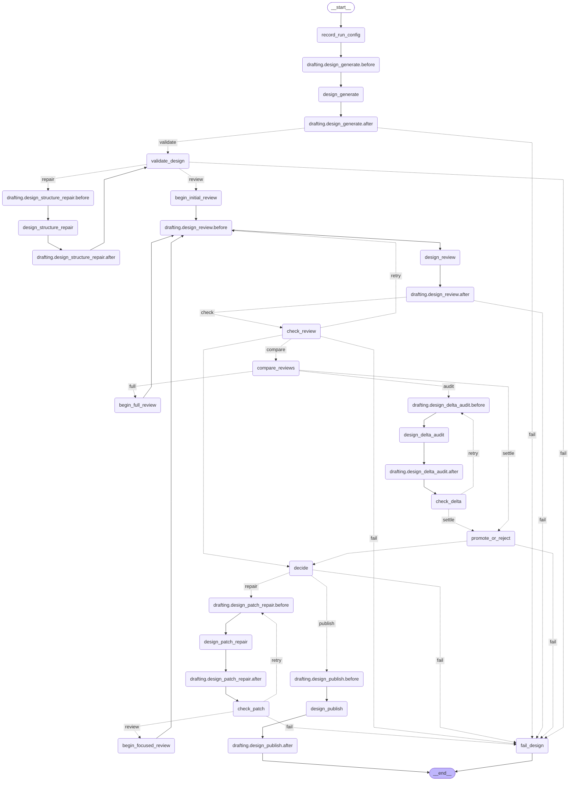

### investigation

```mermaid
---
config:
  flowchart:
    curve: linear
---
graph TD;
	__start__(<p>__start__</p>)
	record_run_config(record_run_config)
	confirm_prune(confirm_prune)
	investigation\2econfirm_prune\2ebefore(investigation.confirm_prune.before)
	investigation\2econfirm_prune\2eafter(investigation.confirm_prune.after)
	establish_incumbent(establish_incumbent)
	investigation\2eestablish_incumbent\2ebefore(investigation.establish_incumbent.before)
	investigation\2eestablish_incumbent\2eafter(investigation.establish_incumbent.after)
	plan_round(plan_round)
	investigation\2eplan_round\2ebefore(investigation.plan_round.before)
	investigation\2eplan_round\2eafter(investigation.plan_round.after)
	join_round(join_round)
	investigation\2ejoin_round\2ebefore(investigation.join_round.before)
	investigation\2ejoin_round\2eafter(investigation.join_round.after)
	prune_round(prune_round)
	investigation\2eprune_round\2ebefore(investigation.prune_round.before)
	investigation\2eprune_round\2eafter(investigation.prune_round.after)
	finalize(finalize)
	investigation\2efinalize\2ebefore(investigation.finalize.before)
	investigation\2efinalize\2eafter(investigation.finalize.after)
	__end__(<p>__end__</p>)
	__start__ --> record_run_config;
	confirm_prune --> investigation\2econfirm_prune\2eafter;
	establish_incumbent --> investigation\2eestablish_incumbent\2eafter;
	finalize --> investigation\2efinalize\2eafter;
	investigation\2econfirm_prune\2eafter -. &nbsp;establish_incumbent&nbsp; .-> investigation\2eestablish_incumbent\2ebefore;
	investigation\2econfirm_prune\2eafter -. &nbsp;finalize&nbsp; .-> investigation\2efinalize\2ebefore;
	investigation\2econfirm_prune\2ebefore --> confirm_prune;
	investigation\2eestablish_incumbent\2eafter -. &nbsp;finalize&nbsp; .-> investigation\2efinalize\2ebefore;
	investigation\2eestablish_incumbent\2eafter -. &nbsp;plan_round&nbsp; .-> investigation\2eplan_round\2ebefore;
	investigation\2eestablish_incumbent\2ebefore --> establish_incumbent;
	investigation\2efinalize\2ebefore --> finalize;
	investigation\2eplan_round\2ebefore --> plan_round;
	plan_round --> investigation\2eplan_round\2eafter;
	record_run_config --> investigation\2econfirm_prune\2ebefore;
	investigation\2efinalize\2eafter --> __end__;
	investigation\2eplan_round\2eafter --> __end__;
	subgraph worker
	worker\3arecord_run_config(record_run_config)
	worker\3ainit_campaign(init_campaign)
	worker\3aworker\2einit_campaign\2ebefore(worker.init_campaign.before)
	worker\3aworker\2einit_campaign\2eafter(worker.init_campaign.after)
	worker\3aconfirm_prune(confirm_prune)
	worker\3aworker\2econfirm_prune\2ebefore(worker.confirm_prune.before)
	worker\3aworker\2econfirm_prune\2eafter(worker.confirm_prune.after)
	worker\3acycle_start(cycle_start)
	worker\3aworker\2ecycle_start\2ebefore(worker.cycle_start.before)
	worker\3aworker\2ecycle_start\2eafter(worker.cycle_start.after)
	worker\3aideation(ideation)
	worker\3aworker\2eideation\2ebefore(worker.ideation.before)
	worker\3aworker\2eideation\2eafter(worker.ideation.after)
	worker\3aaccept_idea(accept_idea)
	worker\3aworker\2eaccept_idea\2ebefore(worker.accept_idea.before)
	worker\3aworker\2eaccept_idea\2eafter(worker.accept_idea.after)
	worker\3aattempt(attempt)
	worker\3aworker\2eattempt\2ebefore(worker.attempt.before)
	worker\3aworker\2eattempt\2eafter(worker.attempt.after)
	worker\3arecord_attempt(record_attempt)
	worker\3aworker\2erecord_attempt\2ebefore(worker.record_attempt.before)
	worker\3aworker\2erecord_attempt\2eafter(worker.record_attempt.after)
	worker\3apush_memory(push_memory)
	worker\3aworker\2epush_memory\2ebefore(worker.push_memory.before)
	worker\3aworker\2epush_memory\2eafter(worker.push_memory.after)
	worker\3acampaign_failed(campaign_failed)
	worker\3aworker\2ecampaign_failed\2ebefore(worker.campaign_failed.before)
	worker\3aworker\2ecampaign_failed\2eafter(worker.campaign_failed.after)
	worker\3afinish(finish)
	worker\3aworker\2efinish\2ebefore(worker.finish.before)
	worker\3aworker\2efinish\2eafter(worker.finish.after)
	worker\3aaccept_idea --> worker\3aworker\2eaccept_idea\2eafter;
	worker\3aattempt --> worker\3aworker\2eattempt\2eafter;
	worker\3acampaign_failed --> worker\3aworker\2ecampaign_failed\2eafter;
	worker\3aconfirm_prune --> worker\3aworker\2econfirm_prune\2eafter;
	worker\3acycle_start --> worker\3aworker\2ecycle_start\2eafter;
	worker\3afinish --> worker\3aworker\2efinish\2eafter;
	worker\3aideation --> worker\3aworker\2eideation\2eafter;
	worker\3ainit_campaign --> worker\3aworker\2einit_campaign\2eafter;
	worker\3apush_memory --> worker\3aworker\2epush_memory\2eafter;
	worker\3arecord_attempt --> worker\3aworker\2erecord_attempt\2eafter;
	worker\3arecord_run_config --> worker\3aworker\2einit_campaign\2ebefore;
	worker\3aworker\2eaccept_idea\2eafter --> worker\3aworker\2eattempt\2ebefore;
	worker\3aworker\2eaccept_idea\2ebefore --> worker\3aaccept_idea;
	worker\3aworker\2eattempt\2eafter --> worker\3aworker\2erecord_attempt\2ebefore;
	worker\3aworker\2eattempt\2ebefore --> worker\3aattempt;
	worker\3aworker\2ecampaign_failed\2eafter --> worker\3aworker\2efinish\2ebefore;
	worker\3aworker\2ecampaign_failed\2ebefore --> worker\3acampaign_failed;
	worker\3aworker\2econfirm_prune\2eafter -. &nbsp;cycle_start&nbsp; .-> worker\3aworker\2ecycle_start\2ebefore;
	worker\3aworker\2econfirm_prune\2eafter -. &nbsp;finish&nbsp; .-> worker\3aworker\2efinish\2ebefore;
	worker\3aworker\2econfirm_prune\2ebefore --> worker\3aconfirm_prune;
	worker\3aworker\2ecycle_start\2eafter --> worker\3aworker\2eideation\2ebefore;
	worker\3aworker\2ecycle_start\2ebefore --> worker\3acycle_start;
	worker\3aworker\2efinish\2ebefore --> worker\3afinish;
	worker\3aworker\2eideation\2eafter -. &nbsp;accept_idea&nbsp; .-> worker\3aworker\2eaccept_idea\2ebefore;
	worker\3aworker\2eideation\2eafter -. &nbsp;campaign_failed&nbsp; .-> worker\3aworker\2ecampaign_failed\2ebefore;
	worker\3aworker\2eideation\2ebefore --> worker\3aideation;
	worker\3aworker\2einit_campaign\2eafter -. &nbsp;confirm_prune&nbsp; .-> worker\3aworker\2econfirm_prune\2ebefore;
	worker\3aworker\2einit_campaign\2eafter -. &nbsp;finish&nbsp; .-> worker\3aworker\2efinish\2ebefore;
	worker\3aworker\2einit_campaign\2ebefore --> worker\3ainit_campaign;
	worker\3aworker\2epush_memory\2eafter -. &nbsp;cycle_start&nbsp; .-> worker\3aworker\2ecycle_start\2ebefore;
	worker\3aworker\2epush_memory\2eafter -. &nbsp;finish&nbsp; .-> worker\3aworker\2efinish\2ebefore;
	worker\3aworker\2epush_memory\2ebefore --> worker\3apush_memory;
	worker\3aworker\2erecord_attempt\2eafter -. &nbsp;finish&nbsp; .-> worker\3aworker\2efinish\2ebefore;
	worker\3aworker\2erecord_attempt\2eafter -. &nbsp;push_memory&nbsp; .-> worker\3aworker\2epush_memory\2ebefore;
	worker\3aworker\2erecord_attempt\2ebefore --> worker\3arecord_attempt;
	end
	classDef default fill:#f2f0ff,line-height:1.2
	classDef first fill-opacity:0
	classDef last fill:#bfb6fc
```

### campaign worker

```mermaid
---
config:
  flowchart:
    curve: linear
---
graph TD;
	__start__([<p>__start__</p>]):::first
	record_run_config(record_run_config)
	init_campaign(init_campaign)
	worker\2einit_campaign\2ebefore(worker.init_campaign.before)
	worker\2einit_campaign\2eafter(worker.init_campaign.after)
	confirm_prune(confirm_prune)
	worker\2econfirm_prune\2ebefore(worker.confirm_prune.before)
	worker\2econfirm_prune\2eafter(worker.confirm_prune.after)
	cycle_start(cycle_start)
	worker\2ecycle_start\2ebefore(worker.cycle_start.before)
	worker\2ecycle_start\2eafter(worker.cycle_start.after)
	worker\2eideation\2ebefore(worker.ideation.before)
	worker\2eideation\2eafter(worker.ideation.after)
	accept_idea(accept_idea)
	worker\2eaccept_idea\2ebefore(worker.accept_idea.before)
	worker\2eaccept_idea\2eafter(worker.accept_idea.after)
	worker\2eattempt\2ebefore(worker.attempt.before)
	worker\2eattempt\2eafter(worker.attempt.after)
	record_attempt(record_attempt)
	worker\2erecord_attempt\2ebefore(worker.record_attempt.before)
	worker\2erecord_attempt\2eafter(worker.record_attempt.after)
	push_memory(push_memory)
	worker\2epush_memory\2ebefore(worker.push_memory.before)
	worker\2epush_memory\2eafter(worker.push_memory.after)
	campaign_failed(campaign_failed)
	worker\2ecampaign_failed\2ebefore(worker.campaign_failed.before)
	worker\2ecampaign_failed\2eafter(worker.campaign_failed.after)
	finish(finish)
	worker\2efinish\2ebefore(worker.finish.before)
	worker\2efinish\2eafter(worker.finish.after)
	__end__([<p>__end__</p>]):::last
	__start__ --> record_run_config;
	accept_idea --> worker\2eaccept_idea\2eafter;
	attempt\3aattempt\2efinish\2eafter --> worker\2eattempt\2eafter;
	campaign_failed --> worker\2ecampaign_failed\2eafter;
	confirm_prune --> worker\2econfirm_prune\2eafter;
	cycle_start --> worker\2ecycle_start\2eafter;
	finish --> worker\2efinish\2eafter;
	ideation\3a__end__ --> worker\2eideation\2eafter;
	init_campaign --> worker\2einit_campaign\2eafter;
	push_memory --> worker\2epush_memory\2eafter;
	record_attempt --> worker\2erecord_attempt\2eafter;
	record_run_config --> worker\2einit_campaign\2ebefore;
	worker\2eaccept_idea\2eafter --> worker\2eattempt\2ebefore;
	worker\2eaccept_idea\2ebefore --> accept_idea;
	worker\2eattempt\2eafter --> worker\2erecord_attempt\2ebefore;
	worker\2eattempt\2ebefore --> attempt\3arecord_run_config;
	worker\2ecampaign_failed\2eafter --> worker\2efinish\2ebefore;
	worker\2ecampaign_failed\2ebefore --> campaign_failed;
	worker\2econfirm_prune\2eafter -. &nbsp;cycle_start&nbsp; .-> worker\2ecycle_start\2ebefore;
	worker\2econfirm_prune\2eafter -. &nbsp;finish&nbsp; .-> worker\2efinish\2ebefore;
	worker\2econfirm_prune\2ebefore --> confirm_prune;
	worker\2ecycle_start\2eafter --> worker\2eideation\2ebefore;
	worker\2ecycle_start\2ebefore --> cycle_start;
	worker\2efinish\2ebefore --> finish;
	worker\2eideation\2eafter -. &nbsp;accept_idea&nbsp; .-> worker\2eaccept_idea\2ebefore;
	worker\2eideation\2eafter -. &nbsp;campaign_failed&nbsp; .-> worker\2ecampaign_failed\2ebefore;
	worker\2eideation\2ebefore --> ideation\3arecord_run_config;
	worker\2einit_campaign\2eafter -. &nbsp;confirm_prune&nbsp; .-> worker\2econfirm_prune\2ebefore;
	worker\2einit_campaign\2eafter -. &nbsp;finish&nbsp; .-> worker\2efinish\2ebefore;
	worker\2einit_campaign\2ebefore --> init_campaign;
	worker\2epush_memory\2eafter -. &nbsp;cycle_start&nbsp; .-> worker\2ecycle_start\2ebefore;
	worker\2epush_memory\2eafter -. &nbsp;finish&nbsp; .-> worker\2efinish\2ebefore;
	worker\2epush_memory\2ebefore --> push_memory;
	worker\2erecord_attempt\2eafter -. &nbsp;finish&nbsp; .-> worker\2efinish\2ebefore;
	worker\2erecord_attempt\2eafter -. &nbsp;push_memory&nbsp; .-> worker\2epush_memory\2ebefore;
	worker\2erecord_attempt\2ebefore --> record_attempt;
	worker\2efinish\2eafter --> __end__;
	subgraph ideation
	ideation\3arecord_run_config(record_run_config)
	ideation\3astage(stage)
	ideation\3aideation\2estage\2ebefore(ideation.stage.before)
	ideation\3aideation\2estage\2eafter(ideation.stage.after)
	ideation\3aideate(ideate)
	ideation\3aideation\2eideate\2ebefore(ideation.ideate.before)
	ideation\3aideation\2eideate\2eafter(ideation.ideate.after)
	ideation\3avalidate(validate)
	ideation\3aideation\2evalidate\2ebefore(ideation.validate.before)
	ideation\3aideation\2evalidate\2eafter(ideation.validate.after)
	ideation\3a__end__(<p>__end__</p>)
	ideation\3aideate --> ideation\3aideation\2eideate\2eafter;
	ideation\3aideation\2eideate\2eafter --> ideation\3aideation\2evalidate\2ebefore;
	ideation\3aideation\2eideate\2ebefore --> ideation\3aideate;
	ideation\3aideation\2estage\2eafter --> ideation\3aideation\2eideate\2ebefore;
	ideation\3aideation\2estage\2ebefore --> ideation\3astage;
	ideation\3aideation\2evalidate\2eafter -.-> ideation\3a__end__;
	ideation\3aideation\2evalidate\2eafter -. &nbsp;stage&nbsp; .-> ideation\3aideation\2estage\2ebefore;
	ideation\3aideation\2evalidate\2ebefore --> ideation\3avalidate;
	ideation\3arecord_run_config --> ideation\3aideation\2estage\2ebefore;
	ideation\3astage --> ideation\3aideation\2estage\2eafter;
	ideation\3avalidate --> ideation\3aideation\2evalidate\2eafter;
	end
	subgraph attempt
	attempt\3arecord_run_config(record_run_config)
	attempt\3aprepare(prepare)
	attempt\3aattempt\2eprepare\2ebefore(attempt.prepare.before)
	attempt\3aattempt\2eprepare\2eafter(attempt.prepare.after)
	attempt\3aauthor_candidate(author_candidate)
	attempt\3aattempt\2eauthor_candidate\2ebefore(attempt.author_candidate.before)
	attempt\3aattempt\2eauthor_candidate\2eafter(attempt.author_candidate.after)
	attempt\3asearch(search)
	attempt\3aattempt\2esearch\2ebefore(attempt.search.before)
	attempt\3aattempt\2esearch\2eafter(attempt.search.after)
	attempt\3acollect_memory(collect_memory)
	attempt\3aattempt\2ecollect_memory\2ebefore(attempt.collect_memory.before)
	attempt\3aattempt\2ecollect_memory\2eafter(attempt.collect_memory.after)
	attempt\3acheck_outputs(check_outputs)
	attempt\3aattempt\2echeck_outputs\2ebefore(attempt.check_outputs.before)
	attempt\3aattempt\2echeck_outputs\2eafter(attempt.check_outputs.after)
	attempt\3aevaluate_candidate(evaluate_candidate)
	attempt\3aattempt\2eevaluate_candidate\2ebefore(attempt.evaluate_candidate.before)
	attempt\3aattempt\2eevaluate_candidate\2eafter(attempt.evaluate_candidate.after)
	attempt\3averify_rubrics(verify_rubrics)
	attempt\3aattempt\2everify_rubrics\2ebefore(attempt.verify_rubrics.before)
	attempt\3aattempt\2everify_rubrics\2eafter(attempt.verify_rubrics.after)
	attempt\3arecord_memory(record_memory)
	attempt\3aattempt\2erecord_memory\2ebefore(attempt.record_memory.before)
	attempt\3aattempt\2erecord_memory\2eafter(attempt.record_memory.after)
	attempt\3afinish(finish)
	attempt\3aattempt\2efinish\2ebefore(attempt.finish.before)
	attempt\3aattempt\2efinish\2eafter(attempt.finish.after)
	attempt\3aattempt\2eauthor_candidate\2eafter --> attempt\3aattempt\2echeck_outputs\2ebefore;
	attempt\3aattempt\2eauthor_candidate\2ebefore --> attempt\3aauthor_candidate;
	attempt\3aattempt\2echeck_outputs\2eafter -. &nbsp;evaluate_candidate&nbsp; .-> attempt\3aattempt\2eevaluate_candidate\2ebefore;
	attempt\3aattempt\2echeck_outputs\2eafter -. &nbsp;finish&nbsp; .-> attempt\3aattempt\2efinish\2ebefore;
	attempt\3aattempt\2echeck_outputs\2ebefore --> attempt\3acheck_outputs;
	attempt\3aattempt\2ecollect_memory\2eafter --> attempt\3aattempt\2efinish\2ebefore;
	attempt\3aattempt\2ecollect_memory\2ebefore --> attempt\3acollect_memory;
	attempt\3aattempt\2eevaluate_candidate\2eafter -. &nbsp;finish&nbsp; .-> attempt\3aattempt\2efinish\2ebefore;
	attempt\3aattempt\2eevaluate_candidate\2eafter -. &nbsp;verify_rubrics&nbsp; .-> attempt\3aattempt\2everify_rubrics\2ebefore;
	attempt\3aattempt\2eevaluate_candidate\2ebefore --> attempt\3aevaluate_candidate;
	attempt\3aattempt\2efinish\2ebefore --> attempt\3afinish;
	attempt\3aattempt\2eprepare\2eafter -. &nbsp;author_candidate&nbsp; .-> attempt\3aattempt\2eauthor_candidate\2ebefore;
	attempt\3aattempt\2eprepare\2eafter -. &nbsp;search&nbsp; .-> attempt\3aattempt\2esearch\2ebefore;
	attempt\3aattempt\2eprepare\2ebefore --> attempt\3aprepare;
	attempt\3aattempt\2erecord_memory\2eafter --> attempt\3aattempt\2efinish\2ebefore;
	attempt\3aattempt\2erecord_memory\2ebefore --> attempt\3arecord_memory;
	attempt\3aattempt\2esearch\2eafter --> attempt\3aattempt\2ecollect_memory\2ebefore;
	attempt\3aattempt\2esearch\2ebefore --> attempt\3asearch;
	attempt\3aattempt\2everify_rubrics\2eafter -. &nbsp;finish&nbsp; .-> attempt\3aattempt\2efinish\2ebefore;
	attempt\3aattempt\2everify_rubrics\2eafter -. &nbsp;record_memory&nbsp; .-> attempt\3aattempt\2erecord_memory\2ebefore;
	attempt\3aattempt\2everify_rubrics\2ebefore --> attempt\3averify_rubrics;
	attempt\3aauthor_candidate --> attempt\3aattempt\2eauthor_candidate\2eafter;
	attempt\3acheck_outputs --> attempt\3aattempt\2echeck_outputs\2eafter;
	attempt\3acollect_memory --> attempt\3aattempt\2ecollect_memory\2eafter;
	attempt\3aevaluate_candidate --> attempt\3aattempt\2eevaluate_candidate\2eafter;
	attempt\3afinish --> attempt\3aattempt\2efinish\2eafter;
	attempt\3aprepare --> attempt\3aattempt\2eprepare\2eafter;
	attempt\3arecord_memory --> attempt\3aattempt\2erecord_memory\2eafter;
	attempt\3arecord_run_config --> attempt\3aattempt\2eprepare\2ebefore;
	attempt\3asearch --> attempt\3aattempt\2esearch\2eafter;
	attempt\3averify_rubrics --> attempt\3aattempt\2everify_rubrics\2eafter;
	end
	classDef default fill:#f2f0ff,line-height:1.2
	classDef first fill-opacity:0
	classDef last fill:#bfb6fc
```

### ideation

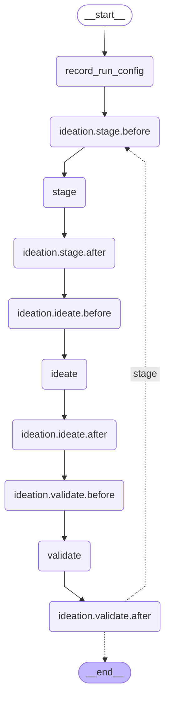

### attempt

```mermaid
---
config:
  flowchart:
    curve: linear
---
graph TD;
	__start__([<p>__start__</p>]):::first
	record_run_config(record_run_config)
	prepare(prepare)
	attempt\2eprepare\2ebefore(attempt.prepare.before)
	attempt\2eprepare\2eafter(attempt.prepare.after)
	author_candidate(author_candidate)
	attempt\2eauthor_candidate\2ebefore(attempt.author_candidate.before)
	attempt\2eauthor_candidate\2eafter(attempt.author_candidate.after)
	search(search)
	attempt\2esearch\2ebefore(attempt.search.before)
	attempt\2esearch\2eafter(attempt.search.after)
	collect_memory(collect_memory)
	attempt\2ecollect_memory\2ebefore(attempt.collect_memory.before)
	attempt\2ecollect_memory\2eafter(attempt.collect_memory.after)
	check_outputs(check_outputs)
	attempt\2echeck_outputs\2ebefore(attempt.check_outputs.before)
	attempt\2echeck_outputs\2eafter(attempt.check_outputs.after)
	evaluate_candidate(evaluate_candidate)
	attempt\2eevaluate_candidate\2ebefore(attempt.evaluate_candidate.before)
	attempt\2eevaluate_candidate\2eafter(attempt.evaluate_candidate.after)
	verify_rubrics(verify_rubrics)
	attempt\2everify_rubrics\2ebefore(attempt.verify_rubrics.before)
	attempt\2everify_rubrics\2eafter(attempt.verify_rubrics.after)
	record_memory(record_memory)
	attempt\2erecord_memory\2ebefore(attempt.record_memory.before)
	attempt\2erecord_memory\2eafter(attempt.record_memory.after)
	finish(finish)
	attempt\2efinish\2ebefore(attempt.finish.before)
	attempt\2efinish\2eafter(attempt.finish.after)
	__end__([<p>__end__</p>]):::last
	__start__ --> record_run_config;
	attempt\2eauthor_candidate\2eafter --> attempt\2echeck_outputs\2ebefore;
	attempt\2eauthor_candidate\2ebefore --> author_candidate;
	attempt\2echeck_outputs\2eafter -. &nbsp;evaluate_candidate&nbsp; .-> attempt\2eevaluate_candidate\2ebefore;
	attempt\2echeck_outputs\2eafter -. &nbsp;finish&nbsp; .-> attempt\2efinish\2ebefore;
	attempt\2echeck_outputs\2ebefore --> check_outputs;
	attempt\2ecollect_memory\2eafter --> attempt\2efinish\2ebefore;
	attempt\2ecollect_memory\2ebefore --> collect_memory;
	attempt\2eevaluate_candidate\2eafter -. &nbsp;finish&nbsp; .-> attempt\2efinish\2ebefore;
	attempt\2eevaluate_candidate\2eafter -. &nbsp;verify_rubrics&nbsp; .-> attempt\2everify_rubrics\2ebefore;
	attempt\2eevaluate_candidate\2ebefore --> evaluate_candidate;
	attempt\2efinish\2ebefore --> finish;
	attempt\2eprepare\2eafter -. &nbsp;author_candidate&nbsp; .-> attempt\2eauthor_candidate\2ebefore;
	attempt\2eprepare\2eafter -. &nbsp;search&nbsp; .-> attempt\2esearch\2ebefore;
	attempt\2eprepare\2ebefore --> prepare;
	attempt\2erecord_memory\2eafter --> attempt\2efinish\2ebefore;
	attempt\2erecord_memory\2ebefore --> record_memory;
	attempt\2esearch\2eafter --> attempt\2ecollect_memory\2ebefore;
	attempt\2esearch\2ebefore --> search;
	attempt\2everify_rubrics\2eafter -. &nbsp;finish&nbsp; .-> attempt\2efinish\2ebefore;
	attempt\2everify_rubrics\2eafter -. &nbsp;record_memory&nbsp; .-> attempt\2erecord_memory\2ebefore;
	attempt\2everify_rubrics\2ebefore --> verify_rubrics;
	author_candidate --> attempt\2eauthor_candidate\2eafter;
	check_outputs --> attempt\2echeck_outputs\2eafter;
	collect_memory --> attempt\2ecollect_memory\2eafter;
	evaluate_candidate --> attempt\2eevaluate_candidate\2eafter;
	finish --> attempt\2efinish\2eafter;
	prepare --> attempt\2eprepare\2eafter;
	record_memory --> attempt\2erecord_memory\2eafter;
	record_run_config --> attempt\2eprepare\2ebefore;
	search --> attempt\2esearch\2eafter;
	verify_rubrics --> attempt\2everify_rubrics\2eafter;
	attempt\2efinish\2eafter --> __end__;
	classDef default fill:#f2f0ff,line-height:1.2
	classDef first fill-opacity:0
	classDef last fill:#bfb6fc
```

### downstream selection

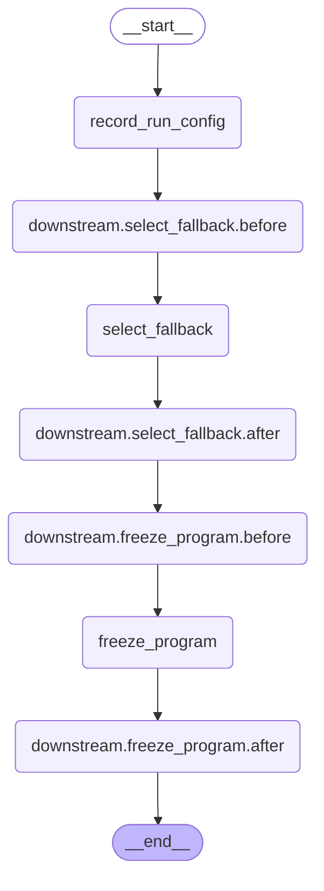

### variants

```mermaid
---
config:
  flowchart:
    curve: linear
---
graph TD;
	__start__([<p>__start__</p>]):::first
	record_run_config(record_run_config)
	prepare(prepare)
	variants\2eprepare\2ebefore(variants.prepare.before)
	variants\2eprepare\2eafter(variants.prepare.after)
	extract(extract)
	variants\2eextract\2ebefore(variants.extract.before)
	variants\2eextract\2eafter(variants.extract.after)
	retrofit_prepare(retrofit_prepare)
	variants\2eretrofit_prepare\2ebefore(variants.retrofit_prepare.before)
	variants\2eretrofit_prepare\2eafter(variants.retrofit_prepare.after)
	retrofit_agent(retrofit_agent)
	variants\2eretrofit_agent\2ebefore(variants.retrofit_agent.before)
	variants\2eretrofit_agent\2eafter(variants.retrofit_agent.after)
	retrofit_finish(retrofit_finish)
	variants\2eretrofit_finish\2ebefore(variants.retrofit_finish.before)
	variants\2eretrofit_finish\2eafter(variants.retrofit_finish.after)
	generate(generate)
	variants\2egenerate\2ebefore(variants.generate.before)
	variants\2egenerate\2eafter(variants.generate.after)
	select(select)
	variants\2eselect\2ebefore(variants.select.before)
	variants\2eselect\2eafter(variants.select.after)
	custom_baselines(custom_baselines)
	variants\2ecustom_baselines\2ebefore(variants.custom_baselines.before)
	variants\2ecustom_baselines\2eafter(variants.custom_baselines.after)
	materialize(materialize)
	variants\2ematerialize\2ebefore(variants.materialize.before)
	variants\2ematerialize\2eafter(variants.materialize.after)
	after_control(after_control)
	variants\2eafter_control\2ebefore(variants.after_control.before)
	variants\2eafter_control\2eafter(variants.after_control.after)
	join_variants(join_variants)
	variants\2ejoin_variants\2ebefore(variants.join_variants.before)
	variants\2ejoin_variants\2eafter(variants.join_variants.after)
	variants\2ecross_task\2ebefore(variants.cross_task.before)
	variants\2ecross_task\2eafter(variants.cross_task.after)
	cross_result(cross_result)
	aggregate(aggregate)
	variants\2eaggregate\2ebefore(variants.aggregate.before)
	variants\2eaggregate\2eafter(variants.aggregate.after)
	readme(readme)
	variants\2ereadme\2ebefore(variants.readme.before)
	variants\2ereadme\2eafter(variants.readme.after)
	finish(finish)
	variants\2efinish\2ebefore(variants.finish.before)
	variants\2efinish\2eafter(variants.finish.after)
	__end__([<p>__end__</p>]):::last
	__start__ --> record_run_config;
	after_control --> variants\2eafter_control\2eafter;
	aggregate --> variants\2eaggregate\2eafter;
	cross_result -. &nbsp;ok&nbsp; .-> variants\2eaggregate\2ebefore;
	cross_result -. &nbsp;finish&nbsp; .-> variants\2efinish\2ebefore;
	cross_task\3across_task\2efinish\2eafter --> variants\2ecross_task\2eafter;
	custom_baselines --> variants\2ecustom_baselines\2eafter;
	extract --> variants\2eextract\2eafter;
	finish --> variants\2efinish\2eafter;
	generate --> variants\2egenerate\2eafter;
	join_variants --> variants\2ejoin_variants\2eafter;
	materialize --> variants\2ematerialize\2eafter;
	prepare --> variants\2eprepare\2eafter;
	readme --> variants\2ereadme\2eafter;
	record_run_config --> variants\2eprepare\2ebefore;
	retrofit_agent --> variants\2eretrofit_agent\2eafter;
	retrofit_finish --> variants\2eretrofit_finish\2eafter;
	retrofit_prepare --> variants\2eretrofit_prepare\2eafter;
	run_control\3avariants\2efinish_variant\2eafter --> variants\2eafter_control\2ebefore;
	run_variant\3avariants\2efinish_variant\2eafter --> variants\2ejoin_variants\2ebefore;
	select --> variants\2eselect\2eafter;
	variants\2eafter_control\2eafter -.-> run_variant\3avariants\2einit_variant\2ebefore;
	variants\2eafter_control\2eafter -.-> variants\2ejoin_variants\2ebefore;
	variants\2eafter_control\2ebefore --> after_control;
	variants\2eaggregate\2eafter --> variants\2ereadme\2ebefore;
	variants\2eaggregate\2ebefore --> aggregate;
	variants\2ecross_task\2eafter --> cross_result;
	variants\2ecross_task\2ebefore --> cross_task\3across_task\2eprepare\2ebefore;
	variants\2ecustom_baselines\2eafter -. &nbsp;finish&nbsp; .-> variants\2efinish\2ebefore;
	variants\2ecustom_baselines\2eafter -. &nbsp;ok&nbsp; .-> variants\2ematerialize\2ebefore;
	variants\2ecustom_baselines\2ebefore --> custom_baselines;
	variants\2eextract\2eafter -. &nbsp;finish&nbsp; .-> variants\2efinish\2ebefore;
	variants\2eextract\2eafter -. &nbsp;ok&nbsp; .-> variants\2eretrofit_prepare\2ebefore;
	variants\2eextract\2ebefore --> extract;
	variants\2efinish\2ebefore --> finish;
	variants\2egenerate\2eafter --> variants\2eselect\2ebefore;
	variants\2egenerate\2ebefore --> generate;
	variants\2ejoin_variants\2eafter -. &nbsp;aggregate&nbsp; .-> variants\2eaggregate\2ebefore;
	variants\2ejoin_variants\2eafter -. &nbsp;cross_task&nbsp; .-> variants\2ecross_task\2ebefore;
	variants\2ejoin_variants\2eafter -. &nbsp;finish&nbsp; .-> variants\2efinish\2ebefore;
	variants\2ejoin_variants\2ebefore --> join_variants;
	variants\2ematerialize\2eafter -.-> run_control\3avariants\2einit_variant\2ebefore;
	variants\2ematerialize\2eafter -.-> run_variant\3avariants\2einit_variant\2ebefore;
	variants\2ematerialize\2eafter -.-> variants\2efinish\2ebefore;
	variants\2ematerialize\2eafter -.-> variants\2ejoin_variants\2ebefore;
	variants\2ematerialize\2ebefore --> materialize;
	variants\2eprepare\2eafter -. &nbsp;ok&nbsp; .-> variants\2eextract\2ebefore;
	variants\2eprepare\2eafter -. &nbsp;finish&nbsp; .-> variants\2efinish\2ebefore;
	variants\2eprepare\2ebefore --> prepare;
	variants\2ereadme\2eafter --> variants\2efinish\2ebefore;
	variants\2ereadme\2ebefore --> readme;
	variants\2eretrofit_agent\2eafter --> variants\2eretrofit_finish\2ebefore;
	variants\2eretrofit_agent\2ebefore --> retrofit_agent;
	variants\2eretrofit_finish\2eafter -. &nbsp;custom&nbsp; .-> variants\2ecustom_baselines\2ebefore;
	variants\2eretrofit_finish\2eafter -. &nbsp;finish&nbsp; .-> variants\2efinish\2ebefore;
	variants\2eretrofit_finish\2eafter -. &nbsp;generate&nbsp; .-> variants\2egenerate\2ebefore;
	variants\2eretrofit_finish\2ebefore --> retrofit_finish;
	variants\2eretrofit_prepare\2eafter -. &nbsp;finish&nbsp; .-> variants\2efinish\2ebefore;
	variants\2eretrofit_prepare\2eafter -. &nbsp;agent&nbsp; .-> variants\2eretrofit_agent\2ebefore;
	variants\2eretrofit_prepare\2eafter -. &nbsp;done&nbsp; .-> variants\2eretrofit_finish\2ebefore;
	variants\2eretrofit_prepare\2ebefore --> retrofit_prepare;
	variants\2eselect\2eafter --> variants\2ecustom_baselines\2ebefore;
	variants\2eselect\2ebefore --> select;
	variants\2efinish\2eafter --> __end__;
	subgraph run_control
	run_control\3ainit_variant(init_variant)
	run_control\3avariants\2einit_variant\2ebefore(variants.init_variant.before)
	run_control\3avariants\2einit_variant\2eafter(variants.init_variant.after)
	run_control\3aedit(edit)
	run_control\3avariants\2eedit\2ebefore(variants.edit.before)
	run_control\3avariants\2eedit\2eafter(variants.edit.after)
	run_control\3aafter_edit(after_edit)
	run_control\3aevaluate(evaluate)
	run_control\3avariants\2eevaluate\2ebefore(variants.evaluate.before)
	run_control\3avariants\2eevaluate\2eafter(variants.evaluate.after)
	run_control\3ascaffold_status(scaffold_status)
	run_control\3avariants\2escaffold_status\2ebefore(variants.scaffold_status.before)
	run_control\3avariants\2escaffold_status\2eafter(variants.scaffold_status.after)
	run_control\3averify(verify)
	run_control\3avariants\2everify\2ebefore(variants.verify.before)
	run_control\3avariants\2everify\2eafter(variants.verify.after)
	run_control\3aafter_verify(after_verify)
	run_control\3avariants\2eafter_verify\2ebefore(variants.after_verify.before)
	run_control\3avariants\2eafter_verify\2eafter(variants.after_verify.after)
	run_control\3anext_program(next_program)
	run_control\3afinish_variant(finish_variant)
	run_control\3avariants\2efinish_variant\2ebefore(variants.finish_variant.before)
	run_control\3avariants\2efinish_variant\2eafter(variants.finish_variant.after)
	run_control\3aafter_edit -. &nbsp;edit&nbsp; .-> run_control\3avariants\2eedit\2ebefore;
	run_control\3aafter_edit -. &nbsp;evaluate&nbsp; .-> run_control\3avariants\2eevaluate\2ebefore;
	run_control\3aafter_edit -. &nbsp;finish&nbsp; .-> run_control\3avariants\2efinish_variant\2ebefore;
	run_control\3aafter_verify --> run_control\3avariants\2eafter_verify\2eafter;
	run_control\3aedit --> run_control\3avariants\2eedit\2eafter;
	run_control\3aevaluate --> run_control\3avariants\2eevaluate\2eafter;
	run_control\3afinish_variant --> run_control\3avariants\2efinish_variant\2eafter;
	run_control\3ainit_variant --> run_control\3avariants\2einit_variant\2eafter;
	run_control\3anext_program -. &nbsp;edit&nbsp; .-> run_control\3avariants\2eedit\2ebefore;
	run_control\3anext_program -. &nbsp;finish&nbsp; .-> run_control\3avariants\2efinish_variant\2ebefore;
	run_control\3ascaffold_status --> run_control\3avariants\2escaffold_status\2eafter;
	run_control\3avariants\2eafter_verify\2eafter -. &nbsp;next&nbsp; .-> run_control\3anext_program;
	run_control\3avariants\2eafter_verify\2eafter -. &nbsp;scaffold&nbsp; .-> run_control\3avariants\2escaffold_status\2ebefore;
	run_control\3avariants\2eafter_verify\2ebefore --> run_control\3aafter_verify;
	run_control\3avariants\2eedit\2eafter --> run_control\3aafter_edit;
	run_control\3avariants\2eedit\2ebefore --> run_control\3aedit;
	run_control\3avariants\2eevaluate\2eafter -. &nbsp;finish&nbsp; .-> run_control\3avariants\2efinish_variant\2ebefore;
	run_control\3avariants\2eevaluate\2eafter -. &nbsp;scaffold&nbsp; .-> run_control\3avariants\2escaffold_status\2ebefore;
	run_control\3avariants\2eevaluate\2ebefore --> run_control\3aevaluate;
	run_control\3avariants\2efinish_variant\2ebefore --> run_control\3afinish_variant;
	run_control\3avariants\2einit_variant\2eafter -. &nbsp;edit&nbsp; .-> run_control\3avariants\2eedit\2ebefore;
	run_control\3avariants\2einit_variant\2eafter -. &nbsp;evaluate&nbsp; .-> run_control\3avariants\2eevaluate\2ebefore;
	run_control\3avariants\2einit_variant\2eafter -. &nbsp;finish&nbsp; .-> run_control\3avariants\2efinish_variant\2ebefore;
	run_control\3avariants\2einit_variant\2ebefore --> run_control\3ainit_variant;
	run_control\3avariants\2escaffold_status\2eafter --> run_control\3avariants\2everify\2ebefore;
	run_control\3avariants\2escaffold_status\2ebefore --> run_control\3ascaffold_status;
	run_control\3avariants\2everify\2eafter --> run_control\3avariants\2eafter_verify\2ebefore;
	run_control\3avariants\2everify\2ebefore --> run_control\3averify;
	run_control\3averify --> run_control\3avariants\2everify\2eafter;
	end
	subgraph run_variant
	run_variant\3ainit_variant(init_variant)
	run_variant\3avariants\2einit_variant\2ebefore(variants.init_variant.before)
	run_variant\3avariants\2einit_variant\2eafter(variants.init_variant.after)
	run_variant\3aedit(edit)
	run_variant\3avariants\2eedit\2ebefore(variants.edit.before)
	run_variant\3avariants\2eedit\2eafter(variants.edit.after)
	run_variant\3aafter_edit(after_edit)
	run_variant\3aevaluate(evaluate)
	run_variant\3avariants\2eevaluate\2ebefore(variants.evaluate.before)
	run_variant\3avariants\2eevaluate\2eafter(variants.evaluate.after)
	run_variant\3ascaffold_status(scaffold_status)
	run_variant\3avariants\2escaffold_status\2ebefore(variants.scaffold_status.before)
	run_variant\3avariants\2escaffold_status\2eafter(variants.scaffold_status.after)
	run_variant\3averify(verify)
	run_variant\3avariants\2everify\2ebefore(variants.verify.before)
	run_variant\3avariants\2everify\2eafter(variants.verify.after)
	run_variant\3aafter_verify(after_verify)
	run_variant\3avariants\2eafter_verify\2ebefore(variants.after_verify.before)
	run_variant\3avariants\2eafter_verify\2eafter(variants.after_verify.after)
	run_variant\3anext_program(next_program)
	run_variant\3afinish_variant(finish_variant)
	run_variant\3avariants\2efinish_variant\2ebefore(variants.finish_variant.before)
	run_variant\3avariants\2efinish_variant\2eafter(variants.finish_variant.after)
	run_variant\3aafter_edit -. &nbsp;edit&nbsp; .-> run_variant\3avariants\2eedit\2ebefore;
	run_variant\3aafter_edit -. &nbsp;evaluate&nbsp; .-> run_variant\3avariants\2eevaluate\2ebefore;
	run_variant\3aafter_edit -. &nbsp;finish&nbsp; .-> run_variant\3avariants\2efinish_variant\2ebefore;
	run_variant\3aafter_verify --> run_variant\3avariants\2eafter_verify\2eafter;
	run_variant\3aedit --> run_variant\3avariants\2eedit\2eafter;
	run_variant\3aevaluate --> run_variant\3avariants\2eevaluate\2eafter;
	run_variant\3afinish_variant --> run_variant\3avariants\2efinish_variant\2eafter;
	run_variant\3ainit_variant --> run_variant\3avariants\2einit_variant\2eafter;
	run_variant\3anext_program -. &nbsp;edit&nbsp; .-> run_variant\3avariants\2eedit\2ebefore;
	run_variant\3anext_program -. &nbsp;finish&nbsp; .-> run_variant\3avariants\2efinish_variant\2ebefore;
	run_variant\3ascaffold_status --> run_variant\3avariants\2escaffold_status\2eafter;
	run_variant\3avariants\2eafter_verify\2eafter -. &nbsp;next&nbsp; .-> run_variant\3anext_program;
	run_variant\3avariants\2eafter_verify\2eafter -. &nbsp;scaffold&nbsp; .-> run_variant\3avariants\2escaffold_status\2ebefore;
	run_variant\3avariants\2eafter_verify\2ebefore --> run_variant\3aafter_verify;
	run_variant\3avariants\2eedit\2eafter --> run_variant\3aafter_edit;
	run_variant\3avariants\2eedit\2ebefore --> run_variant\3aedit;
	run_variant\3avariants\2eevaluate\2eafter -. &nbsp;finish&nbsp; .-> run_variant\3avariants\2efinish_variant\2ebefore;
	run_variant\3avariants\2eevaluate\2eafter -. &nbsp;scaffold&nbsp; .-> run_variant\3avariants\2escaffold_status\2ebefore;
	run_variant\3avariants\2eevaluate\2ebefore --> run_variant\3aevaluate;
	run_variant\3avariants\2efinish_variant\2ebefore --> run_variant\3afinish_variant;
	run_variant\3avariants\2einit_variant\2eafter -. &nbsp;edit&nbsp; .-> run_variant\3avariants\2eedit\2ebefore;
	run_variant\3avariants\2einit_variant\2eafter -. &nbsp;evaluate&nbsp; .-> run_variant\3avariants\2eevaluate\2ebefore;
	run_variant\3avariants\2einit_variant\2eafter -. &nbsp;finish&nbsp; .-> run_variant\3avariants\2efinish_variant\2ebefore;
	run_variant\3avariants\2einit_variant\2ebefore --> run_variant\3ainit_variant;
	run_variant\3avariants\2escaffold_status\2eafter --> run_variant\3avariants\2everify\2ebefore;
	run_variant\3avariants\2escaffold_status\2ebefore --> run_variant\3ascaffold_status;
	run_variant\3avariants\2everify\2eafter --> run_variant\3avariants\2eafter_verify\2ebefore;
	run_variant\3avariants\2everify\2ebefore --> run_variant\3averify;
	run_variant\3averify --> run_variant\3avariants\2everify\2eafter;
	end
	subgraph cross_task
	cross_task\3aprepare(prepare)
	cross_task\3across_task\2eprepare\2ebefore(cross_task.prepare.before)
	cross_task\3across_task\2eprepare\2eafter(cross_task.prepare.after)
	cross_task\3astart_task(start_task)
	cross_task\3across_task\2estart_task\2ebefore(cross_task.start_task.before)
	cross_task\3across_task\2estart_task\2eafter(cross_task.start_task.after)
	cross_task\3aretrofit_prepare(retrofit_prepare)
	cross_task\3across_task\2eretrofit_prepare\2ebefore(cross_task.retrofit_prepare.before)
	cross_task\3across_task\2eretrofit_prepare\2eafter(cross_task.retrofit_prepare.after)
	cross_task\3aretrofit_agent(retrofit_agent)
	cross_task\3across_task\2eretrofit_agent\2ebefore(cross_task.retrofit_agent.before)
	cross_task\3across_task\2eretrofit_agent\2eafter(cross_task.retrofit_agent.after)
	cross_task\3aretrofit_finish(retrofit_finish)
	cross_task\3across_task\2eretrofit_finish\2ebefore(cross_task.retrofit_finish.before)
	cross_task\3across_task\2eretrofit_finish\2eafter(cross_task.retrofit_finish.after)
	cross_task\3aprepare_control(prepare_control)
	cross_task\3across_task\2eprepare_control\2ebefore(cross_task.prepare_control.before)
	cross_task\3across_task\2eprepare_control\2eafter(cross_task.prepare_control.after)
	cross_task\3arun_control(run_control)
	cross_task\3aafter_control(after_control)
	cross_task\3across_task\2eafter_control\2ebefore(cross_task.after_control.before)
	cross_task\3across_task\2eafter_control\2eafter(cross_task.after_control.after)
	cross_task\3aprepare_variants(prepare_variants)
	cross_task\3across_task\2eprepare_variants\2ebefore(cross_task.prepare_variants.before)
	cross_task\3across_task\2eprepare_variants\2eafter(cross_task.prepare_variants.after)
	cross_task\3arun_adapt_variant(run_adapt_variant)
	cross_task\3ajoin_task(join_task)
	cross_task\3across_task\2ejoin_task\2ebefore(cross_task.join_task.before)
	cross_task\3across_task\2ejoin_task\2eafter(cross_task.join_task.after)
	cross_task\3afinish(finish)
	cross_task\3across_task\2efinish\2ebefore(cross_task.finish.before)
	cross_task\3across_task\2efinish\2eafter(cross_task.finish.after)
	cross_task\3aafter_control --> cross_task\3across_task\2eafter_control\2eafter;
	cross_task\3across_task\2eafter_control\2eafter -. &nbsp;finish&nbsp; .-> cross_task\3across_task\2efinish\2ebefore;
	cross_task\3across_task\2eafter_control\2eafter -. &nbsp;ok&nbsp; .-> cross_task\3across_task\2eprepare_variants\2ebefore;
	cross_task\3across_task\2eafter_control\2ebefore --> cross_task\3aafter_control;
	cross_task\3across_task\2efinish\2ebefore --> cross_task\3afinish;
	cross_task\3across_task\2ejoin_task\2eafter -. &nbsp;finish&nbsp; .-> cross_task\3across_task\2efinish\2ebefore;
	cross_task\3across_task\2ejoin_task\2eafter -. &nbsp;next&nbsp; .-> cross_task\3across_task\2estart_task\2ebefore;
	cross_task\3across_task\2ejoin_task\2ebefore --> cross_task\3ajoin_task;
	cross_task\3across_task\2eprepare\2eafter -. &nbsp;finish&nbsp; .-> cross_task\3across_task\2efinish\2ebefore;
	cross_task\3across_task\2eprepare\2eafter -. &nbsp;ok&nbsp; .-> cross_task\3across_task\2estart_task\2ebefore;
	cross_task\3across_task\2eprepare\2ebefore --> cross_task\3aprepare;
	cross_task\3across_task\2eprepare_control\2eafter -.-> cross_task\3across_task\2eafter_control\2ebefore;
	cross_task\3across_task\2eprepare_control\2eafter -.-> cross_task\3across_task\2efinish\2ebefore;
	cross_task\3across_task\2eprepare_control\2eafter -.-> cross_task\3arun_control;
	cross_task\3across_task\2eprepare_control\2ebefore --> cross_task\3aprepare_control;
	cross_task\3across_task\2eprepare_variants\2eafter -.-> cross_task\3across_task\2efinish\2ebefore;
	cross_task\3across_task\2eprepare_variants\2eafter -.-> cross_task\3across_task\2ejoin_task\2ebefore;
	cross_task\3across_task\2eprepare_variants\2eafter -.-> cross_task\3arun_adapt_variant;
	cross_task\3across_task\2eprepare_variants\2ebefore --> cross_task\3aprepare_variants;
	cross_task\3across_task\2eretrofit_agent\2eafter --> cross_task\3across_task\2eretrofit_finish\2ebefore;
	cross_task\3across_task\2eretrofit_agent\2ebefore --> cross_task\3aretrofit_agent;
	cross_task\3across_task\2eretrofit_finish\2eafter -. &nbsp;finish&nbsp; .-> cross_task\3across_task\2efinish\2ebefore;
	cross_task\3across_task\2eretrofit_finish\2eafter -. &nbsp;ok&nbsp; .-> cross_task\3across_task\2eprepare_control\2ebefore;
	cross_task\3across_task\2eretrofit_finish\2ebefore --> cross_task\3aretrofit_finish;
	cross_task\3across_task\2eretrofit_prepare\2eafter -. &nbsp;finish&nbsp; .-> cross_task\3across_task\2efinish\2ebefore;
	cross_task\3across_task\2eretrofit_prepare\2eafter -. &nbsp;adapt&nbsp; .-> cross_task\3across_task\2eprepare_control\2ebefore;
	cross_task\3across_task\2eretrofit_prepare\2eafter -. &nbsp;agent&nbsp; .-> cross_task\3across_task\2eretrofit_agent\2ebefore;
	cross_task\3across_task\2eretrofit_prepare\2ebefore --> cross_task\3aretrofit_prepare;
	cross_task\3across_task\2estart_task\2eafter -. &nbsp;finish&nbsp; .-> cross_task\3across_task\2efinish\2ebefore;
	cross_task\3across_task\2estart_task\2eafter -. &nbsp;ok&nbsp; .-> cross_task\3across_task\2eretrofit_prepare\2ebefore;
	cross_task\3across_task\2estart_task\2ebefore --> cross_task\3astart_task;
	cross_task\3afinish --> cross_task\3across_task\2efinish\2eafter;
	cross_task\3ajoin_task --> cross_task\3across_task\2ejoin_task\2eafter;
	cross_task\3aprepare --> cross_task\3across_task\2eprepare\2eafter;
	cross_task\3aprepare_control --> cross_task\3across_task\2eprepare_control\2eafter;
	cross_task\3aprepare_variants --> cross_task\3across_task\2eprepare_variants\2eafter;
	cross_task\3aretrofit_agent --> cross_task\3across_task\2eretrofit_agent\2eafter;
	cross_task\3aretrofit_finish --> cross_task\3across_task\2eretrofit_finish\2eafter;
	cross_task\3aretrofit_prepare --> cross_task\3across_task\2eretrofit_prepare\2eafter;
	cross_task\3arun_adapt_variant --> cross_task\3across_task\2ejoin_task\2ebefore;
	cross_task\3arun_control --> cross_task\3across_task\2eafter_control\2ebefore;
	cross_task\3astart_task --> cross_task\3across_task\2estart_task\2eafter;
	end
	classDef default fill:#f2f0ff,line-height:1.2
	classDef first fill-opacity:0
	classDef last fill:#bfb6fc
```

### final evaluation

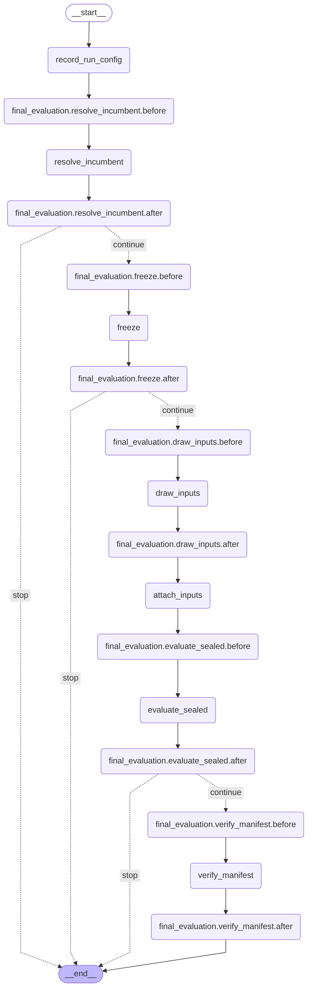

### post-hoc

```mermaid
---
config:
  flowchart:
    curve: linear
---
graph TD;
	__start__([<p>__start__</p>]):::first
	record_run_config(record_run_config)
	extract(extract)
	posthoc\2eextract\2ebefore(posthoc.extract.before)
	posthoc\2eextract\2eafter(posthoc.extract.after)
	bootstrap_prepare(bootstrap_prepare)
	posthoc\2ebootstrap_prepare\2ebefore(posthoc.bootstrap_prepare.before)
	posthoc\2ebootstrap_prepare\2eafter(posthoc.bootstrap_prepare.after)
	bootstrap_reset(bootstrap_reset)
	posthoc\2ebootstrap_reset\2ebefore(posthoc.bootstrap_reset.before)
	posthoc\2ebootstrap_reset\2eafter(posthoc.bootstrap_reset.after)
	bootstrap_agent(bootstrap_agent)
	posthoc\2ebootstrap_agent\2ebefore(posthoc.bootstrap_agent.before)
	posthoc\2ebootstrap_agent\2eafter(posthoc.bootstrap_agent.after)
	bootstrap_evaluate(bootstrap_evaluate)
	posthoc\2ebootstrap_evaluate\2ebefore(posthoc.bootstrap_evaluate.before)
	posthoc\2ebootstrap_evaluate\2eafter(posthoc.bootstrap_evaluate.after)
	bootstrap_record(bootstrap_record)
	posthoc\2ebootstrap_record\2ebefore(posthoc.bootstrap_record.before)
	posthoc\2ebootstrap_record\2eafter(posthoc.bootstrap_record.after)
	bootstrap_finish(bootstrap_finish)
	posthoc\2ebootstrap_finish\2ebefore(posthoc.bootstrap_finish.before)
	posthoc\2ebootstrap_finish\2eafter(posthoc.bootstrap_finish.after)
	restore_evidence(restore_evidence)
	posthoc\2erestore_evidence\2ebefore(posthoc.restore_evidence.before)
	posthoc\2erestore_evidence\2eafter(posthoc.restore_evidence.after)
	generate(generate)
	posthoc\2egenerate\2ebefore(posthoc.generate.before)
	posthoc\2egenerate\2eafter(posthoc.generate.after)
	select(select)
	posthoc\2eselect\2ebefore(posthoc.select.before)
	posthoc\2eselect\2eafter(posthoc.select.after)
	apply_constraints(apply_constraints)
	posthoc\2eapply_constraints\2ebefore(posthoc.apply_constraints.before)
	posthoc\2eapply_constraints\2eafter(posthoc.apply_constraints.after)
	materialize(materialize)
	posthoc\2ematerialize\2ebefore(posthoc.materialize.before)
	posthoc\2ematerialize\2eafter(posthoc.materialize.after)
	publish(publish)
	posthoc\2epublish\2ebefore(posthoc.publish.before)
	posthoc\2epublish\2eafter(posthoc.publish.after)
	__end__([<p>__end__</p>]):::last
	__start__ --> record_run_config;
	apply_constraints --> posthoc\2eapply_constraints\2eafter;
	bootstrap_agent --> posthoc\2ebootstrap_agent\2eafter;
	bootstrap_evaluate --> posthoc\2ebootstrap_evaluate\2eafter;
	bootstrap_finish --> posthoc\2ebootstrap_finish\2eafter;
	bootstrap_prepare --> posthoc\2ebootstrap_prepare\2eafter;
	bootstrap_record --> posthoc\2ebootstrap_record\2eafter;
	bootstrap_reset --> posthoc\2ebootstrap_reset\2eafter;
	extract --> posthoc\2eextract\2eafter;
	generate --> posthoc\2egenerate\2eafter;
	materialize --> posthoc\2ematerialize\2eafter;
	posthoc\2eapply_constraints\2eafter --> posthoc\2ematerialize\2ebefore;
	posthoc\2eapply_constraints\2ebefore --> apply_constraints;
	posthoc\2ebootstrap_agent\2eafter -. &nbsp;evaluate&nbsp; .-> posthoc\2ebootstrap_evaluate\2ebefore;
	posthoc\2ebootstrap_agent\2eafter -. &nbsp;record&nbsp; .-> posthoc\2ebootstrap_record\2ebefore;
	posthoc\2ebootstrap_agent\2ebefore --> bootstrap_agent;
	posthoc\2ebootstrap_evaluate\2eafter --> posthoc\2ebootstrap_record\2ebefore;
	posthoc\2ebootstrap_evaluate\2ebefore --> bootstrap_evaluate;
	posthoc\2ebootstrap_finish\2eafter --> posthoc\2erestore_evidence\2ebefore;
	posthoc\2ebootstrap_finish\2ebefore --> bootstrap_finish;
	posthoc\2ebootstrap_prepare\2eafter -. &nbsp;finish&nbsp; .-> posthoc\2ebootstrap_finish\2ebefore;
	posthoc\2ebootstrap_prepare\2eafter -. &nbsp;attempt&nbsp; .-> posthoc\2ebootstrap_reset\2ebefore;
	posthoc\2ebootstrap_prepare\2eafter -. &nbsp;stop&nbsp; .-> posthoc\2epublish\2ebefore;
	posthoc\2ebootstrap_prepare\2ebefore --> bootstrap_prepare;
	posthoc\2ebootstrap_record\2eafter -. &nbsp;finish&nbsp; .-> posthoc\2ebootstrap_finish\2ebefore;
	posthoc\2ebootstrap_record\2eafter -. &nbsp;attempt&nbsp; .-> posthoc\2ebootstrap_reset\2ebefore;
	posthoc\2ebootstrap_record\2ebefore --> bootstrap_record;
	posthoc\2ebootstrap_reset\2eafter --> posthoc\2ebootstrap_agent\2ebefore;
	posthoc\2ebootstrap_reset\2ebefore --> bootstrap_reset;
	posthoc\2eextract\2eafter -. &nbsp;go&nbsp; .-> posthoc\2ebootstrap_prepare\2ebefore;
	posthoc\2eextract\2eafter -. &nbsp;stop&nbsp; .-> posthoc\2epublish\2ebefore;
	posthoc\2eextract\2ebefore --> extract;
	posthoc\2egenerate\2eafter -. &nbsp;stop&nbsp; .-> posthoc\2epublish\2ebefore;
	posthoc\2egenerate\2eafter -. &nbsp;go&nbsp; .-> posthoc\2eselect\2ebefore;
	posthoc\2egenerate\2ebefore --> generate;
	posthoc\2ematerialize\2eafter -.-> posthoc\2epublish\2ebefore;
	posthoc\2ematerialize\2eafter -.-> run_analysis\3arecord_run_config;
	posthoc\2ematerialize\2ebefore --> materialize;
	posthoc\2epublish\2ebefore --> publish;
	posthoc\2erestore_evidence\2eafter -. &nbsp;go&nbsp; .-> posthoc\2egenerate\2ebefore;
	posthoc\2erestore_evidence\2eafter -. &nbsp;stop&nbsp; .-> posthoc\2epublish\2ebefore;
	posthoc\2erestore_evidence\2ebefore --> restore_evidence;
	posthoc\2eselect\2eafter --> posthoc\2eapply_constraints\2ebefore;
	posthoc\2eselect\2ebefore --> select;
	publish --> posthoc\2epublish\2eafter;
	record_run_config --> posthoc\2eextract\2ebefore;
	restore_evidence --> posthoc\2erestore_evidence\2eafter;
	run_analysis\3aposthoc\2eanalysis\2eanalysis_finish\2eafter --> posthoc\2epublish\2ebefore;
	select --> posthoc\2eselect\2eafter;
	posthoc\2epublish\2eafter --> __end__;
	subgraph run_analysis
	run_analysis\3arecord_run_config(record_run_config)
	run_analysis\3aanalysis_begin(analysis_begin)
	run_analysis\3aposthoc\2eanalysis\2eanalysis_begin\2ebefore(posthoc.analysis.analysis_begin.before)
	run_analysis\3aposthoc\2eanalysis\2eanalysis_begin\2eafter(posthoc.analysis.analysis_begin.after)
	run_analysis\3aattempt_prepare(attempt_prepare)
	run_analysis\3aposthoc\2eanalysis\2eattempt_prepare\2ebefore(posthoc.analysis.attempt_prepare.before)
	run_analysis\3aposthoc\2eanalysis\2eattempt_prepare\2eafter(posthoc.analysis.attempt_prepare.after)
	run_analysis\3aattempt_execute(attempt_execute)
	run_analysis\3aposthoc\2eanalysis\2eattempt_execute\2ebefore(posthoc.analysis.attempt_execute.before)
	run_analysis\3aposthoc\2eanalysis\2eattempt_execute\2eafter(posthoc.analysis.attempt_execute.after)
	run_analysis\3aattempt_inspect(attempt_inspect)
	run_analysis\3aposthoc\2eanalysis\2eattempt_inspect\2ebefore(posthoc.analysis.attempt_inspect.before)
	run_analysis\3aposthoc\2eanalysis\2eattempt_inspect\2eafter(posthoc.analysis.attempt_inspect.after)
	run_analysis\3aanalysis_finish(analysis_finish)
	run_analysis\3aposthoc\2eanalysis\2eanalysis_finish\2ebefore(posthoc.analysis.analysis_finish.before)
	run_analysis\3aposthoc\2eanalysis\2eanalysis_finish\2eafter(posthoc.analysis.analysis_finish.after)
	run_analysis\3aanalysis_begin --> run_analysis\3aposthoc\2eanalysis\2eanalysis_begin\2eafter;
	run_analysis\3aanalysis_finish --> run_analysis\3aposthoc\2eanalysis\2eanalysis_finish\2eafter;
	run_analysis\3aattempt_execute --> run_analysis\3aposthoc\2eanalysis\2eattempt_execute\2eafter;
	run_analysis\3aattempt_inspect --> run_analysis\3aposthoc\2eanalysis\2eattempt_inspect\2eafter;
	run_analysis\3aattempt_prepare --> run_analysis\3aposthoc\2eanalysis\2eattempt_prepare\2eafter;
	run_analysis\3aposthoc\2eanalysis\2eanalysis_begin\2eafter -. &nbsp;finish&nbsp; .-> run_analysis\3aposthoc\2eanalysis\2eanalysis_finish\2ebefore;
	run_analysis\3aposthoc\2eanalysis\2eanalysis_begin\2eafter -. &nbsp;attempt&nbsp; .-> run_analysis\3aposthoc\2eanalysis\2eattempt_prepare\2ebefore;
	run_analysis\3aposthoc\2eanalysis\2eanalysis_begin\2ebefore --> run_analysis\3aanalysis_begin;
	run_analysis\3aposthoc\2eanalysis\2eanalysis_finish\2ebefore --> run_analysis\3aanalysis_finish;
	run_analysis\3aposthoc\2eanalysis\2eattempt_execute\2eafter --> run_analysis\3aposthoc\2eanalysis\2eattempt_inspect\2ebefore;
	run_analysis\3aposthoc\2eanalysis\2eattempt_execute\2ebefore --> run_analysis\3aattempt_execute;
	run_analysis\3aposthoc\2eanalysis\2eattempt_inspect\2eafter -. &nbsp;finish&nbsp; .-> run_analysis\3aposthoc\2eanalysis\2eanalysis_finish\2ebefore;
	run_analysis\3aposthoc\2eanalysis\2eattempt_inspect\2eafter -. &nbsp;attempt&nbsp; .-> run_analysis\3aposthoc\2eanalysis\2eattempt_prepare\2ebefore;
	run_analysis\3aposthoc\2eanalysis\2eattempt_inspect\2ebefore --> run_analysis\3aattempt_inspect;
	run_analysis\3aposthoc\2eanalysis\2eattempt_prepare\2eafter --> run_analysis\3aposthoc\2eanalysis\2eattempt_execute\2ebefore;
	run_analysis\3aposthoc\2eanalysis\2eattempt_prepare\2ebefore --> run_analysis\3aattempt_prepare;
	run_analysis\3arecord_run_config --> run_analysis\3aposthoc\2eanalysis\2eanalysis_begin\2ebefore;
	end
	classDef default fill:#f2f0ff,line-height:1.2
	classDef first fill-opacity:0
	classDef last fill:#bfb6fc
```

### paper

```mermaid
---
config:
  flowchart:
    curve: linear
---
graph TD;
	__start__([<p>__start__</p>]):::first
	record_run_config(record_run_config)
	prepare(prepare)
	paper\2eprepare\2ebefore(paper.prepare.before)
	paper\2eprepare\2eafter(paper.prepare.after)
	paper_data(paper_data)
	paper\2epaper_data\2ebefore(paper.paper_data.before)
	paper\2epaper_data\2eafter(paper.paper_data.after)
	check_final_outcome(check_final_outcome)
	paper\2echeck_final_outcome\2ebefore(paper.check_final_outcome.before)
	paper\2echeck_final_outcome\2eafter(paper.check_final_outcome.after)
	seed_edit(seed_edit)
	paper\2eseed_edit\2ebefore(paper.seed_edit.before)
	paper\2eseed_edit\2eafter(paper.seed_edit.after)
	stage_inputs(stage_inputs)
	paper\2estage_inputs\2ebefore(paper.stage_inputs.before)
	paper\2estage_inputs\2eafter(paper.stage_inputs.after)
	references(references)
	paper\2ereferences\2ebefore(paper.references.before)
	paper\2ereferences\2eafter(paper.references.after)
	references_failed(references_failed)
	strategy(strategy)
	paper\2estrategy\2ebefore(paper.strategy.before)
	paper\2estrategy\2eafter(paper.strategy.after)
	strategy_repair(strategy_repair)
	strategy_exhausted(strategy_exhausted)
	resolve_family(resolve_family)
	paper\2eresolve_family\2ebefore(paper.resolve_family.before)
	paper\2eresolve_family\2eafter(paper.resolve_family.after)
	rank_posthoc(rank_posthoc)
	paper\2erank_posthoc\2ebefore(paper.rank_posthoc.before)
	paper\2erank_posthoc\2eafter(paper.rank_posthoc.after)
	ranking_repair(ranking_repair)
	ranking_exhausted(ranking_exhausted)
	augment_paper_data(augment_paper_data)
	paper\2eaugment_paper_data\2ebefore(paper.augment_paper_data.before)
	paper\2eaugment_paper_data\2eafter(paper.augment_paper_data.after)
	init_concept_figure(init_concept_figure)
	paper\2einit_concept_figure\2ebefore(paper.init_concept_figure.before)
	paper\2einit_concept_figure\2eafter(paper.init_concept_figure.after)
	select_stage(select_stage)
	paper\2eselect_stage\2ebefore(paper.select_stage.before)
	paper\2eselect_stage\2eafter(paper.select_stage.after)
	write(write)
	paper\2ewrite\2ebefore(paper.write.before)
	paper\2ewrite\2eafter(paper.write.after)
	after_write(after_write)
	paper\2eafter_write\2ebefore(paper.after_write.before)
	paper\2eafter_write\2eafter(paper.after_write.after)
	postdraft_gate(postdraft_gate)
	paper\2epostdraft\2ebefore(paper.postdraft.before)
	paper\2epostdraft\2eafter(paper.postdraft.after)
	after_postdraft(after_postdraft)
	figures(figures)
	paper\2efigures\2ebefore(paper.figures.before)
	paper\2efigures\2eafter(paper.figures.after)
	validate(validate)
	paper\2evalidate\2ebefore(paper.validate.before)
	paper\2evalidate\2eafter(paper.validate.after)
	after_validate(after_validate)
	paper\2eafter_validate\2ebefore(paper.after_validate.before)
	paper\2eafter_validate\2eafter(paper.after_validate.after)
	paper\2eaudit\2ebefore(paper.audit.before)
	paper\2eaudit\2eafter(paper.audit.after)
	after_audit(after_audit)
	paper\2eafter_audit\2ebefore(paper.after_audit.before)
	paper\2eafter_audit\2eafter(paper.after_audit.after)
	review_check(review_check)
	paper\2ereview_gate\2ebefore(paper.review_gate.before)
	paper\2ereview_gate\2eafter(paper.review_gate.after)
	after_review(after_review)
	paper\2eafter_review\2ebefore(paper.after_review.before)
	paper\2eafter_review\2eafter(paper.after_review.after)
	figure_quality_gate(figure_quality_gate)
	paper\2efigure_quality_gate\2ebefore(paper.figure_quality_gate.before)
	paper\2efigure_quality_gate\2eafter(paper.figure_quality_gate.after)
	loop_decision(loop_decision)
	finalize(finalize)
	paper\2efinalize\2ebefore(paper.finalize.before)
	paper\2efinalize\2eafter(paper.finalize.after)
	outcome(outcome)
	__end__([<p>__end__</p>]):::last
	__start__ --> record_run_config;
	after_audit --> paper\2eafter_audit\2eafter;
	after_postdraft -.-> outcome;
	after_postdraft -. &nbsp;figures&nbsp; .-> paper\2efigures\2ebefore;
	after_review --> paper\2eafter_review\2eafter;
	after_validate --> paper\2eafter_validate\2eafter;
	after_write --> paper\2eafter_write\2eafter;
	audit\3a__end__ --> paper\2eaudit\2eafter;
	augment_paper_data --> paper\2eaugment_paper_data\2eafter;
	check_final_outcome --> paper\2echeck_final_outcome\2eafter;
	figure_quality_gate --> paper\2efigure_quality_gate\2eafter;
	figures --> paper\2efigures\2eafter;
	finalize --> paper\2efinalize\2eafter;
	init_concept_figure --> paper\2einit_concept_figure\2eafter;
	loop_decision -.-> outcome;
	loop_decision -. &nbsp;finalize&nbsp; .-> paper\2efinalize\2ebefore;
	loop_decision -. &nbsp;select_stage&nbsp; .-> paper\2eselect_stage\2ebefore;
	paper\2eafter_audit\2eafter -.-> outcome;
	paper\2eafter_audit\2eafter -. &nbsp;figure_quality_gate&nbsp; .-> paper\2efigure_quality_gate\2ebefore;
	paper\2eafter_audit\2eafter -. &nbsp;select_stage&nbsp; .-> paper\2eselect_stage\2ebefore;
	paper\2eafter_audit\2eafter -.-> review_check;
	paper\2eafter_audit\2ebefore --> after_audit;
	paper\2eafter_review\2eafter -.-> outcome;
	paper\2eafter_review\2eafter -. &nbsp;select_stage&nbsp; .-> paper\2eselect_stage\2ebefore;
	paper\2eafter_review\2ebefore --> after_review;
	paper\2eafter_validate\2eafter -. &nbsp;audit&nbsp; .-> paper\2eaudit\2ebefore;
	paper\2eafter_validate\2eafter -. &nbsp;validate&nbsp; .-> paper\2evalidate\2ebefore;
	paper\2eafter_validate\2eafter -.-> review_check;
	paper\2eafter_validate\2ebefore --> after_validate;
	paper\2eafter_write\2eafter -.-> outcome;
	paper\2eafter_write\2eafter -. &nbsp;select_stage&nbsp; .-> paper\2eselect_stage\2ebefore;
	paper\2eafter_write\2eafter -.-> postdraft_gate;
	paper\2eafter_write\2ebefore --> after_write;
	paper\2eaudit\2eafter --> paper\2eafter_audit\2ebefore;
	paper\2eaudit\2ebefore --> audit\3a__start__;
	paper\2eaugment_paper_data\2eafter --> paper\2einit_concept_figure\2ebefore;
	paper\2eaugment_paper_data\2ebefore --> augment_paper_data;
	paper\2echeck_final_outcome\2eafter -.-> outcome;
	paper\2echeck_final_outcome\2eafter -. &nbsp;seed_edit&nbsp; .-> paper\2eseed_edit\2ebefore;
	paper\2echeck_final_outcome\2ebefore --> check_final_outcome;
	paper\2efigure_quality_gate\2eafter -.-> loop_decision;
	paper\2efigure_quality_gate\2eafter -. &nbsp;select_stage&nbsp; .-> paper\2eselect_stage\2ebefore;
	paper\2efigure_quality_gate\2ebefore --> figure_quality_gate;
	paper\2efigures\2eafter --> paper\2evalidate\2ebefore;
	paper\2efigures\2ebefore --> figures;
	paper\2efinalize\2ebefore --> finalize;
	paper\2einit_concept_figure\2eafter --> paper\2eselect_stage\2ebefore;
	paper\2einit_concept_figure\2ebefore --> init_concept_figure;
	paper\2epaper_data\2eafter --> paper\2echeck_final_outcome\2ebefore;
	paper\2epaper_data\2ebefore --> paper_data;
	paper\2epostdraft\2eafter --> after_postdraft;
	paper\2epostdraft\2ebefore --> postdraft\3a__start__;
	paper\2eprepare\2eafter -.-> outcome;
	paper\2eprepare\2eafter -. &nbsp;paper_data&nbsp; .-> paper\2epaper_data\2ebefore;
	paper\2eprepare\2ebefore --> prepare;
	paper\2erank_posthoc\2eafter -. &nbsp;augment_paper_data&nbsp; .-> paper\2eaugment_paper_data\2ebefore;
	paper\2erank_posthoc\2eafter -.-> ranking_exhausted;
	paper\2erank_posthoc\2eafter -.-> ranking_repair;
	paper\2erank_posthoc\2ebefore --> rank_posthoc;
	paper\2ereferences\2eafter -.-> outcome;
	paper\2ereferences\2eafter -. &nbsp;rank_posthoc&nbsp; .-> paper\2erank_posthoc\2ebefore;
	paper\2ereferences\2eafter -. &nbsp;strategy&nbsp; .-> paper\2estrategy\2ebefore;
	paper\2ereferences\2eafter -.-> references_failed;
	paper\2ereferences\2ebefore --> references;
	paper\2eresolve_family\2eafter -.-> outcome;
	paper\2eresolve_family\2eafter -. &nbsp;rank_posthoc&nbsp; .-> paper\2erank_posthoc\2ebefore;
	paper\2eresolve_family\2ebefore --> resolve_family;
	paper\2ereview_gate\2eafter --> paper\2eafter_review\2ebefore;
	paper\2ereview_gate\2ebefore --> review_gate\3a__start__;
	paper\2eseed_edit\2eafter --> paper\2estage_inputs\2ebefore;
	paper\2eseed_edit\2ebefore --> seed_edit;
	paper\2eselect_stage\2eafter --> paper\2ewrite\2ebefore;
	paper\2eselect_stage\2ebefore --> select_stage;
	paper\2estage_inputs\2eafter -.-> outcome;
	paper\2estage_inputs\2eafter -. &nbsp;references&nbsp; .-> paper\2ereferences\2ebefore;
	paper\2estage_inputs\2ebefore --> stage_inputs;
	paper\2estrategy\2eafter -. &nbsp;resolve_family&nbsp; .-> paper\2eresolve_family\2ebefore;
	paper\2estrategy\2eafter -.-> strategy_exhausted;
	paper\2estrategy\2eafter -.-> strategy_repair;
	paper\2estrategy\2ebefore --> strategy;
	paper\2evalidate\2eafter --> paper\2eafter_validate\2ebefore;
	paper\2evalidate\2ebefore --> validate;
	paper\2ewrite\2eafter --> paper\2eafter_write\2ebefore;
	paper\2ewrite\2ebefore --> write;
	paper_data --> paper\2epaper_data\2eafter;
	postdraft\3a__end__ --> paper\2epostdraft\2eafter;
	postdraft_gate -. &nbsp;figures&nbsp; .-> paper\2efigures\2ebefore;
	postdraft_gate -. &nbsp;postdraft&nbsp; .-> paper\2epostdraft\2ebefore;
	prepare --> paper\2eprepare\2eafter;
	rank_posthoc --> paper\2erank_posthoc\2eafter;
	ranking_exhausted --> outcome;
	ranking_repair --> paper\2erank_posthoc\2ebefore;
	record_run_config --> paper\2eprepare\2ebefore;
	references --> paper\2ereferences\2eafter;
	references_failed --> outcome;
	resolve_family --> paper\2eresolve_family\2eafter;
	review_check -. &nbsp;audit&nbsp; .-> paper\2eaudit\2ebefore;
	review_check -. &nbsp;figure_quality_gate&nbsp; .-> paper\2efigure_quality_gate\2ebefore;
	review_check -. &nbsp;review_gate&nbsp; .-> paper\2ereview_gate\2ebefore;
	review_gate\3a__end__ --> paper\2ereview_gate\2eafter;
	seed_edit --> paper\2eseed_edit\2eafter;
	select_stage --> paper\2eselect_stage\2eafter;
	stage_inputs --> paper\2estage_inputs\2eafter;
	strategy --> paper\2estrategy\2eafter;
	strategy_exhausted --> outcome;
	strategy_repair --> paper\2estrategy\2ebefore;
	validate --> paper\2evalidate\2eafter;
	write --> paper\2ewrite\2eafter;
	outcome --> __end__;
	paper\2efinalize\2eafter --> __end__;
	subgraph postdraft
	postdraft\3a__start__(<p>__start__</p>)
	postdraft\3agaps(gaps)
	postdraft\3apaper\2epostdraft_enrichment\2egaps\2ebefore(paper.postdraft_enrichment.gaps.before)
	postdraft\3apaper\2epostdraft_enrichment\2egaps\2eafter(paper.postdraft_enrichment.gaps.after)
	postdraft\3arepair_gaps(repair_gaps)
	postdraft\3ano_gaps(no_gaps)
	postdraft\3apaper\2epostdraft_enrichment\2eno_gaps\2ebefore(paper.postdraft_enrichment.no_gaps.before)
	postdraft\3apaper\2epostdraft_enrichment\2eno_gaps\2eafter(paper.postdraft_enrichment.no_gaps.after)
	postdraft\3afailed_gaps(failed_gaps)
	postdraft\3aplan(plan)
	postdraft\3apaper\2epostdraft_enrichment\2eplan\2ebefore(paper.postdraft_enrichment.plan.before)
	postdraft\3apaper\2epostdraft_enrichment\2eplan\2eafter(paper.postdraft_enrichment.plan.after)
	postdraft\3acheck_plan(check_plan)
	postdraft\3apaper\2epostdraft_enrichment\2echeck_plan\2ebefore(paper.postdraft_enrichment.check_plan.before)
	postdraft\3apaper\2epostdraft_enrichment\2echeck_plan\2eafter(paper.postdraft_enrichment.check_plan.after)
	postdraft\3arepair_plan(repair_plan)
	postdraft\3afailed_plan(failed_plan)
	postdraft\3aretrieve(retrieve)
	postdraft\3apaper\2epostdraft_enrichment\2eretrieve\2ebefore(paper.postdraft_enrichment.retrieve.before)
	postdraft\3apaper\2epostdraft_enrichment\2eretrieve\2eafter(paper.postdraft_enrichment.retrieve.after)
	postdraft\3aweave(weave)
	postdraft\3apaper\2epostdraft_enrichment\2eweave\2ebefore(paper.postdraft_enrichment.weave.before)
	postdraft\3apaper\2epostdraft_enrichment\2eweave\2eafter(paper.postdraft_enrichment.weave.after)
	postdraft\3a__end__(<p>__end__</p>)
	postdraft\3a__start__ --> postdraft\3apaper\2epostdraft_enrichment\2egaps\2ebefore;
	postdraft\3acheck_plan --> postdraft\3apaper\2epostdraft_enrichment\2echeck_plan\2eafter;
	postdraft\3agaps --> postdraft\3apaper\2epostdraft_enrichment\2egaps\2eafter;
	postdraft\3ano_gaps --> postdraft\3apaper\2epostdraft_enrichment\2eno_gaps\2eafter;
	postdraft\3apaper\2epostdraft_enrichment\2echeck_plan\2eafter -. &nbsp;end&nbsp; .-> postdraft\3a__end__;
	postdraft\3apaper\2epostdraft_enrichment\2echeck_plan\2eafter -.-> postdraft\3afailed_plan;
	postdraft\3apaper\2epostdraft_enrichment\2echeck_plan\2eafter -. &nbsp;retrieve&nbsp; .-> postdraft\3apaper\2epostdraft_enrichment\2eretrieve\2ebefore;
	postdraft\3apaper\2epostdraft_enrichment\2echeck_plan\2eafter -.-> postdraft\3arepair_plan;
	postdraft\3apaper\2epostdraft_enrichment\2echeck_plan\2ebefore --> postdraft\3acheck_plan;
	postdraft\3apaper\2epostdraft_enrichment\2egaps\2eafter -.-> postdraft\3afailed_gaps;
	postdraft\3apaper\2epostdraft_enrichment\2egaps\2eafter -. &nbsp;no_gaps&nbsp; .-> postdraft\3apaper\2epostdraft_enrichment\2eno_gaps\2ebefore;
	postdraft\3apaper\2epostdraft_enrichment\2egaps\2eafter -. &nbsp;plan&nbsp; .-> postdraft\3apaper\2epostdraft_enrichment\2eplan\2ebefore;
	postdraft\3apaper\2epostdraft_enrichment\2egaps\2eafter -.-> postdraft\3arepair_gaps;
	postdraft\3apaper\2epostdraft_enrichment\2egaps\2ebefore --> postdraft\3agaps;
	postdraft\3apaper\2epostdraft_enrichment\2eno_gaps\2ebefore --> postdraft\3ano_gaps;
	postdraft\3apaper\2epostdraft_enrichment\2eplan\2eafter --> postdraft\3apaper\2epostdraft_enrichment\2echeck_plan\2ebefore;
	postdraft\3apaper\2epostdraft_enrichment\2eplan\2ebefore --> postdraft\3aplan;
	postdraft\3apaper\2epostdraft_enrichment\2eretrieve\2eafter -. &nbsp;end&nbsp; .-> postdraft\3a__end__;
	postdraft\3apaper\2epostdraft_enrichment\2eretrieve\2eafter -. &nbsp;weave&nbsp; .-> postdraft\3apaper\2epostdraft_enrichment\2eweave\2ebefore;
	postdraft\3apaper\2epostdraft_enrichment\2eretrieve\2ebefore --> postdraft\3aretrieve;
	postdraft\3apaper\2epostdraft_enrichment\2eweave\2ebefore --> postdraft\3aweave;
	postdraft\3aplan --> postdraft\3apaper\2epostdraft_enrichment\2eplan\2eafter;
	postdraft\3arepair_gaps --> postdraft\3apaper\2epostdraft_enrichment\2egaps\2ebefore;
	postdraft\3arepair_plan --> postdraft\3apaper\2epostdraft_enrichment\2eplan\2ebefore;
	postdraft\3aretrieve --> postdraft\3apaper\2epostdraft_enrichment\2eretrieve\2eafter;
	postdraft\3aweave --> postdraft\3apaper\2epostdraft_enrichment\2eweave\2eafter;
	postdraft\3afailed_gaps --> postdraft\3a__end__;
	postdraft\3afailed_plan --> postdraft\3a__end__;
	postdraft\3apaper\2epostdraft_enrichment\2eno_gaps\2eafter --> postdraft\3a__end__;
	postdraft\3apaper\2epostdraft_enrichment\2eweave\2eafter --> postdraft\3a__end__;
	end
	subgraph audit
	audit\3a__start__(<p>__start__</p>)
	audit\3aprepare(prepare)
	audit\3apaper\2eaudit\2eprepare\2ebefore(paper.audit.prepare.before)
	audit\3apaper\2eaudit\2eprepare\2eafter(paper.audit.prepare.after)
	audit\3asession(session)
	audit\3apaper\2eaudit\2esession\2ebefore(paper.audit.session.before)
	audit\3apaper\2eaudit\2esession\2eafter(paper.audit.session.after)
	audit\3afinalize(finalize)
	audit\3apaper\2eaudit\2efinalize\2ebefore(paper.audit.finalize.before)
	audit\3apaper\2eaudit\2efinalize\2eafter(paper.audit.finalize.after)
	audit\3a__end__(<p>__end__</p>)
	audit\3a__start__ --> audit\3apaper\2eaudit\2eprepare\2ebefore;
	audit\3afinalize --> audit\3apaper\2eaudit\2efinalize\2eafter;
	audit\3apaper\2eaudit\2efinalize\2eafter -. &nbsp;done&nbsp; .-> audit\3a__end__;
	audit\3apaper\2eaudit\2efinalize\2eafter -. &nbsp;retry&nbsp; .-> audit\3apaper\2eaudit\2eprepare\2ebefore;
	audit\3apaper\2eaudit\2efinalize\2ebefore --> audit\3afinalize;
	audit\3apaper\2eaudit\2eprepare\2eafter --> audit\3apaper\2eaudit\2esession\2ebefore;
	audit\3apaper\2eaudit\2eprepare\2ebefore --> audit\3aprepare;
	audit\3apaper\2eaudit\2esession\2eafter --> audit\3apaper\2eaudit\2efinalize\2ebefore;
	audit\3apaper\2eaudit\2esession\2ebefore --> audit\3asession;
	audit\3aprepare --> audit\3apaper\2eaudit\2eprepare\2eafter;
	audit\3asession --> audit\3apaper\2eaudit\2esession\2eafter;
	end
	subgraph review_gate
	review_gate\3a__start__(<p>__start__</p>)
	review_gate\3aprepare(prepare)
	review_gate\3apaper\2ereview_gate\2eprepare\2ebefore(paper.review_gate.prepare.before)
	review_gate\3apaper\2ereview_gate\2eprepare\2eafter(paper.review_gate.prepare.after)
	review_gate\3asession(session)
	review_gate\3apaper\2ereview_gate\2esession\2ebefore(paper.review_gate.session.before)
	review_gate\3apaper\2ereview_gate\2esession\2eafter(paper.review_gate.session.after)
	review_gate\3afinalize(finalize)
	review_gate\3apaper\2ereview_gate\2efinalize\2ebefore(paper.review_gate.finalize.before)
	review_gate\3apaper\2ereview_gate\2efinalize\2eafter(paper.review_gate.finalize.after)
	review_gate\3a__end__(<p>__end__</p>)
	review_gate\3a__start__ --> review_gate\3apaper\2ereview_gate\2eprepare\2ebefore;
	review_gate\3afinalize --> review_gate\3apaper\2ereview_gate\2efinalize\2eafter;
	review_gate\3apaper\2ereview_gate\2efinalize\2eafter -. &nbsp;done&nbsp; .-> review_gate\3a__end__;
	review_gate\3apaper\2ereview_gate\2efinalize\2eafter -. &nbsp;retry&nbsp; .-> review_gate\3apaper\2ereview_gate\2eprepare\2ebefore;
	review_gate\3apaper\2ereview_gate\2efinalize\2ebefore --> review_gate\3afinalize;
	review_gate\3apaper\2ereview_gate\2eprepare\2eafter --> review_gate\3apaper\2ereview_gate\2esession\2ebefore;
	review_gate\3apaper\2ereview_gate\2eprepare\2ebefore --> review_gate\3aprepare;
	review_gate\3apaper\2ereview_gate\2esession\2eafter --> review_gate\3apaper\2ereview_gate\2efinalize\2ebefore;
	review_gate\3apaper\2ereview_gate\2esession\2ebefore --> review_gate\3asession;
	review_gate\3aprepare --> review_gate\3apaper\2ereview_gate\2eprepare\2eafter;
	review_gate\3asession --> review_gate\3apaper\2ereview_gate\2esession\2eafter;
	end
	classDef default fill:#f2f0ff,line-height:1.2
	classDef first fill-opacity:0
	classDef last fill:#bfb6fc
```

### references

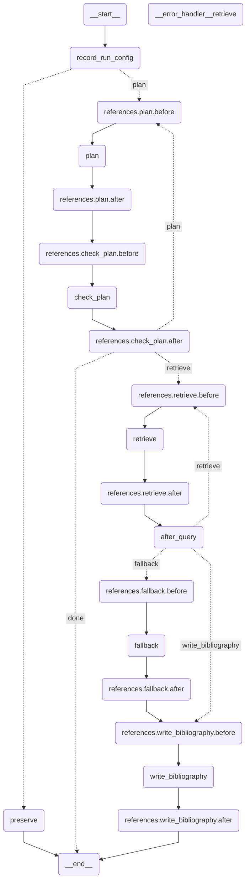

### review

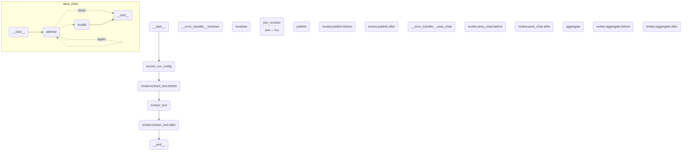

### revision

```mermaid
---
config:
  flowchart:
    curve: linear
---
graph TD;
	__start__([<p>__start__</p>]):::first
	record_run_config(record_run_config)
	check_preconditions(check_preconditions)
	revision\2echeck_preconditions\2ebefore(revision.check_preconditions.before)
	revision\2echeck_preconditions\2eafter(revision.check_preconditions.after)
	stage_revision(stage_revision)
	revision\2estage_revision\2ebefore(revision.stage_revision.before)
	revision\2estage_revision\2eafter(revision.stage_revision.after)
	revision\2epaper\2ebefore(revision.paper.before)
	revision\2epaper\2eafter(revision.paper.after)
	retention_check(retention_check)
	revision\2eretention_check\2ebefore(revision.retention_check.before)
	revision\2eretention_check\2eafter(revision.retention_check.after)
	snapshot_original(snapshot_original)
	revision\2esnapshot_original\2ebefore(revision.snapshot_original.before)
	revision\2esnapshot_original\2eafter(revision.snapshot_original.after)
	promote(promote)
	revision\2epromote\2ebefore(revision.promote.before)
	revision\2epromote\2eafter(revision.promote.after)
	second_review(second_review)
	revision\2esecond_review\2ebefore(revision.second_review.before)
	revision\2esecond_review\2eafter(revision.second_review.after)
	finalize(finalize)
	revision\2efinalize\2ebefore(revision.finalize.before)
	revision\2efinalize\2eafter(revision.finalize.after)
	__end__([<p>__end__</p>]):::last
	__start__ --> record_run_config;
	check_preconditions --> revision\2echeck_preconditions\2eafter;
	finalize --> revision\2efinalize\2eafter;
	paper\3a__end__ --> revision\2epaper\2eafter;
	promote --> revision\2epromote\2eafter;
	record_run_config --> revision\2echeck_preconditions\2ebefore;
	retention_check --> revision\2eretention_check\2eafter;
	revision\2echeck_preconditions\2eafter -. &nbsp;done&nbsp; .-> revision\2efinalize\2ebefore;
	revision\2echeck_preconditions\2eafter -. &nbsp;rereview&nbsp; .-> revision\2esecond_review\2ebefore;
	revision\2echeck_preconditions\2eafter -. &nbsp;edit&nbsp; .-> revision\2estage_revision\2ebefore;
	revision\2echeck_preconditions\2ebefore --> check_preconditions;
	revision\2efinalize\2ebefore --> finalize;
	revision\2epaper\2eafter -. &nbsp;failed&nbsp; .-> revision\2efinalize\2ebefore;
	revision\2epaper\2eafter -. &nbsp;ok&nbsp; .-> revision\2eretention_check\2ebefore;
	revision\2epaper\2ebefore --> paper\3arecord_run_config;
	revision\2epromote\2eafter -. &nbsp;failed&nbsp; .-> revision\2efinalize\2ebefore;
	revision\2epromote\2eafter -. &nbsp;ok&nbsp; .-> revision\2esecond_review\2ebefore;
	revision\2epromote\2ebefore --> promote;
	revision\2eretention_check\2eafter -. &nbsp;failed&nbsp; .-> revision\2efinalize\2ebefore;
	revision\2eretention_check\2eafter -. &nbsp;ok&nbsp; .-> revision\2esnapshot_original\2ebefore;
	revision\2eretention_check\2ebefore --> retention_check;
	revision\2esecond_review\2eafter --> revision\2efinalize\2ebefore;
	revision\2esecond_review\2ebefore --> second_review;
	revision\2esnapshot_original\2eafter --> revision\2epromote\2ebefore;
	revision\2esnapshot_original\2ebefore --> snapshot_original;
	revision\2estage_revision\2eafter -. &nbsp;failed&nbsp; .-> revision\2efinalize\2ebefore;
	revision\2estage_revision\2eafter -. &nbsp;edit&nbsp; .-> revision\2epaper\2ebefore;
	revision\2estage_revision\2eafter -. &nbsp;reuse&nbsp; .-> revision\2eretention_check\2ebefore;
	revision\2estage_revision\2ebefore --> stage_revision;
	second_review --> revision\2esecond_review\2eafter;
	snapshot_original --> revision\2esnapshot_original\2eafter;
	stage_revision --> revision\2estage_revision\2eafter;
	revision\2efinalize\2eafter --> __end__;
	subgraph paper
	paper\3arecord_run_config(record_run_config)
	paper\3aprepare(prepare)
	paper\3apaper\2eprepare\2ebefore(paper.prepare.before)
	paper\3apaper\2eprepare\2eafter(paper.prepare.after)
	paper\3apaper_data(paper_data)
	paper\3apaper\2epaper_data\2ebefore(paper.paper_data.before)
	paper\3apaper\2epaper_data\2eafter(paper.paper_data.after)
	paper\3acheck_final_outcome(check_final_outcome)
	paper\3apaper\2echeck_final_outcome\2ebefore(paper.check_final_outcome.before)
	paper\3apaper\2echeck_final_outcome\2eafter(paper.check_final_outcome.after)
	paper\3aseed_edit(seed_edit)
	paper\3apaper\2eseed_edit\2ebefore(paper.seed_edit.before)
	paper\3apaper\2eseed_edit\2eafter(paper.seed_edit.after)
	paper\3astage_inputs(stage_inputs)
	paper\3apaper\2estage_inputs\2ebefore(paper.stage_inputs.before)
	paper\3apaper\2estage_inputs\2eafter(paper.stage_inputs.after)
	paper\3areferences(references)
	paper\3apaper\2ereferences\2ebefore(paper.references.before)
	paper\3apaper\2ereferences\2eafter(paper.references.after)
	paper\3areferences_failed(references_failed)
	paper\3astrategy(strategy)
	paper\3apaper\2estrategy\2ebefore(paper.strategy.before)
	paper\3apaper\2estrategy\2eafter(paper.strategy.after)
	paper\3astrategy_repair(strategy_repair)
	paper\3astrategy_exhausted(strategy_exhausted)
	paper\3aresolve_family(resolve_family)
	paper\3apaper\2eresolve_family\2ebefore(paper.resolve_family.before)
	paper\3apaper\2eresolve_family\2eafter(paper.resolve_family.after)
	paper\3arank_posthoc(rank_posthoc)
	paper\3apaper\2erank_posthoc\2ebefore(paper.rank_posthoc.before)
	paper\3apaper\2erank_posthoc\2eafter(paper.rank_posthoc.after)
	paper\3aranking_repair(ranking_repair)
	paper\3aranking_exhausted(ranking_exhausted)
	paper\3aaugment_paper_data(augment_paper_data)
	paper\3apaper\2eaugment_paper_data\2ebefore(paper.augment_paper_data.before)
	paper\3apaper\2eaugment_paper_data\2eafter(paper.augment_paper_data.after)
	paper\3ainit_concept_figure(init_concept_figure)
	paper\3apaper\2einit_concept_figure\2ebefore(paper.init_concept_figure.before)
	paper\3apaper\2einit_concept_figure\2eafter(paper.init_concept_figure.after)
	paper\3aselect_stage(select_stage)
	paper\3apaper\2eselect_stage\2ebefore(paper.select_stage.before)
	paper\3apaper\2eselect_stage\2eafter(paper.select_stage.after)
	paper\3awrite(write)
	paper\3apaper\2ewrite\2ebefore(paper.write.before)
	paper\3apaper\2ewrite\2eafter(paper.write.after)
	paper\3aafter_write(after_write)
	paper\3apaper\2eafter_write\2ebefore(paper.after_write.before)
	paper\3apaper\2eafter_write\2eafter(paper.after_write.after)
	paper\3apostdraft_gate(postdraft_gate)
	paper\3apostdraft(postdraft)
	paper\3apaper\2epostdraft\2ebefore(paper.postdraft.before)
	paper\3apaper\2epostdraft\2eafter(paper.postdraft.after)
	paper\3aafter_postdraft(after_postdraft)
	paper\3afigures(figures)
	paper\3apaper\2efigures\2ebefore(paper.figures.before)
	paper\3apaper\2efigures\2eafter(paper.figures.after)
	paper\3avalidate(validate)
	paper\3apaper\2evalidate\2ebefore(paper.validate.before)
	paper\3apaper\2evalidate\2eafter(paper.validate.after)
	paper\3aafter_validate(after_validate)
	paper\3apaper\2eafter_validate\2ebefore(paper.after_validate.before)
	paper\3apaper\2eafter_validate\2eafter(paper.after_validate.after)
	paper\3aaudit(audit)
	paper\3apaper\2eaudit\2ebefore(paper.audit.before)
	paper\3apaper\2eaudit\2eafter(paper.audit.after)
	paper\3aafter_audit(after_audit)
	paper\3apaper\2eafter_audit\2ebefore(paper.after_audit.before)
	paper\3apaper\2eafter_audit\2eafter(paper.after_audit.after)
	paper\3areview_check(review_check)
	paper\3areview_gate(review_gate)
	paper\3apaper\2ereview_gate\2ebefore(paper.review_gate.before)
	paper\3apaper\2ereview_gate\2eafter(paper.review_gate.after)
	paper\3aafter_review(after_review)
	paper\3apaper\2eafter_review\2ebefore(paper.after_review.before)
	paper\3apaper\2eafter_review\2eafter(paper.after_review.after)
	paper\3afigure_quality_gate(figure_quality_gate)
	paper\3apaper\2efigure_quality_gate\2ebefore(paper.figure_quality_gate.before)
	paper\3apaper\2efigure_quality_gate\2eafter(paper.figure_quality_gate.after)
	paper\3aloop_decision(loop_decision)
	paper\3afinalize(finalize)
	paper\3apaper\2efinalize\2ebefore(paper.finalize.before)
	paper\3apaper\2efinalize\2eafter(paper.finalize.after)
	paper\3aoutcome(outcome)
	paper\3a__end__(<p>__end__</p>)
	paper\3aafter_audit --> paper\3apaper\2eafter_audit\2eafter;
	paper\3aafter_postdraft -.-> paper\3aoutcome;
	paper\3aafter_postdraft -. &nbsp;figures&nbsp; .-> paper\3apaper\2efigures\2ebefore;
	paper\3aafter_review --> paper\3apaper\2eafter_review\2eafter;
	paper\3aafter_validate --> paper\3apaper\2eafter_validate\2eafter;
	paper\3aafter_write --> paper\3apaper\2eafter_write\2eafter;
	paper\3aaudit --> paper\3apaper\2eaudit\2eafter;
	paper\3aaugment_paper_data --> paper\3apaper\2eaugment_paper_data\2eafter;
	paper\3acheck_final_outcome --> paper\3apaper\2echeck_final_outcome\2eafter;
	paper\3afigure_quality_gate --> paper\3apaper\2efigure_quality_gate\2eafter;
	paper\3afigures --> paper\3apaper\2efigures\2eafter;
	paper\3afinalize --> paper\3apaper\2efinalize\2eafter;
	paper\3ainit_concept_figure --> paper\3apaper\2einit_concept_figure\2eafter;
	paper\3aloop_decision -.-> paper\3aoutcome;
	paper\3aloop_decision -. &nbsp;finalize&nbsp; .-> paper\3apaper\2efinalize\2ebefore;
	paper\3aloop_decision -. &nbsp;select_stage&nbsp; .-> paper\3apaper\2eselect_stage\2ebefore;
	paper\3apaper\2eafter_audit\2eafter -.-> paper\3aoutcome;
	paper\3apaper\2eafter_audit\2eafter -. &nbsp;figure_quality_gate&nbsp; .-> paper\3apaper\2efigure_quality_gate\2ebefore;
	paper\3apaper\2eafter_audit\2eafter -. &nbsp;select_stage&nbsp; .-> paper\3apaper\2eselect_stage\2ebefore;
	paper\3apaper\2eafter_audit\2eafter -.-> paper\3areview_check;
	paper\3apaper\2eafter_audit\2ebefore --> paper\3aafter_audit;
	paper\3apaper\2eafter_review\2eafter -.-> paper\3aoutcome;
	paper\3apaper\2eafter_review\2eafter -. &nbsp;select_stage&nbsp; .-> paper\3apaper\2eselect_stage\2ebefore;
	paper\3apaper\2eafter_review\2ebefore --> paper\3aafter_review;
	paper\3apaper\2eafter_validate\2eafter -. &nbsp;audit&nbsp; .-> paper\3apaper\2eaudit\2ebefore;
	paper\3apaper\2eafter_validate\2eafter -. &nbsp;validate&nbsp; .-> paper\3apaper\2evalidate\2ebefore;
	paper\3apaper\2eafter_validate\2eafter -.-> paper\3areview_check;
	paper\3apaper\2eafter_validate\2ebefore --> paper\3aafter_validate;
	paper\3apaper\2eafter_write\2eafter -.-> paper\3aoutcome;
	paper\3apaper\2eafter_write\2eafter -. &nbsp;select_stage&nbsp; .-> paper\3apaper\2eselect_stage\2ebefore;
	paper\3apaper\2eafter_write\2eafter -.-> paper\3apostdraft_gate;
	paper\3apaper\2eafter_write\2ebefore --> paper\3aafter_write;
	paper\3apaper\2eaudit\2eafter --> paper\3apaper\2eafter_audit\2ebefore;
	paper\3apaper\2eaudit\2ebefore --> paper\3aaudit;
	paper\3apaper\2eaugment_paper_data\2eafter --> paper\3apaper\2einit_concept_figure\2ebefore;
	paper\3apaper\2eaugment_paper_data\2ebefore --> paper\3aaugment_paper_data;
	paper\3apaper\2echeck_final_outcome\2eafter -.-> paper\3aoutcome;
	paper\3apaper\2echeck_final_outcome\2eafter -. &nbsp;seed_edit&nbsp; .-> paper\3apaper\2eseed_edit\2ebefore;
	paper\3apaper\2echeck_final_outcome\2ebefore --> paper\3acheck_final_outcome;
	paper\3apaper\2efigure_quality_gate\2eafter -.-> paper\3aloop_decision;
	paper\3apaper\2efigure_quality_gate\2eafter -. &nbsp;select_stage&nbsp; .-> paper\3apaper\2eselect_stage\2ebefore;
	paper\3apaper\2efigure_quality_gate\2ebefore --> paper\3afigure_quality_gate;
	paper\3apaper\2efigures\2eafter --> paper\3apaper\2evalidate\2ebefore;
	paper\3apaper\2efigures\2ebefore --> paper\3afigures;
	paper\3apaper\2efinalize\2ebefore --> paper\3afinalize;
	paper\3apaper\2einit_concept_figure\2eafter --> paper\3apaper\2eselect_stage\2ebefore;
	paper\3apaper\2einit_concept_figure\2ebefore --> paper\3ainit_concept_figure;
	paper\3apaper\2epaper_data\2eafter --> paper\3apaper\2echeck_final_outcome\2ebefore;
	paper\3apaper\2epaper_data\2ebefore --> paper\3apaper_data;
	paper\3apaper\2epostdraft\2eafter --> paper\3aafter_postdraft;
	paper\3apaper\2epostdraft\2ebefore --> paper\3apostdraft;
	paper\3apaper\2eprepare\2eafter -.-> paper\3aoutcome;
	paper\3apaper\2eprepare\2eafter -. &nbsp;paper_data&nbsp; .-> paper\3apaper\2epaper_data\2ebefore;
	paper\3apaper\2eprepare\2ebefore --> paper\3aprepare;
	paper\3apaper\2erank_posthoc\2eafter -. &nbsp;augment_paper_data&nbsp; .-> paper\3apaper\2eaugment_paper_data\2ebefore;
	paper\3apaper\2erank_posthoc\2eafter -.-> paper\3aranking_exhausted;
	paper\3apaper\2erank_posthoc\2eafter -.-> paper\3aranking_repair;
	paper\3apaper\2erank_posthoc\2ebefore --> paper\3arank_posthoc;
	paper\3apaper\2ereferences\2eafter -.-> paper\3aoutcome;
	paper\3apaper\2ereferences\2eafter -. &nbsp;rank_posthoc&nbsp; .-> paper\3apaper\2erank_posthoc\2ebefore;
	paper\3apaper\2ereferences\2eafter -. &nbsp;strategy&nbsp; .-> paper\3apaper\2estrategy\2ebefore;
	paper\3apaper\2ereferences\2eafter -.-> paper\3areferences_failed;
	paper\3apaper\2ereferences\2ebefore --> paper\3areferences;
	paper\3apaper\2eresolve_family\2eafter -.-> paper\3aoutcome;
	paper\3apaper\2eresolve_family\2eafter -. &nbsp;rank_posthoc&nbsp; .-> paper\3apaper\2erank_posthoc\2ebefore;
	paper\3apaper\2eresolve_family\2ebefore --> paper\3aresolve_family;
	paper\3apaper\2ereview_gate\2eafter --> paper\3apaper\2eafter_review\2ebefore;
	paper\3apaper\2ereview_gate\2ebefore --> paper\3areview_gate;
	paper\3apaper\2eseed_edit\2eafter --> paper\3apaper\2estage_inputs\2ebefore;
	paper\3apaper\2eseed_edit\2ebefore --> paper\3aseed_edit;
	paper\3apaper\2eselect_stage\2eafter --> paper\3apaper\2ewrite\2ebefore;
	paper\3apaper\2eselect_stage\2ebefore --> paper\3aselect_stage;
	paper\3apaper\2estage_inputs\2eafter -.-> paper\3aoutcome;
	paper\3apaper\2estage_inputs\2eafter -. &nbsp;references&nbsp; .-> paper\3apaper\2ereferences\2ebefore;
	paper\3apaper\2estage_inputs\2ebefore --> paper\3astage_inputs;
	paper\3apaper\2estrategy\2eafter -. &nbsp;resolve_family&nbsp; .-> paper\3apaper\2eresolve_family\2ebefore;
	paper\3apaper\2estrategy\2eafter -.-> paper\3astrategy_exhausted;
	paper\3apaper\2estrategy\2eafter -.-> paper\3astrategy_repair;
	paper\3apaper\2estrategy\2ebefore --> paper\3astrategy;
	paper\3apaper\2evalidate\2eafter --> paper\3apaper\2eafter_validate\2ebefore;
	paper\3apaper\2evalidate\2ebefore --> paper\3avalidate;
	paper\3apaper\2ewrite\2eafter --> paper\3apaper\2eafter_write\2ebefore;
	paper\3apaper\2ewrite\2ebefore --> paper\3awrite;
	paper\3apaper_data --> paper\3apaper\2epaper_data\2eafter;
	paper\3apostdraft --> paper\3apaper\2epostdraft\2eafter;
	paper\3apostdraft_gate -. &nbsp;figures&nbsp; .-> paper\3apaper\2efigures\2ebefore;
	paper\3apostdraft_gate -. &nbsp;postdraft&nbsp; .-> paper\3apaper\2epostdraft\2ebefore;
	paper\3aprepare --> paper\3apaper\2eprepare\2eafter;
	paper\3arank_posthoc --> paper\3apaper\2erank_posthoc\2eafter;
	paper\3aranking_exhausted --> paper\3aoutcome;
	paper\3aranking_repair --> paper\3apaper\2erank_posthoc\2ebefore;
	paper\3arecord_run_config --> paper\3apaper\2eprepare\2ebefore;
	paper\3areferences --> paper\3apaper\2ereferences\2eafter;
	paper\3areferences_failed --> paper\3aoutcome;
	paper\3aresolve_family --> paper\3apaper\2eresolve_family\2eafter;
	paper\3areview_check -. &nbsp;audit&nbsp; .-> paper\3apaper\2eaudit\2ebefore;
	paper\3areview_check -. &nbsp;figure_quality_gate&nbsp; .-> paper\3apaper\2efigure_quality_gate\2ebefore;
	paper\3areview_check -. &nbsp;review_gate&nbsp; .-> paper\3apaper\2ereview_gate\2ebefore;
	paper\3areview_gate --> paper\3apaper\2ereview_gate\2eafter;
	paper\3aseed_edit --> paper\3apaper\2eseed_edit\2eafter;
	paper\3aselect_stage --> paper\3apaper\2eselect_stage\2eafter;
	paper\3astage_inputs --> paper\3apaper\2estage_inputs\2eafter;
	paper\3astrategy --> paper\3apaper\2estrategy\2eafter;
	paper\3astrategy_exhausted --> paper\3aoutcome;
	paper\3astrategy_repair --> paper\3apaper\2estrategy\2ebefore;
	paper\3avalidate --> paper\3apaper\2evalidate\2eafter;
	paper\3awrite --> paper\3apaper\2ewrite\2eafter;
	paper\3aoutcome --> paper\3a__end__;
	paper\3apaper\2efinalize\2eafter --> paper\3a__end__;
	end
	classDef default fill:#f2f0ff,line-height:1.2
	classDef first fill-opacity:0
	classDef last fill:#bfb6fc
```

<!-- END GENERATED GRAPHS -->
